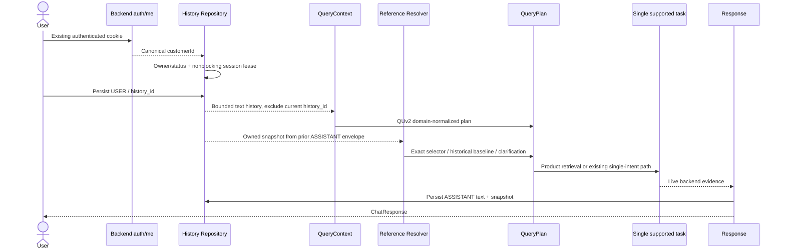

# CONVERSATION PERSISTENCE & SESSION REFERENCE RESOLUTION

Task `c2c_chatbot_upgrade_03`, iteration0. **Hoàn thành phạm vi đã được user duyệt:** durable history, canonical customer identity, session lifecycle, snapshot/reference resolution và Lab đọc lại session. Multi-intent/summary **chỉ thiết kế**, chưa triển khai theo phê duyệt riêng.

12case chính: **11 PASS, T56 DEFERRED_APPROVED_SCOPE**, 0FAIL; thêm2reference requests sau restart PASS. Không gọi T56 là multi-intent PASS chỉ vì bot hỏi lại an toàn.

## 1. Persistence architecture

Workspace `/Users/vu/Documents/Vu/HUIT-Year4/KLTN/KLCN-QL_CHTBDT-Ecommerce-main`; branch `dev/thai-duy-vu`, HEAD `d235df5cc4411d12accae8489930a31d281abbf8`. Trước implementation đã đọc migrations/report01–02 và xác minh source hashes checkpoint02 còn nguyên. User duyệt phương án sau preflight: customerId thật, thumbsRAM, snapshotTEXT, ACTIVE/CLOSED và session durable mới. [preflight-summary](checkpoint03/preflight-summary.json) giữ trạng thái **trước** approval; kết quả hiện tại ở [verification-summary](checkpoint03/verification-summary.json).

ConversationService dùng PostgresConversationRepository khi CONVERSATION_STORAGE=postgres. Default memory giữ tương thích tests/legacy; không tự fallbackRAM khi Postgres lỗi. DB hiện có V1–V8 đầy đủ; không thêm bảng/cột/index/migration. Local .env ignored đã bật postgres với connection tới DB hiện có; không đưa URL/credentials vào report. .env.example có configuration keys để người khác setup.

| Component | Vai trò hiện tại |
|---|---|
| PostgresConversationRepository | Owner checks, session/history SQL, versioned snapshot decode, paging, request lease |
| ConversationService | Validation/list/close/rating theo contract; thumbs chỉRAM |
| ChatService | Serialize request theo session; append USER; recent window; snapshot/ref; live retrieval; append ASSISTANT |
| Chat Router | Authenticated own session/list/history/close; status storage; trace API giữ behaviorRAM |
| Chatbot Lab | Namespace session.v2, chọn phiên cũ, paging, closed read-only, text restore và thông báo feedbackRAM |

### Files changed trong checkpoint03

- Java: auth/dto/LoginSessionResponse.java, auth/service/AuthServiceImpl.java, auth/integration/AuthMeIntegrationTest.java.
- Python: shared/config.py, shared/backend/client.py, customer_context/models.py; conversation/models.py/repository.py/service.py; chat/dependencies.py/service.py/router.py.
- Mới: conversation/postgres_repository.py, conversation/references.py, tests/test_persistent_conversation.py.
- Tests/settings: tests/test_backend_client.py, tests/conftest.py, .env.example.
- Frontend: ChatbotLabPage.jsx, chatbotApi.js, ChatbotLab.test.jsx.

Paths Python từ chatbot-service/app; frontend từ Fontend/src/features/chatbot; Java từ backend/src/main/java hoặc src/test/java/com/example/backend. Git diff hiện tại còn chứa checkpoint02 chưa commit; không được coi toàn bộ diff là thay đổi03. Product/QUv2 contracts giữ single-intent compatibility; full suite bao gồm regressions02.

## 2. Schema/identity mapping

GET /api/auth/me và login/refresh response thêm **nullable customerId**, Java chỉ resolve profile khi principal.roleName=CUSTOMER, qua customers.user_id. Không sửa JWT claims/cookies/password/role assignment/mutation workflow. Python yêu cầu roleCUSTOMER + customerId thực, không dùng userId làm FK. STAFF hoặc thiếu customer profile bị403; invalid identity payload bị502.

| Object | Existing schema | Mapping |
|---|---|---|
| customer.user_id | users.user_id | Identity từ authenticated principal |
| customer.customer_id | customers.customer_id | UUID riêng, FK đích cho history/session |
| ChatSession.id/customer_id | chat_sessions.session_id/customer_id | Persisted session owner |
| created_at/is_active/ended_at | started_at/status/ended_at | ACTIVE ↔ true, CLOSED ↔ false |
| ChatMessage.id | chat_history.history_id | UUID persisted, ổn định sau restart |
| sender_type/message/created_at | chat_history columns | USER plain text; ASSISTANT decoded envelope text |
| rating -1/0/1 | message_feedback CHECK1–5 | Không map; giữ RAM map theo history_id |

Development có2synthetic customer, cả hai customerId khác userId; runtime login xác minh sự khác biệt. DB validation kiểm mọi case session.customer_id bằng customerId authenticated, mọi history.customer_id bằng session owner; chỉ xuất booleans, không raw identity/DTO.

Không đổi FK hoặc CHECK. DB các FK riêng chưa bảo đảm owner consistency của mọi chain nên repository kiểm owner trước read/write/close/rate. Session create ON CONFLICT không overwrite owner; existing UUID của customer khác trả403.

## 3. Session lifecycle

- Session mới được tạo khi POST message đầu tiên; ACTIVE, started_at do DB.
- Có thể liệt kê cả active/closed sessions của owner, page/size bounded, sort started_at DESC + session_id DESC.
- Close dùng approved CLOSED, ended_at=clock_timestamp, idempotent giữ ended_at cũ.
- Closed session đọc history được; gửi message trả409, không tự reopen.
- PostgreSQL advisory lease theo sessionUUID: concurrent request cùng session bị409, không queue hoặc xen kẽ USER/ASSISTANT. Lease giữ một connection autocommit trong thời gian xử lý; không giữ row-lock transaction dài quanh Ollama/HTTP.
- Close cũng lấy lease nên không đóng giữa turn đang xử lý.
- USER và ASSISTANT commit trong hai short transactions. Nếu retrieval/model/storage lỗi, USER có thể còn lưu mà chưa có ASSISTANT; không hứa exactly-once hoặc atomic toàn turn.

Front dùng sessionStorage namespacev2 theo userId. RAM histories cũ không tự chuyển/rekey; cần reload Lab sau nâng cấp và bắt đầu durable session mới. Không tạo customer hoặc import RAM records tự động. Các session test durable đã ghi được giữ lại để kiểm lại, không xóa history vừa được yêu cầu persist.

## 4. Context loading sequence



Tasks node là **một supported legacy task**, không task-list executor chưa duyệt. QueryContext chỉ nhận role/content/datetime từ decoded text; metadata JSON không thành prompt instructions. Current USER được loại bằng persisted history_id, không giả định là phần tử cuối khi có concurrency. Recent window default10; DB reads capped100. window0 vẫn có thể resolve bằng owned snapshot riêng.

History API giữ array message shape, thêm optional before UUID/size<=100 để đọc trang cũ. Cursor phải nằm trong đúng session/customer. SQL lấy descending created_at/history_id rồi trả ascending. UUID là deterministic tie-break, serialization giảm turn interleaving; không hứa causal ordering từ UUID ngẫu nhiên khi có external DB writers.

## 5. Reference resolution rules

ASSISTANT message TEXT chứa version1 envelope; API unwrap text nên frontend/model không thấy raw metadata. USER luôn plain untrusted text, không được forge snapshot bằng JSON. Legacy ASSISTANT plain text đọc được; không tự dùng giá trong text làm business evidence.

```text
StoredAssistantMessage(version=1):
  text: assistant message
  snapshot:
    cards: ordered typed ProductCards (IDs/SKU/giá đã hiển thị và metadata lúc gợi ý)
    search: prior effective search constraints
    captured_at: timestamp
```

Snapshot tối đa20cards, payload128KB. Đây là dữ liệu lịch sử; giá/tồn đã lưu không là current truth. Resolver đọc tối đa100ASSISTANT messages gần nhất để tìm last non-empty snapshot; no evidence → clarification. Full history vẫn còn DB và đọc được qua cursor paging, nhưng reference lookup có giới hạn riêng.

| Phrase | Rule thực thi |
|---|---|
| Chiếc máy vừa gợi ý có giá bao nhiêu? | Chỉ resolve nếu snapshot có1card; ưu tiên variantId rồi reload live backend |
| Máy đầu tiên còn hàng không? | Index1 theo displayed card order; fresh backend availability tại kho đã cấu hình |
| Cái thứ hai là gì? | Index2 phải tồn tại; không tạo đối tượng thứ2 khi previous count1 |
| Có loại rẻ hơn không? | Baseline=min giá đã hiển thị của last non-empty snapshot; max<=baseline−1VND và existing/new explicit price bounds; giữ filters gốc |
| Có phiên bản512GB không? / Bản512GB thì sao? | Cần một product reference; productId + exact_storage512; không tự thêm RAM16 |

Detail follow-up giữ original discovery requirements trong snapshot để T24 không làm mất RAM16/budget trước T25. Explicit RAM/storage trong cheaper request có thể cập nhật supported constraints. Bản512 giữ prior RAM minimum nếu có yêu cầu ấy; snapshot không yêu cầu RAM thì không tạo RAM filter.

Resolver không override CART/ORDER/PAYMENT/KNOWLEDGE/personal warranty intents; không override domain errors như unsupported capacity/price conflict. Explicit new target theo QUv2 vẫn là target mới, không bị thay bằng snapshot.

Nếu backend đã đổi price/stock, response/card dùng dữ liệu mới. Unit regression chứng minh old displayed18.990.000 → live17.000.000/stock0, answer không dùng old price. Baseline “rẻ hơn” cố ý là **giá lúc gợi ý trước**, không khẳng định đó là current price của reference. Warehouse/NOT_FOUND/backend outage semantics vẫn theo checkpoint02.

## 6. Multi-intent design — chưa implementation

User đã duyệt **chỉ thiết kế** cho multi-intent và summary. QueryPlan vẫn một intent/search; targets[] hỗ trợ product detail/compare, không độc lập tasks. T56 trả clarification chọn laptop hoặc điện thoại trước, không tuyên bố xử lý cả hai.

Interface proposal giữ để C00 review:

```text
QueryEnvelopeV2.tasks[]:
  TaskPlan(task_id, QueryPlan, clarification?)
TaskOutcome:
  task_id, COMPLETED / NO_MATCH / NEEDS_CLARIFICATION / UNAVAILABLE
  evidence_refs, response_text, products, sources
```

Policy **đề xuất, chưa áp dụng**: max3tasks, max3cards/task, max6cards/global; candidate cap500/product discovery hiện có; global deadline30s cần benchmark trước khi duyệt. Legacy single-intent có thể wrap một task nội bộ; optional task_outcomes chỉ thêm khi contract được chốt.

Ví dụ iPhone availability + chưa biết so iPhone/Xiaomi model nào + laptopRAM16: đề xuất tách3needs, chạy supported discovery, hỏi rõ comparison targets và trả honest partial outcomes. Code hiện tại không có partial task completion executor; tests cho execution/deadline/aggregation **chưa chạy**, không PASS giả.

Summary proposal: bounded session-only text + covered_message_ids + provenance. Không thêm summary table/cross-session personal memory; không dùng summary làm giá/tồn/order/payment evidence. Không có summary generator/storage đang chạy.

## 7. Before/after examples

| Case | Before checkpoint03 | Actual bản cuối | Verdict |
|---|---|---|---|
| T23 | Product searchv2 nhưng snapshot/history RAM | Laptop<=20triệu, RAM>=16;1card; history/snapshot persist | PASS |
| T24 | Conservative clarification; chưa general reference | Last displayed variant→live price;1card cùngvariantT23 | PASS |
| T25 | Cheaper chỉ RAM, dễ mất origin constraints qua detail | RAM16 giữ lại;max15.989.999;0candidate đúng dataset | PASS |
| T26 | Ordinal chưa resolve | No second object; clarify,0cards | PASS |
| T27 | v2 discovery đúng, historyRAM | Xiaomi3cards và ordered snapshot persisted | PASS |
| T28 | Generic first-reference chưa resolve | Đúng first displayed variant, live stock | PASS |
| T29 | Storage reference chưa explicit | Đúng parent củaT28, exact512; không thêmRAM16 | PASS |
| T30 | Fresh cheaper đã safeclarify02 | Persisted fresh session khôngbaseline→clarification | PASS |
| T56 | Multi-intent clarification | Giữ clarification; không multitask executor | DEFERRED_APPROVED_SCOPE |
| T58 | RAM ownership checks | Owner200; other history/send403; canonical FK | PASS |
| T59 | Reload textRAM; restart mất history | Restart giữ8messages với exactIDs/text; thumbs reset0 | PASS |
| T60 | Own-account traceRAM | Ownertrace200; other404 trước restart | PASS |

SessionA=T23–26; SessionB=T27–29; SessionC=T30fresh; SessionD=T56fresh. T27 first product trong lượt thực là Xiaomi14TPro theo ranking, không mặc địnhXiaomi15; T28/T29 bind đúng card thực của lượt ấy. R01/R02 sau restart xác minh reference LAST và STORAGE vẫn resolve từ DB.

### Actual prompts/plans/results và trace IDs

#### T23 — PASS

Prompt: Tìm laptop dưới 20 triệu, RAM ít nhất 16GB.

Session `b2d2c6d8-74a8-49c3-a528-6014e517545d`; trace `363cd34e-ca2c-45b6-a777-bd08b5a3bf47`; HTTP200; 9016.09ms.

QueryPlan sau context resolution:

```json
{
  "clarification": null,
  "intent": "PRODUCT_DISCOVERY",
  "requested_fields": [
    "SPECIFICATIONS"
  ],
  "references": {},
  "product_search": {
    "targets": [],
    "category": "Laptop",
    "brands": [],
    "min_price": null,
    "max_price": "20000000",
    "min_ram_gb": 16,
    "min_storage_gb": null,
    "cpu_keywords": [],
    "in_stock_only": false,
    "semantic_query": "Tìm laptop dưới 20 triệu, RAM ít nhất 16GB.",
    "top_k": 5
  },
  "semantic_query": null
}
```

Actual text:

Dell Inspiron 15
- DEV-DELL-I15-512: RAM 16GB, bộ nhớ 512GB, màu Bạc; giá 15,990,000 VND; còn 2 máy tại kho được chọn; bảo hành 24 tháng.

Cards: 1; live variant checks: 1. [Correlated trace](checkpoint03/T23.jsonl).

#### T24 — PASS

Prompt: Chiếc máy vừa gợi ý có giá bao nhiêu?

Session `b2d2c6d8-74a8-49c3-a528-6014e517545d`; trace `3c5272da-fde9-4e05-98df-232d0f7393f9`; HTTP200; 2308.07ms.

QueryPlan sau context resolution:

```json
{
  "clarification": null,
  "intent": "PRODUCT_DETAIL",
  "requested_fields": [
    "PRICE"
  ],
  "references": {
    "source": "owned_session_snapshot"
  },
  "product_search": {
    "targets": [
      {
        "product_id": null,
        "variant_id": "9ede9a3c-6406-4058-9ce0-414d19b7939f",
        "product_name": null,
        "sku": null,
        "ram_gb": null,
        "storage_gb": null,
        "color": null
      }
    ],
    "category": null,
    "brands": [],
    "min_price": null,
    "max_price": null,
    "min_ram_gb": null,
    "min_storage_gb": null,
    "cpu_keywords": [],
    "in_stock_only": false,
    "semantic_query": null,
    "top_k": 5
  },
  "semantic_query": null
}
```

Actual text:

Dell Inspiron 15
- DEV-DELL-I15-512: RAM 16GB, bộ nhớ 512GB, màu Bạc; giá 15,990,000 VND; còn 2 máy tại kho được chọn; bảo hành 24 tháng.

Cards: 1; live variant checks: 1. [Correlated trace](checkpoint03/T24.jsonl).

#### T25 — PASS

Prompt: Có chiếc nào rẻ hơn mà RAM vẫn 16GB không?

Session `b2d2c6d8-74a8-49c3-a528-6014e517545d`; trace `b0470c1e-0b56-4cc2-b74d-e52c0f372307`; HTTP200; 2316.26ms.

QueryPlan sau context resolution:

```json
{
  "clarification": null,
  "intent": "PRODUCT_DISCOVERY",
  "requested_fields": [
    "PRICE"
  ],
  "references": {
    "baseline": "historical_display_price"
  },
  "product_search": {
    "targets": [],
    "category": "Laptop",
    "brands": [],
    "min_price": null,
    "max_price": "15989999.0",
    "min_ram_gb": 16,
    "min_storage_gb": null,
    "cpu_keywords": [],
    "in_stock_only": false,
    "semantic_query": "Có chiếc nào rẻ hơn mà RAM vẫn 16GB không?",
    "top_k": 5
  },
  "semantic_query": null
}
```

Actual text:

Mình chưa tìm thấy sản phẩm phù hợp với các điều kiện hiện tại.

Cards: 0; live variant checks: 0. [Correlated trace](checkpoint03/T25.jsonl).

#### T26 — PASS

Prompt: Cái thứ hai là gì?

Session `b2d2c6d8-74a8-49c3-a528-6014e517545d`; trace `207e1760-8af2-4204-b874-ebbe60668f6e`; HTTP200; 2208.41ms.

QueryPlan sau context resolution:

```json
{
  "clarification": "Lần gợi ý trước không có sản phẩm thứ hai. Bạn vui lòng nêu tên hoặc SKU cần hỏi.",
  "intent": "UNKNOWN",
  "requested_fields": [],
  "references": {},
  "product_search": null,
  "semantic_query": null
}
```

Actual text:

Lần gợi ý trước không có sản phẩm thứ hai. Bạn vui lòng nêu tên hoặc SKU cần hỏi.

Cards: 0; live variant checks: 0. [Correlated trace](checkpoint03/T26.jsonl).

#### T27 — PASS

Prompt: Tìm điện thoại Xiaomi.

Session `181165ff-4c28-45a7-a30a-d334a5f52e43`; trace `cdcf71ac-5694-42d5-85b6-a089d926515b`; HTTP200; 1071.11ms.

QueryPlan sau context resolution:

```json
{
  "clarification": null,
  "intent": "PRODUCT_DISCOVERY",
  "requested_fields": [],
  "references": {},
  "product_search": {
    "targets": [],
    "category": "Điện thoại",
    "brands": [
      "Xiaomi"
    ],
    "min_price": null,
    "max_price": null,
    "min_ram_gb": null,
    "min_storage_gb": null,
    "cpu_keywords": [],
    "in_stock_only": false,
    "semantic_query": "Tìm điện thoại Xiaomi.",
    "top_k": 5
  },
  "semantic_query": null
}
```

Actual text:

Xiaomi 15
- DEV-X15-BLK-256: RAM 12GB, bộ nhớ 256GB, màu Đen; giá 18,990,000 VND; còn 2 máy tại kho được chọn; bảo hành 12 tháng.
- DEV-X15-WHT-512: RAM 12GB, bộ nhớ 512GB, màu Trắng; giá 20,990,000 VND; còn 2 máy tại kho được chọn; bảo hành 12 tháng.
- DEV-X15-GRN-512: RAM 16GB, bộ nhớ 512GB, màu Xanh lá; giá 21,990,000 VND; còn 2 máy tại kho được chọn; bảo hành 12 tháng.
Xiaomi 14T Pro
- DEV-X14TP-BLK-256: RAM 12GB, bộ nhớ 256GB, màu Đen; giá 16,990,000 VND; còn 2 máy tại kho được chọn; bảo hành 12 tháng.
- DEV-X14TP-BLU-512: RAM 12GB, bộ nhớ 512GB, màu Xanh; giá 18,990,000 VND; còn 2 máy tại kho được chọn; bảo hành 12 tháng.
- DEV-X14TP-GRY-512: RAM 16GB, bộ nhớ 512GB, màu Xám; giá 19,990,000 VND; còn 2 máy tại kho được chọn; bảo hành 12 tháng.
Xiaomi Redmi Note 13
- DEV-RN13-BLK-128: RAM 6GB, bộ nhớ 128GB, màu Đen; giá 4,490,000 VND; còn 2 máy tại kho được chọn; bảo hành 12 tháng.

Cards: 3; live variant checks: 7. [Correlated trace](checkpoint03/T27.jsonl).

#### T28 — PASS

Prompt: Máy đầu tiên còn hàng không?

Session `181165ff-4c28-45a7-a30a-d334a5f52e43`; trace `fb05f338-2404-4be7-a02c-ad84043b79ab`; HTTP200; 3013.6ms.

QueryPlan sau context resolution:

```json
{
  "clarification": null,
  "intent": "PRODUCT_DETAIL",
  "requested_fields": [
    "STOCK"
  ],
  "references": {
    "source": "owned_session_snapshot"
  },
  "product_search": {
    "targets": [
      {
        "product_id": null,
        "variant_id": "986a65b7-18dc-40a4-bd2a-bf07c6e12b6a",
        "product_name": null,
        "sku": null,
        "ram_gb": null,
        "storage_gb": null,
        "color": null
      }
    ],
    "category": null,
    "brands": [],
    "min_price": null,
    "max_price": null,
    "min_ram_gb": null,
    "min_storage_gb": null,
    "cpu_keywords": [],
    "in_stock_only": false,
    "semantic_query": null,
    "top_k": 5
  },
  "semantic_query": null
}
```

Actual text:

Xiaomi 15
- DEV-X15-BLK-256: RAM 12GB, bộ nhớ 256GB, màu Đen; giá 18,990,000 VND; còn 2 máy tại kho được chọn; bảo hành 12 tháng.

Cards: 1; live variant checks: 1. [Correlated trace](checkpoint03/T28.jsonl).

#### T29 — PASS

Prompt: Có phiên bản 512GB không?

Session `181165ff-4c28-45a7-a30a-d334a5f52e43`; trace `c0d270df-1a83-4cee-943e-49437bea24ae`; HTTP200; 1801.2ms.

QueryPlan sau context resolution:

```json
{
  "clarification": null,
  "intent": "PRODUCT_DETAIL",
  "requested_fields": [
    "SPECIFICATIONS"
  ],
  "references": {
    "source": "owned_session_snapshot"
  },
  "product_search": {
    "targets": [
      {
        "product_id": "169710dd-d072-4e83-9fd0-e618d706ee26",
        "variant_id": null,
        "product_name": null,
        "sku": null,
        "ram_gb": null,
        "storage_gb": 512,
        "color": null
      }
    ],
    "category": null,
    "brands": [],
    "min_price": null,
    "max_price": null,
    "min_ram_gb": null,
    "min_storage_gb": null,
    "cpu_keywords": [],
    "in_stock_only": false,
    "semantic_query": null,
    "top_k": 5
  },
  "semantic_query": null
}
```

Actual text:

Xiaomi 15
- DEV-X15-WHT-512: RAM 12GB, bộ nhớ 512GB, màu Trắng; giá 20,990,000 VND; còn 2 máy tại kho được chọn; bảo hành 12 tháng.
- DEV-X15-GRN-512: RAM 16GB, bộ nhớ 512GB, màu Xanh lá; giá 21,990,000 VND; còn 2 máy tại kho được chọn; bảo hành 12 tháng.

Cards: 1; live variant checks: 2. [Correlated trace](checkpoint03/T29.jsonl).

#### T30 — PASS

Prompt: Có loại rẻ hơn không?

Session `7e1d27b9-83ee-4f22-b047-ee7dbffac287`; trace `d39a1e15-e588-4c1f-ab45-5f15255333e5`; HTTP200; 949.05ms.

QueryPlan sau context resolution:

```json
{
  "clarification": "Mình chưa có sản phẩm tham chiếu trong phiên này. Bạn vui lòng nêu tên sản phẩm hoặc SKU.",
  "intent": "UNKNOWN",
  "requested_fields": [],
  "references": {},
  "product_search": null,
  "semantic_query": null
}
```

Actual text:

Mình chưa có sản phẩm tham chiếu trong phiên này. Bạn vui lòng nêu tên sản phẩm hoặc SKU.

Cards: 0; live variant checks: 0. [Correlated trace](checkpoint03/T30.jsonl).

#### T56 — DEFERRED_APPROVED_SCOPE

Prompt: Tìm laptop RAM 16GB và điện thoại Xiaomi, mỗi loại một chiếc.

Session `7628e43e-c38b-4bdc-b46c-590ed1008fdf`; trace `3997015f-5c0a-44cb-9fc3-87dc9a26bb4d`; HTTP200; 2852.47ms.

QueryPlan sau context resolution:

```json
{
  "clarification": "Mình hỗ trợ tìm từng nhóm sản phẩm. Bạn muốn tìm laptop hay điện thoại trước?",
  "intent": "UNKNOWN",
  "requested_fields": [],
  "references": {},
  "product_search": null,
  "semantic_query": null
}
```

Actual text:

Mình hỗ trợ tìm từng nhóm sản phẩm. Bạn muốn tìm laptop hay điện thoại trước?

Cards: 0; live variant checks: 0. [Correlated trace](checkpoint03/T56.jsonl).

#### R01-reference-after-restart — PASS

Prompt: Chiếc máy vừa gợi ý có giá bao nhiêu?

Session `b2d2c6d8-74a8-49c3-a528-6014e517545d`; trace `3118dfc7-99ea-4788-90e5-a35dbe0d226a`; HTTP200; 2701.48ms.

QueryPlan sau context resolution:

```json
{
  "clarification": null,
  "intent": "PRODUCT_DETAIL",
  "requested_fields": [
    "PRICE"
  ],
  "references": {
    "source": "owned_session_snapshot"
  },
  "product_search": {
    "targets": [
      {
        "product_id": null,
        "variant_id": "9ede9a3c-6406-4058-9ce0-414d19b7939f",
        "product_name": null,
        "sku": null,
        "ram_gb": null,
        "storage_gb": null,
        "color": null
      }
    ],
    "category": null,
    "brands": [],
    "min_price": null,
    "max_price": null,
    "min_ram_gb": null,
    "min_storage_gb": null,
    "cpu_keywords": [],
    "in_stock_only": false,
    "semantic_query": null,
    "top_k": 5
  },
  "semantic_query": null
}
```

Actual text:

Dell Inspiron 15
- DEV-DELL-I15-512: RAM 16GB, bộ nhớ 512GB, màu Bạc; giá 15,990,000 VND; còn 2 máy tại kho được chọn; bảo hành 24 tháng.

Cards: 1; live variant checks: 1. [Correlated trace](checkpoint03/R01-reference-after-restart.jsonl).

#### R02-storage-after-restart — PASS

Prompt: Bản 512GB thì sao?

Session `181165ff-4c28-45a7-a30a-d334a5f52e43`; trace `b4fcc6ce-af70-4df3-a7ef-3e406082c28d`; HTTP200; 4349.07ms.

QueryPlan sau context resolution:

```json
{
  "clarification": null,
  "intent": "PRODUCT_DETAIL",
  "requested_fields": [
    "SPECIFICATIONS"
  ],
  "references": {
    "source": "owned_session_snapshot"
  },
  "product_search": {
    "targets": [
      {
        "product_id": "169710dd-d072-4e83-9fd0-e618d706ee26",
        "variant_id": null,
        "product_name": null,
        "sku": null,
        "ram_gb": null,
        "storage_gb": 512,
        "color": null
      }
    ],
    "category": null,
    "brands": [],
    "min_price": null,
    "max_price": null,
    "min_ram_gb": null,
    "min_storage_gb": null,
    "cpu_keywords": [],
    "in_stock_only": false,
    "semantic_query": null,
    "top_k": 5
  },
  "semantic_query": null
}
```

Actual text:

Xiaomi 15
- DEV-X15-WHT-512: RAM 12GB, bộ nhớ 512GB, màu Trắng; giá 20,990,000 VND; còn 2 máy tại kho được chọn; bảo hành 12 tháng.
- DEV-X15-GRN-512: RAM 16GB, bộ nhớ 512GB, màu Xanh lá; giá 21,990,000 VND; còn 2 máy tại kho được chọn; bảo hành 12 tháng.

Cards: 1; live variant checks: 2. [Correlated trace](checkpoint03/R02-storage-after-restart.jsonl).

## 8. Tests and evidence

- **Python full với isolated PostgreSQL:220PASS,1SKIP**. Skip là optional Knowledge integration chưa có KNOWLEDGE_TEST_DATABASE_URL. Conversation DB integration4tests đã chạy, không phải skip.
- tests/test_persistent_conversation.py:19tests:15pure/reference regressions và4PostgreSQL integration tests. Full suite còn chạy regressions QueryProductv2/single-intent/tracing.
- PostgreSQL test container riêng áp dụng **migrations V1–V8 hiện có** rồi tạo synthetic fixtures; container bị hủy sau suite. Không sửa business inventory để làm price/stock update test pass (test ấy dùng fake backend).
- **Java AuthMe/AuthLogin/AuthRefresh integration17PASS,0SKIP**; AuthMe test mới xác minh customerId khácuserId. Package jar đã build và local backend đã restart để dùng DTO mới. Cookie/JWT/refresh/login checks cũ vẫn pass.
- **Frontend9PASS/2files**, buildPASS, chatbot-targeted ESLintPASS. Có tests chọn session cũ, closed-read-only/newsession và selected session nằm ngoài first list page.
- Runtime qua frontend proxy5173 → FastAPI8090 → Spring8080, CUSTOMER synthetic1/2; Ollama/DB thật. Đã restart FastAPI thật trong lượt cuối và kiểm persisted IDs/text/canonical owner FK/snapshot decode.

[Runtime records](checkpoint03/runtime-results.json), [restart & ownership](checkpoint03/restart-ownership-results.json), [DB verification](checkpoint03/database-verification.json), [verification summary](checkpoint03/verification-summary.json). 11pipeline requests có11trace excerpts riêng; T58–60 là HTTP/restart observations, không tạo pipeline event giả cho GET/restart.

Trace gồm conversation.session_persisted/message_persisted/reference_resolution + query.plan/product/response checkpoints. Đã kiểm trace/session correlation, dropped_events0, chronological offsets, mọi eligible SKU/price/stock với live backend. Artifacts chỉ synthetic prompts/products và booleans; không cookie/JWT/Authorization/password/DB URL/full personal DTO/embedding vectors.

Snapshot [business-after](checkpoint03/business-after.json) bằng checkpoint02 business-after: inventory/orders/payments/variant fields unchanged. Chat_sessions/chat_history có write là **mục tiêu đã duyệt**, message_feedback vẫn0rows. Raw logs/cookies/helpers ở .local ignored; không commit runtime raw logs.

### Cách cấu hình và thao tác

1. Update backend mới để GET auth/me trả customerId; không dùng backendDTO cũ với Python mới.
2. Trong local chatbot .env, chọn CONVERSATION_STORAGE=postgres và cấu hình CONVERSATION_DATABASE_URL tới DB với migrations hiện có. Default .env.example=memory là opt-in, không bảo đảmdurability khi chưa bật postgres.
3. Restart chatbot để lấy settings; reload Lab dùng namespacev2 và tạo phiên mới. Lịch sửRAM cũ không tự import.
4. Gửi T23, hỏi T24/T25; chọn lại phiên từ “Lịch sử phiên”, dùng “Tải thêm phiên cũ”/“Tải tin nhắn cũ hơn” khi có.
5. Restart FastAPI; kỳ vọng đọc lại messages cùngIDs/text và follow-up vẫn dùng backend live. Feedback trở về0/unrated, nguồn/cards/responseJSON không replay đầy đủ.
6. “Đóng phiên” giữ history nhưng ngăn gửi409. “Cuộc trò chuyện mới” vẫn dùng được khi phiên cũ đãclosed.

Tests PostgreSQL cần CONVERSATION_TEST_DATABASE_URL trỏ **isolated testDB** có existing migrations; không trỏ business DB vì fixture tạo synthetic users/customer/history. Pytest conftest ép pipeline tests vềmemory để không ghi development histories do local.env đangpostgres. Integration repo fixture dùng dedicated testURL riêng.

## 9. Remaining limitations

- Multi-intent/partial aggregation và long-term summary chưa được duyệt implementation; T56 đúng safeclarification nhưng không chức năng multi-intent.
- Rating cố ýRAM; không durable1–5 và không silently map thumbs. Trace store cũngRAM: traceAPI của oldtrace có thể404 sau restart; JSONL file giữ logs local, không hứa traceAPI persistence.
- Lab restore **text** từ DB, không full cards/source/responseJSON; backend snapshot đủ reference resolution, không phải historical business truth.
- Reference lookup last100ASSISTANT messages; history paging có thể đọc xa hơn nhưng không arbitrary reference tới mọi oldturn. Chưa full semantic reference resolver cho mọi paraphrase/nhiều product ambiguity.
- Request lease dùng connection trong suốt model/network processing; chưa load-test/pool tuning. Concurrent POST rejected409, không có queue/retry idempotency key.
- Failure sau USER commit có thể đểturn thiếuASSISTANT; networktimeout retry có thể tạo repeated turns. Không hứa exactly-once.
- LegacyRAM records không migrate; DB sessionstatus ngoàiACTIVE/CLOSED hoặc future envelopeversion cần explicit compatibility review.
- Original discovery constraints giữ cho cheaper; những cuộc hội thoại thay nhiều constraints từng bước cần thêm evaluation. Price/stock change được chứng minh bằng isolated fake; không chỉnh business stock thật.
- Browser rendering sau server restart không được retest bằngChrome trong checkpoint này; APIrestart + frontend tests/build đã chạy và được ghi riêng, không giả là browsere2e.

## 10. HANDOFF checkpoint04

Approved scope checkpoint03 hoàn thành. Review code identity/lease/envelope/ref rules và các giới hạn trên trước checkpoint04. Multi-intent vẫn cần C00 chốt tasks/outcomes/limits và summary policy riêng. Không tự triển khai04 hoặc persist cross-session personal memory.

Git: giữ toàn bộ thay đổi02 chưa commit và thêm03; migrations/schema/seed/business mutation flows không sửa. Local ignored.env cấu hìnhpostgres; .env.example cập nhậtkeys. Không stage/commit/push. Source hashes và git status được ghi ở verification-summary/kiểm tra cuối; services backend/frontend/chatbot/Ollama tiếp tục chạy.
