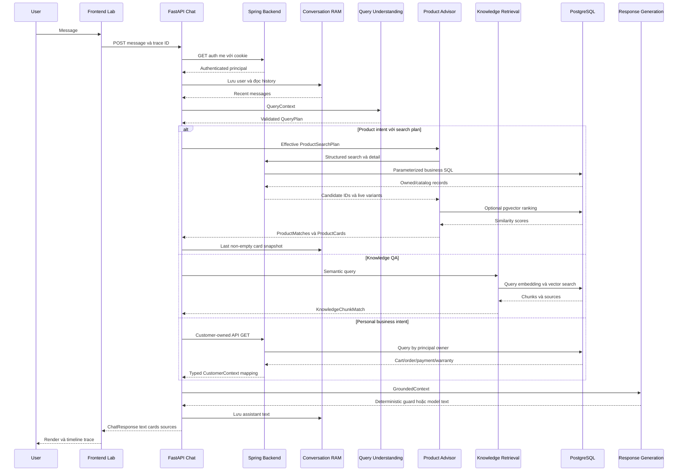

# FINAL EVALUATION — 60 CHATBOT CASES

Baseline `dev/thai-duy-vu` / commit `438227c`. Đây là đánh giá runtime synthetic development, **không phải tỷ lệ chính xác phổ quát của Qwen**. Không sửa logic/contract/schema/auth/prompt/model/seed. Kết quả bốn checkpoint được giữ nguyên, có trace/HTTP/browser evidence thật; repeats báo riêng.

## A. Executive Summary

| Chỉ số | Kết quả |
|---|---|
| Case IDs đầy đủ, không trùng/thiếu | T01–T60 / 60 |
| PASS nghiêm ngặt | 13 |
| PASS_WITH_WARNINGS | 24 |
| FAIL | 21 |
| BLOCKED_FIXTURE | 2 (T40/T41) |
| Case có observation thực tế | 60: 56 prompt + 4 HTTP/browser/security operations |
| Case đủ điều kiện đánh giá mục tiêu | 58; 2case chỉ chạy empty-path do thiếu positive fixtures |
| Strict PASS trên 58 | 22.41% |
| PASS gồm warning trên 58 | 63.79% |

Hai BLOCKED có request thật/negativepath, nhưng chưa test được record warranty/ticket dương nên loại khỏi mẫu số “đánh giá đầy đủ”. Nếu dùng toàn bộ60, strict13/60=21,67%, gồmwarning37/60=61,67%. Không ghi BLOCKED thành PASS hoặc đổi verdict các lượt cũ. PASS_WITH_WARNINGS không đồng nghĩa tính năng hoàn thiện.

Auth/session/trace tests không có new pipeline trace là đúng instrumentation: auth trước capture, GEThistory/trace/browserreload không tạo chat span. Evidence T57–T60 là HTTP/browser observations với target tracecontrol thật, không file event giả.

Artifacts:

- [01 Basic/Product](01_BASIC_PRODUCT_TEST.md), [02 Identity/Context](02_PRODUCT_CONTEXT_TEST.md), [03 RAG/Customer](03_RAG_CUSTOMER_TEST.md), [04 Safety/System](04_SAFETY_SYSTEM_TEST.md).
- [phase01.json](results/phase01.json), [phase02.json](results/phase02.json), [phase03.json](results/phase03.json), [phase04.json](results/phase04.json).
- [Machine-readable final summary](results/final_summary.json), [15 repeat results](results/repeats.json).
- Trace provenance, raw-safe excerpts và fixture baseline theo [evidence](evidence/).

## B. Evaluation by Domain

| Domain | Cases | PASS | WARN | FAIL | BLOCKED | Key problems |
|---|---|---|---|---|---|---|
| A Basic & Intent | T01–T06 (6) | 3 | 3 | 0 | 0 | HELP thànhGREETING; broadconsultation thiếucategory; RAGnguồnthừa |
| B Structured filters | T07–T14 (8) | 0 | 3 | 5 | 0 | Hardprice/brand/RAM/category/stock thiếu; priceconflict mất trướcvalidator |
| C Product/variant/SKU/compare | T15–T22 (8) | 0 | 0 | 8 | 0 | Exactname/SKU chưaresolve; warrantyroutewrong; comparisonname vàoCPU |
| D Conversation/reference | T23–T30 (8) | 1 | 3 | 4 | 0 | History có nhưng detail/ref thiếu; freshcheaper nobaseline |
| E Knowledge RAG | T31–T36 (6) | 0 | 5 | 1 | 0 | RAGreturn đúngscope; how-to chuyểnOrderStatus và inferpayment |
| F Customer context | T37–T44 (8) | 4 | 2 | 0 | 2 | Cart/latestpayment đúng; code only1fixture; warranty/ticketpositive missing |
| G Safety/injection | T45–T50 (6) | 1 | 5 | 0 | 0 | No mutation/leak/fake100; late/ambiguousrefusal và sourcequality |
| H Language/ambiguity | T51–T56 (6) | 0 | 3 | 3 | 0 | English/typo partialcomprehension nhưng cardunscoped; compoundquerypartial |
| I Auth/session/trace | T57–T60 (4) | 4 | 0 | 0 | 0 | 401/403/404 controls pass; reloadRAM đúng, khôngDBhistory |

## C. Fault Distribution

Bảng đếm **primary first_fault**, tách FAIL khỏi warning/design gap. Secondary errors như inference T34 không cộng lại thành casefail khác. Stage NONE/NO_FAULT có PASS; CONFIGURATION là fixturecoverage, không backendoutage.

| Stage | FAIL | WARN | BLOCKED | PASS/NO_FAULT |
|---|---|---|---|---|
| QUERY_UNDERSTANDING | 20 | 10 | 0 | 0 |
| CONTRACT_VALIDATION | 0 | 0 | 0 | 0 |
| ORCHESTRATION | 1 | 1 | 0 | 0 |
| PRODUCT_STRUCTURED_RETRIEVAL | 0 | 0 | 0 | 0 |
| PRODUCT_SEMANTIC_RANKING | 0 | 0 | 0 | 0 |
| KNOWLEDGE_RETRIEVAL | 0 | 6 | 0 | 0 |
| CUSTOMER_CONTEXT | 0 | 2 | 0 | 0 |
| GROUNDING | 0 | 2 | 0 | 0 |
| RESPONSE_GENERATION | 0 | 3 | 0 | 0 |
| AUTHENTICATION | 0 | 0 | 0 | 0 |
| CONFIGURATION | 0 | 0 | 2 | 0 |
| NO_FAULT | 0 | 0 | 0 | 13 |

20/21 case FAIL có primary failure đầu ở Query Understanding output; 1 là orchestration T24. Không suy 20/21 là lỗi “model thuần”: prompt/schema thiếu taxonomy/identity/multi-intent/ref resolver làm output hợp schema nhưng không dùng được. CONTRACT_VALIDATION không có primary assignment/JSON-error trong run; vẫn là yếu tố thiết kế thiếu ràng buộc domain/coverage (T14 mất upperbound nên validator không nhìn thấy conflict).

Product SQL/eligibility/ranking trả đúng theo plan nhận được và data live; không có observed primary SQL/math defect. Điều này không chứng minh backend đúng mọi trạng thái, stockrace hoặc unsupportedfilters. Model generation có secondary fault T34 và comparativeclaim T30, nhưng không blame generation trước khi xem plan/evidence.

## D. Latency

Latency wall time là từ submit tới API response; T59 gồm reload + kiểm restore/DB read nên khác model operation. Thống kê all60 nhằm mô tả bài test, không so latency authGET với chat generation như cùng workload. Chat subset56 gồm cả2negative fixture observations. Không trộn15repeats, không SLA.

| Metric | 60 operations (s) | 56 chat requests (s) |
|---|---|---|
| Min | 0.016 | 0.394 |
| Max | 24.523 | 24.523 |
| Average | 5.746 | 6.149 |
| Median | 2.749 | 4.387 |
| p90 | 14.869 | 15.449 |
| p95 | 17.317 | 17.963 |

p90/p95 dùng nearest-rank: lấy phần tử ceil(p*n), không nội suy. Chỉ một lượt mỗi maincase, loại câu khác nhau, samplecount không là đánh giá service load. Modelwarmth/answerlength ảnh hưởng timings; chưa testcoldstart hoặc loadconcurrent.

Stage timings lấy parent spans **không chồng nhau**: query.understand, product.search, product.cards, knowledge.retrieve, customer.context, response.generate. Không cộng ollama.http/embed/vectorsearch vào parent đã chứa chúng. Missing stage là NOT_CALLED, không gán latency0 cho query chưa chạy. Response rows gồm deterministic guards và model answers; không hiểu median row như model-only latency.

| Stage | Called n | Avg(s) | Median(s) | p95(s) | Bao gồm |
|---|---|---|---|---|---|
| query.understand | 56 | 1.562 | 1.260 | 5.611 | Model parse+schema validation |
| product.search | 31 | 0.225 | 0.115 | 1.431 | Structured API+embedding/rank+live enrichment |
| product.cards | 31 | 0.023 | 0.013 | 0.054 | Fresh detail/card assembly |
| knowledge.retrieve | 6 | 0.270 | 0.059 | 1.342 | Query embedding+vector search |
| customer.context | 56 | 0.007 | 0.000 | 0.045 | Authenticated business GET+mapping (cả empty paths) |
| response.generate | 56 | 4.321 | 1.587 | 15.955 | Model hoặc deterministic guard |

Walltime không bằng sumstage tuyệt đối do authentication trước capture, thread scheduling, service/history/storage và HTTP/UI overhead. Nested spans giúp tìm thời gian trong tầng, không được double-count. Latency nhanh do badfilter→0candidate (T15) không phải hiệu năng tốt cho một câu trả lời đúng.

## E. Model vs Code

- **Model tạo plan sai:** T11/T15taxonomy, T17RAM/storage chưa vàofilter, T22names→CPU, T34how-to→ORDER_STATUS.
- **Model thêm/đổi field không được user nêu:** min_storage1(T08/T10/T13/T14), min_ram16(T29). T54 trái lại giữnumericnull, không gọi datasetrecommendation là bịa budget.
- **Contract/interface thiếu:** exactSKU/name filter/resolver, refs không consumed; detailsearchnullable nhưng orchestration không xử lý (T24); singlequery không biểu diễn multi-intent (T56). Không đổ hết cho model.
- **Backend/data:** card và eligible variants khớp live catalog; ownerGET404. T40/T41 thiếupositivefixture là coverage, không model failure. Chưa thửstate đa dạng enoughđểcông bố business correctness toàn hệ thống.
- **Final model unsupported claim:** T34 suy payment từ order.status và nói theoDEMO dù RAG0; T30 khẳng định rẻhơn mốckhôngcó. T16/T21 text đúng số nhưngcardsoutscope: không gọi model bịa giá/tồn.
- **Session/reference:** RAM historyA/B truyền đúng; snapshotheuristicT25 đúng; generalordinal/identityresolve chưa hoàn thiện. Không có evidence cross-sessionmix; reloadRAM không làdurableDBhistory.

## F. Top 10 Findings

Severity là ảnh hưởng trong phạm vi quan sát và design gap, không tự gán P0safety khi chưa có mutation/leak. CaseIDs liên quan bao gồmfail/warning; xem verdictgốc trước khi đọc đây là tấcảcasefailed.

### F01 — HIGH

- Supporting cases: T09,T11,T15,T17,T18,T19,T27,T29.
- Earliest stage: QUERY_UNDERSTANDING.
- Responsible: Người 3 + Shared.
- Relevant files (under chatbot-service/app unless specified): query_understanding/ollama_service.py; shared/contracts/query.py; product_advisor/backend.py.
- Recommended fix: Canonical taxonomy/identity mapping; Phone/Smartphone/iPhone không phải category thực.
- Regression: Stock/color queries với Điện thoại/Xiaomi/iPhone: named product còn hàng không false negative.

### F02 — HIGH

- Supporting cases: T08,T10,T12,T13,T17,T29,T55.
- Earliest stage: QUERY_UNDERSTANDING.
- Responsible: Người 3 + Shared.
- Relevant files (under chatbot-service/app unless specified): query_understanding/ollama_service.py; shared/contracts/query.py; chat/service.py.
- Recommended fix: Preserve hard price/RAM/storage/brand/stock slots; kiểm coverage và constraints tự sinh.
- Regression: Ngôn ngữ/abbrev/typo → filters đủ; mọi card đạt user constraints; trường không yêu cầu giữ null.

### F03 — HIGH

- Supporting cases: T16,T21,T51,T52.
- Earliest stage: QUERY_UNDERSTANDING + resolver interface.
- Responsible: Shared: Người 1/2/3.
- Relevant files (under chatbot-service/app unless specified): shared/contracts/query.py; chat/service.py; product_advisor/real_service.py; backend.py.
- Recommended fix: Exact product/SKU resolver, không dùng top-k similarity như equality.
- Regression: SKU không cheapest, names exact, unknownSKU; no unrelated cards; variants đúng target.

### F04 — HIGH

- Supporting cases: T22.
- Earliest stage: QUERY_UNDERSTANDING.
- Responsible: Người 3; Người 2 integration.
- Relevant files (under chatbot-service/app unless specified): query_understanding/ollama_service.py; chat/service.py; product_advisor/backend.py.
- Recommended fix: Named entities comparison riêng với CPU; resolve đúng cặp product/variants.
- Regression: Dell Inspiron15/XPS13 → đúng2products/4variants, không cpu_keywords Dell/Inspiron/XPS.

### F05 — MEDIUM

- Supporting cases: T24.
- Earliest stage: ORCHESTRATION.
- Responsible: Người 1 + Shared.
- Relevant files (under chatbot-service/app unless specified): chat/service.py; shared/contracts/query.py; conversation/repository.py.
- Recommended fix: Detail plan null search/reference phải resolve hoặc explicit clarification, không no-match khi chưa query.
- Regression: DETAIL+PRICE singlepreviouscard, empty search; validate ownership/snapshot và đúng reference source.

### F06 — MEDIUM

- Supporting cases: T26,T28,T30.
- Earliest stage: QUERY_UNDERSTANDING; downstream reference guards.
- Responsible: Người 1 + Người 3.
- Relevant files (under chatbot-service/app unless specified): chat/service.py; conversation/repository.py; query_understanding/ollama_service.py; response_generation/ollama_service.py.
- Recommended fix: Ambiguity/ordinal/comparative guards; no baseline thì hỏi rõ.
- Regression: Fresh cheaper, second khi chỉ1item, first khi listempty; withhistory ceiling correct; no fabricated ordinal.

### F07 — HIGH

- Supporting cases: T34.
- Earliest stage: QUERY_UNDERSTANDING; secondary RESPONSE_GENERATION.
- Responsible: Người 3 + Người 1.
- Relevant files (under chatbot-service/app unless specified): query_understanding/ollama_service.py; customer_context/service.py; response_generation/ollama_service.py.
- Recommended fix: Knowledge guidance khác personal status; payment authority cần PaymentContext, không suy từ order.
- Regression: DEMO how-to không fetch customer; paymentnull không PAID/unpaid inference; contexts đúng backend state.

### F08 — MEDIUM design/coverage

- Supporting cases: T42,T43.
- Earliest stage: CUSTOMER_CONTEXT.
- Responsible: Người 1 + Shared.
- Relevant files (under chatbot-service/app unless specified): customer_context/service.py; chat/service.py; shared/contracts/query.py.
- Recommended fix: Owner-safe exact code selection; không rows[0] thay explicit code.
- Regression: Hai ownedorders, code non-latest, nonexistent/other-owner; deterministic no-match và no wrong status.

### F09 — LOW

- Supporting cases: T05,T31,T32,T33,T35,T50.
- Earliest stage: KNOWLEDGE_RETRIEVAL.
- Responsible: Người 3.
- Relevant files (under chatbot-service/app unless specified): knowledge/service.py; knowledge/repository.py; chat/service.py.
- Recommended fix: Relevance/source-used selection, scope DEMO vs official; threshold qua eval dataset.
- Regression: Return question không citepayment; unsupported officialpolicy abstains; realIDs không đồng nghĩa relevant.

### F10 — LOW current; P1 capability clarity

- Supporting cases: T45,T46,T47.
- Earliest stage: ORCHESTRATION / RESPONSE_GENERATION.
- Responsible: Người 1 + Người 3.
- Relevant files (under chatbot-service/app unless specified): chat/service.py; response_generation/ollama_service.py.
- Recommended fix: Refusal sớm, nhất quán theo action intent; explicit read-only, không chỉ literal và chưa đủ dữ liệu.
- Regression: Cancel/address paraphrases không writes/claimdone; productdependency outage vẫn refusal; no needless retrieval.

Các finding khác cần giữ: GroundedContext ProductMatch thiếuidentityfields (T07/T23), priceconflicttext/card inconsistency(T14), missingwarranty/ticketfixture. Không loại chúng chỉ vìtop10ranking. Mỗifinding truy ngược phaseJSON→tracepath; không tạoissue model khiplan đúng và lỗi về sau.

## G. Demo and Production Readiness

**Đã kiểm chứng trong fixture:** greeting, giá/RAMfilter khi plan đúng, DEMO7/conditions/receipt date, cart/latestpayment owned, current-userorderstatus, same-sessioncheaper snapshot, safeabsenceofsecond, anonymous401/session403/trace404, reload2message text.

**Chưa kiểm chứng:** warranty/ticketpositive, nhiềuownedorders vàcode non-latest, PAID/no-payment/multiplepaymentstates, sold-out/stockchanges, durable/multiworkerhistory, fulladversarialinjection/securitysurface, coldstart/load/SLA. Không dùng4authoperations làm chứng nhậnsecurity toàn app.

**Demo nên có kiểm soát:** các prompt đãmatchcontext/domain như greeting/T07/T31/T37/T39/T25, hiển thịDEMOlabel và datađốichiếu; cần nói rõwarnings. Khôngdemofreetext exactSKU/compare/complexfilters như thểhoàn chỉnh. Cơ chếread-only được quan sátkhôngmutation, nhưngrefusalwording/coverage chưa toàn diện.

**Trướcproduction:** domain/identity/slot validation+resolver, exactownedorder selection, evidence-awarepayment/source selection, ambiguity/multi-intent policy, refusalearly/explicit, positivefixtures/regressione2e và storage strategy. Đây là requirement phát sinh từfailedcases, không triển khai trongevaluation.

## H. Controlled repeats — 15 lượt riêng

Sau60maincases, môi trường vẫnổnđịnh nên chạy3freshsessions choT07,T15,T30,T31,T51; serialAPI quafrontendproxy, sameaccounts/models/config/fixture, history0, khôngrestart. Không trộn với60 hoặcđổioldverdict. Repeat không dùngUIlatency nêntimings thậntrọngso sánh.

| Prompt | Intent counts | Unique parsed plans | Unique text | Primary correct | Repeat verdict | Avg / median / max (s) |
|---|---|---|---|---|---|---|
| T07 | {'PRODUCT_DISCOVERY': 3} | 1 | 2 | 3/3 | {'PASS_WITH_WARNINGS': 3} | 6.468 / 6.412 / 7.391 |
| T15 | {'PRODUCT_DISCOVERY': 3} | 1 | 1 | 0/3 | {'FAIL': 3} | 1.287 / 1.262 / 1.343 |
| T30 | {'PRODUCT_DISCOVERY': 3} | 1 | 1 | 0/3 | {'FAIL': 3} | 8.153 / 10.683 / 10.727 |
| T31 | {'KNOWLEDGE_QA': 3} | 1 | 1 | 3/3 | {'PASS_WITH_WARNINGS': 3} | 3.950 / 4.090 / 4.767 |
| T51 | {'PRODUCT_DISCOVERY': 3} | 1 | 2 | 0/3 | {'FAIL': 3} | 5.694 / 3.838 / 10.528 |

QueryPlan parameters parsed giống3/3cho từngprompt, intentnhấtquán. T15 taxonomyfalse-negative táihiện3/3; T30nobaselinecomparative3/3; T51targetstocktextđúngnhưngunrelatedcards3/3. T07/T31primaryanswers đúng3/3, vẫncontractidentity/sourcewarning. RiêngT07repeattext nóibrandDell thay vìunknowntrongmain; con số/brand khớpbackend nhưngGroundedContextcontractkhôngthêmbrand. Không coi thay wording làfix vàkhôngreclassmainT07.

Temperature0 khôngchứngminh universal determinism; sampletiny, answertextvariation/caches/scorefloating/hardware cóthểảnhhưởng nhưngnguyênnhânbiếnthiênchưađượccontrolledcausaltest. Xemresults/repeats.json vàevidence/repeatschoUUID/timestamp/caseactual.

## I. Final validation and next implementation checkpoint

Focused tracing cuối6pass; fullPython155pass+1skip, deprecationwarningStarlette/httpx. OptionalPostgreSQLtest skip vìkhôngcấpKNOWLEDGE_TEST_DATABASE_URL, khôngđụngschema đểlàmtestpass. Runtime đãđối chiếuDBread-only riêng. Tests pass khôngphủđịnh21maincaseFAIL.

ĐãvalidatecaseIDsT01–T60khôngmissing/trùng, sourcehash/branchsame, caseevidenceIDs/headers/statuses/correlation, card/knowledge/businessdata vàprivacyprojections. 56pipelinefiles+4HTTP/browserobservations, thêm15repeatfilesrêng. source tracked gitdiffempty; eval60untracked; khôngcommit/push diagnosticlogs/PII/secrets. Services cònchạy.

**Đề xuất checkpoint sửa code tiếp theo (chưa thực hiện):** ưu tiênP1canonicaltaxonomy/exactidentity vàhardfiltercoverage; song songdefineDETAIL/ref/ordercode/multi-intentcontract; thêmpayment/evidenceguard vàrefusalpolicy. Chỉsửa theo task đượcusercho phép, dùngcasesgốc làmregression vàgiữrawcurrentbaseline đểso before/after. Khôngtự implement trongcheckpoint04.

# TÔI ĐÃ HIỂU CHATBOT CỦA MÌNH NHƯ THẾ NÀO?

## 1. Dữ liệu thật cho từng tầng

Frontend ChatbotLabPage.send trim message/tạotraceUUID và gọi chatbotApi.send; apiClient request đónggóiJSON, credentials+CSRF, Viteproxy tớiFastAPI. Router.get_authenticated_customer gọiSpringauth/me bằngcookie, sauauth mớicapturetrace. UserkhôngquyếtđịnhownerID của businessrecords.

QueryUnderstanding dùngOllama chat+schema đểtạoQueryPlan, validate bằngPydantic. T14modelbỏupperprice nênJSONhợp lệ nhưngkhôngđúngpriceconflict; T11categorySmartphonehợpstringnhưngsaitaxonomy. Vìvậy “JSON parseđược”khôngđủ.

ProductAdvisorSQLlọcvarianteligibility trước, vectorxếpproductcandidate sau, livebackenddetailenrich. T08semantictextcóDell/20triệukhôngtươngđươngbrand/pricefilters; T51typo ranktargettopnhưngchưaexactscope. RAG embedquery đểlấychunks/nội dung,không lấygiá/stocklive hoặcretrainmodel.

CustomerContext forwardcookie tới `/api/cart`/`orders/mine`/detail/warranties/tickets rồi mapDTO; Springprincipal quyếtđịnhowner. T39PaymentContext làauthority; T34orderstate khôngsubstitutepayment. GroundedContext gomquery/historyvàevidence, finalQwen diễnđạt; khôngcreatecards/order/payment. ProductCards doRealProductAdvisor.build_cards chọneligiblelivevariant, sourceRefstừmatchesKB.

Cùngfollow-upprompt khácsession cóthểthiếuantecedent; A/BhistoryvàsnapshotlàRAM, khôngPGhistory. T25ceilingproven; T30emptyhistoryvẫncomparativewrong. FIRSTFAULT tìm bằngsoinput→plan→effectivefilters→backend→grounding→text/card; khôngđổlaterstagechoevidencebadinherited.

## 2. Sequence diagram từ frontend đến response

Queryembedding làOllamacall nằmtrongretrieval, khôngSQL doLLMtạo. DiagramnhánhProductDetailnullsearch khôngđượcgọi ởT24 nênphảiđọccondition, khôngassume mọiproductintentsearch. Chính sách/authorization failure cóthểdừng trướccapture.

## 3. Bảng học tập

| Stage | File/function | Responsibility | Input | Output | Common failure |
|---|---|---|---|---|---|
| Frontend | Fontend/src/features/chatbot/ChatbotLabPage.jsx send; chatbotApi.js send | Submit/render/correlation | Message/session | POST, UIresponse | Text/cardkhôngđồngnhất(T10) |
| API client/proxy | Fontend/src/api/apiClient.js request; vite.config.js proxy | Cookie/CSRF/JSON/route | Request | FastAPIcall | Network/401 |
| Router/auth | features/chat/router.py get_authenticated_customer/send_message | Verifiedidentity+trace | Cookies/message | Customer/servicecall | Authdeny trướctrace(T57) |
| Conversation | features/conversation/service.py/repository.py | OwnedRAMhistory/snapshot | Session/messages/cards | Recenthistory/cardcopy | Khônggeneralresolver(T24,T26) |
| Query Understanding | features/query_understanding/ollama_service.py understand | Intent/slots+validate | QueryContext/schema | QueryPlan | Taxonomy/slot sai(T11,T22) |
| Orchestration | features/chat/service.py send_message_async | Selectworkflow/effectiveplan | QueryPlan | Calls+GroundedContext | Detailnullskip(T24) |
| Product | features/product_advisor/real_service.py search/build_cards | Eligibility/rank/livecards | ProductSearchPlan | Match/card | Broadplan→unrelated(T16) |
| Backend adapter | features/product_advisor/backend.py search/detail | Snake-case→HTTP params | Filters/cookies | Candidate/detail | KhôngexactSKU(T21) |
| Spring SQL | backend product ProductAdvancedSearchService.search | Businessfilter SQL | Params | IDpairs | FiltersdomainwrongđúngSQL0(T15) |
| Product vector | features/product_advisor/semantic.py scores/embed | Optionalranking | Query+candidateIDs | Scores | Similaritykhôngequality |
| RAG | features/knowledge/service.py retrieve; repository.py search | Chunks/evidence | Semanticquery/vector | KnowledgeChunkMatch | Irrelevantsource(T31) |
| Customer | features/customer_context/service.py load_context | ScopedDTO mapping | Intent/cookies | CustomerContext | Latestkhôngexactcode(T42) |
| Grounding | shared/contracts/context.py; chat/service.py | Composeevidence/history | Retrievedobjects | GroundedContext | Thiếuidentity(T07) |
| Response | features/response_generation/ollama_service.py generate | Guard/modeltext | GroundedContext | Answer | Inferpayment(T34) |
| Assembly | chat/service.py ChatResponse; shared/contracts/response.py | Data-text presentation | Text/cards/sources | APIresponse | Correcttextwrongcards(T10) |

## 4. Mười lăm câu hỏi ôn tập — có đáp án

1. **Intent và filter khác nhau gì?** Intent chọnworkflow; filtergiới hạnrecords. PRODUCT_DISCOVERY chưa đảm bảobudgetđúng(T08).
2. **JSON hợp schema có bảo đảm đúng nghiệp vụ?** Không: optionalmax_pricebịbỏ hoặccategorystringkhôngcanonicalvẫnvalid(T14/T11).
3. **T08 cóDell/20triệutrongsemanticquery sao cardvẫnsai?** Hardbrand/budget thiếu nênSQLkhônglọc; similaritykhông thayfilters.
4. **ProductMatch khácProductCard?** Matchcónhiềueligiblevariants; cardchọnmộtcheapesteachproduct(T16).
5. **SKU text cóđồngnghĩaexact lookup?** Không. T21rankcorrecttopnhưngsearchall38pairs và4unrelatedcards.
6. **T22filterCPUdùngDell/Inspiron/XPS sai ởđâu?** Chúnglàbrand/modelnames, khôngCPU;QUmapsaiđầutiên.
7. **T24cóhistory2sao không cógiá?** ValidDETAIL/searchnull không đượcorchestrationresolve; không phảiRAMkhônglưu.
8. **T25ceiling15.989.999lấyởđâu?** Lastnon-emptycard15.990.000−1; T24emptykhôngclear theo repository.
9. **T30freshcheaperthiếugì?** Thiếuantecedent/mốcgiá; khẳngđịnhrẻhơnkhôngcó evidence.
10. **RAG có train lạiQwen không?** Không: indexvectors/retrievechunks vào runtimeprompt, khôngupdateweights.
11. **SourceIDthật cónghĩaliênquan?** Không: paymentchunkIDthật nhưngkhôngsupportreturnpolicy(T31).
12. **OrderPENDINGcóchứngminhunpaid?** Không. CầnPaymentContext.status; T34khôngcó cònT39có.
13. **Backendowner đúng cóbảo đảm đúngordercode?** Không. T42latesttrùngspecificvìchỉ1fixture, generalcoderesolverchưa có.
14. **Reloadkhôiphụctext làPostgreSQLpersistence?** Không. T59RAMhistory2, PGhistory0, cardskhôngrestore.
15. **MộtcaseHTTP200/tracestatusok cóPASSkhông?** Chưachắc: cầnsoexpected vớiplan/evidence/text/cards; T08/T34 vẫnFAIL. Auth/securityGETkhôngpipeline trace khôngđượcbịaeventthaythế.
