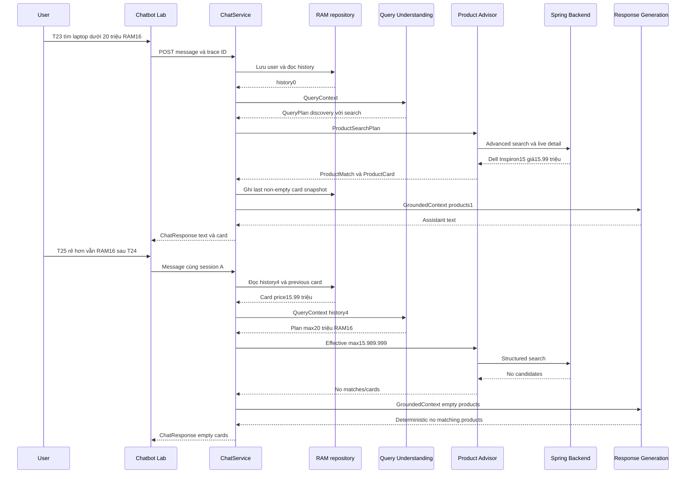

# CHECKPOINT 02 — PRODUCT IDENTITY & CONVERSATION CONTEXT

Task `c2c_chatbot_eval_phase02`, iteration 0. **16 request T15–T30**: 1 PASS, 3 PASS_WITH_WARNINGS, 12 FAIL, 0 BLOCKED. Mỗi case một lượt quan sát, không phải thống kê ổn định model. Toàn bộ HTTP200 không đồng nghĩa đạt yêu cầu.

## 1. Mục tiêu kiểm thử

Exact product/SKU identity, price/stock/warranty/colors theo variant, comparison, product references và short-term memory. Chỉ kiểm thử/diagnose/documentation; không sửa source, prompt, model, contract, retrieval, frontend, schema, seed hoặc tracing.

Đã đọc [checkpoint01](01_BASIC_PRODUCT_TEST.md). Baseline vẫn commit 438227c: các finding taxonomy, missing filters, identity evidence, ambiguous follow-up chưa được sửa. Chạy lại T15 và fresh-session T30 bằng trace mới, không lấy log trước làm kết quả.

Verdict áp dụng cả text/card/source. PASS_WITH_WARNINGS của T26/T28 nghĩa response không bịa ordinal khi antecedent thiếu; **không chứng nhận successful reference resolution**. Identity/SKU cases có text đúng nhưng card ngoài product target vẫn FAIL vì whole response chưa scoped chính xác.

## 2. Test environment/data và thao tác

Workspace `/Users/vu/Documents/Vu/HUIT-Year4/KLTN/KLCN-QL_CHTBDT-Ecommerce-main`, remote ThaiDuyVu/KLCN-QL_CHTBDT-Ecommerce; branch dev/thai-duy-vu, commit438227c. Worktree ban đầu chỉ thư mục eval60 chưa theo dõi từ phase01. Không fetch/checkout/merge/restart; giữ memory runtime đang chạy.

Frontend5173, FastAPI8090, Spring8080, PostgreSQL5432 Docker healthy, Ollama11434 reachable. AI=true/Product Advisor=real; qwen3:4b-instruct và qwen3-embedding:0.6b ready. Trace development bật CHATBOT_TRACE_ENABLED và CHATBOT_TRACE_FILE_ENABLED; không đổi .env. Chỉ CUSTOMER synthetic repo cung cấp, không lộ credentials/contact.

Chrome thật gửi từ Chatbot Lab qua apiClient/Vite; response text/card names được so với API. Boundary sink `.local/logs/chatbot-traces.jsonl`: trước 27 dòng, offset1526100, UTC2026-10-13T06:46:47.790116+00:00; sau43dòng. Chọn16trace mới bằng header UUID+session UUID, không xóa log lịch sử, không rotate. Excerpt1JSONL snapshot/case, events theo offset bắt đầu; raw log/screenshot ở `.local/eval-phase02/` không commit. Trace payload dài/schema/identity/customer DTO được rút gọn, không vector/DSN/token.

T15–T22 dùng8session mới độc lập. T23–T26 dùng A, T27–T29 dùng B, T30 dùng C hoàn toàn mới. Không chèn thêm prompt để tạo đối tượng thứ2 hoặc sửa session B sau T27 thất bại. Tổng11session. Snapshot không có endpoint/log trực tiếp: trường snapshot_before/after_inferred được dựng từ previous ChatResponse và quy tắc repository; **không coi đó là ảnh RAM server trực tiếp**. T25 effective ceiling là bằng chứng runtime độc lập cho việc dùng snapshot.

### Catalog/warehouse đã đọc trước test

[backend-baseline.json](evidence/phase02/backend-baseline.json) có toàn catalog live tại cùng warehouse, cùng các GET structured query chỉ đọc: Điện thoại26variant, Điện thoại+Xiaomi7variant/3product, Laptop/max20triệu/RAM16=1variant. Không tạo/sửa seed.

| Product | SKU | RAM / Storage | Màu | Giá hiệu lực | Tồn tại kho | Bảo hành tháng |
|---|---|---|---|---|---|---|
| Xiaomi 15 | DEV-X15-BLK-256 | 12GB / 256GB | Đen | 18,990,000 | 2 | 12 |
| Xiaomi 15 | DEV-X15-GRN-512 | 16GB / 512GB | Xanh lá | 21,990,000 | 2 | 12 |
| Xiaomi 15 | DEV-X15-WHT-512 | 12GB / 512GB | Trắng | 20,990,000 | 2 | 12 |
| iPhone 15 | DEV-IP15-BLK-128 | 6GB / 128GB | Đen | 17,990,000 | 2 | 12 |
| iPhone 15 | DEV-IP15-BLU-256 | 6GB / 256GB | Xanh dương | 20,990,000 | 2 | 12 |
| Samsung Galaxy A55 | DEV-A55-ICE-256 | 12GB / 256GB | Xanh băng | 10,490,000 | 2 | 12 |
| Samsung Galaxy A55 | DEV-A55-LIL-256 | 8GB / 256GB | Tím | 9,490,000 | 2 | 12 |
| Samsung Galaxy A55 | DEV-A55-NVY-128 | 8GB / 128GB | Xanh đen | 8,490,000 | 2 | 12 |
| Dell Inspiron 15 | DEV-DELL-I15-512 | 16GB / 512GB | Bạc | 15,990,000 | 2 | 24 |
| Dell XPS 13 | DEV-XPS13-GR-1TB | 16GB / 1TB | Xám | 36,990,000 | 2 | 24 |
| Dell XPS 13 | DEV-XPS13-SL-1TB | 32GB / 1TB | Bạc | 41,990,000 | 2 | 24 |
| Dell XPS 13 | DEV-XPS13-SL-512 | 16GB / 512GB | Bạc | 32,990,000 | 2 | 24 |

## 3. Test matrix T15–T30 và chi tiết

| ID | Session / history | Actual intent / response branch | Candidate pair / match / eligible variant / card | Verdict | First fault / Owner |
|---|---|---|---|---|---|
| T15 | T15 / 0 | PRODUCT_DISCOVERY / no_matching_products | 0 / 0 / 0 / 0 | FAIL | QUERY_UNDERSTANDING / PERSON_3 |
| T16 | T16 / 0 | PRODUCT_DISCOVERY / ollama | 38 / 5 / 12 / 5 | FAIL | QUERY_UNDERSTANDING / SHARED |
| T17 | T17 / 0 | PRODUCT_DISCOVERY / no_matching_products | 0 / 0 / 0 / 0 | FAIL | QUERY_UNDERSTANDING / PERSON_3 |
| T18 | T18 / 0 | PRODUCT_DISCOVERY / no_matching_products | 0 / 0 / 0 / 0 | FAIL | QUERY_UNDERSTANDING / PERSON_3 |
| T19 | T19 / 0 | PRODUCT_DISCOVERY / no_matching_products | 0 / 0 / 0 / 0 | FAIL | QUERY_UNDERSTANDING / PERSON_3 |
| T20 | T20 / 0 | WARRANTY_STATUS / insufficient_evidence | 0 / 0 / 0 / 0 | FAIL | QUERY_UNDERSTANDING / PERSON_3 |
| T21 | T21 / 0 | PRODUCT_DISCOVERY / ollama | 38 / 5 / 10 / 5 | FAIL | QUERY_UNDERSTANDING / SHARED |
| T22 | T22 / 0 | PRODUCT_COMPARE / no_matching_products | 0 / 0 / 0 / 0 | FAIL | QUERY_UNDERSTANDING / PERSON_3 |
| T23 | A / 0 | PRODUCT_DISCOVERY / ollama | 1 / 1 / 1 / 1 | PASS_WITH_WARNINGS | GROUNDING / SHARED |
| T24 | A / 2 | PRODUCT_DETAIL / no_matching_products | 0 / 0 / 0 / 0 | FAIL | ORCHESTRATION / PERSON_1 |
| T25 | A / 4 | PRODUCT_DISCOVERY / no_matching_products | 0 / 0 / 0 / 0 | PASS | NO_FAULT / PERSON_1 |
| T26 | A / 6 | PRODUCT_DISCOVERY / ollama | 1 / 1 / 1 / 1 | PASS_WITH_WARNINGS | QUERY_UNDERSTANDING / PERSON_3 |
| T27 | B / 0 | PRODUCT_DISCOVERY / no_matching_products | 0 / 0 / 0 / 0 | FAIL | QUERY_UNDERSTANDING / PERSON_3 |
| T28 | B / 2 | PRODUCT_DISCOVERY / ollama | 38 / 5 / 13 / 5 | PASS_WITH_WARNINGS | QUERY_UNDERSTANDING / PERSON_3 |
| T29 | B / 4 | PRODUCT_DISCOVERY / no_matching_products | 0 / 0 / 0 / 0 | FAIL | QUERY_UNDERSTANDING / PERSON_3 |
| T30 | C / 0 | PRODUCT_DISCOVERY / ollama | 38 / 5 / 13 / 5 | FAIL | QUERY_UNDERSTANDING / PERSON_3 |

### T15 — FAIL

**Prompt:** Xiaomi 15 còn hàng không?

**Expected:** Resolve Xiaomi15, các variant và stock live.

**Execution:** 2026-10-13T13:46:48.031692+07:00; session T15 `92788d2e-4af8-49ca-a508-13fc4160588c`; trace `3520144f-114c-45e8-8b47-3f4d07a4406c`; HTTP200; UI/API latency5.866s, pipeline5.776s; history_count=0.

**Actual QueryPlan (requested fields/references bao gồm):**
```json
{
  "intent": "PRODUCT_DISCOVERY",
  "requested_fields": [],
  "references": {},
  "product_search": {
    "category": "Smartphone",
    "brands": [],
    "min_price": null,
    "max_price": null,
    "min_ram_gb": null,
    "min_storage_gb": null,
    "cpu_keywords": [],
    "in_stock_only": false,
    "semantic_query": "Xiaomi 15",
    "top_k": 5
  },
  "semantic_query": null
}
```
Effective search: `{"product_search":{"category":"Smartphone","brands":[],"min_price":null,"max_price":null,"min_ram_gb":null,"min_storage_gb":null,"cpu_keywords":[],"in_stock_only":false,"semantic_query":"Xiaomi 15","top_k":5},"below_minimum":false,"cheaper_followup":false}`. 1 model attempt; 0 validation error; không repair/fallback. JSON/schema pass không chứng nhận resolve identity đúng.

**Evidence:** conversation.context → query.validation → query.plan.initial → query.plan.effective → product.search → backend.product_http → product.cards → customer.context → response.grounded_context → response.generate → response.strategy. Backend calls: `[{"method":"GET","path":"/api/v1/products/search/advanced","params":[["limit","100"],["offset","0"],["category","Smartphone"],["warehouseId","d13ea247-ab70-473b-80d6-c8adea60334c"],["inStockOnly","false"]]}]`. Candidates=0pairs/0product; semantic ranking=không; matches=0; eligible variants=0; cards=0. Target Xiaomi 15: 0 variants/0 cards.

GroundedContext summary: `{"products":0,"knowledge_chunks":0,"history_count":0,"customer_orders":0,"customer_warranties":0}`. Full product/variant IDs, match/score, response/card và history nằm trong [phase02.json](results/phase02.json) và [T15.jsonl](evidence/phase02/T15.jsonl), không rút số0 thành “query empty” nếu nhánh không gọi (đặc biệt T24).

**Actual response text:**

> Mình chưa tìm thấy sản phẩm phù hợp với các điều kiện hiện tại.

**Diagnosis / First fault:** Category Smartphone không tồn tại, PRODUCT_DISCOVERY/fields[]/references{} không biểu diễn stock/identity. 0 candidate, không ranking, không biết stock dù backend có 3 variant tồn2. Response không bịa stock nhưng false negative.

**Owner:** PERSON_3. **Severity:** HIGH. **Verdict:** FAIL.

### T16 — FAIL

**Prompt:** Xiaomi 15 hiện có giá bao nhiêu?

**Expected:** Giá theo từng variant Xiaomi15, không giá đại diện cho mọi cấu hình.

**Execution:** 2026-10-13T13:47:04.941988+07:00; session T16 `8cdfc382-18bb-4990-9c4b-d3b3e98b4337`; trace `bb77d3c9-3402-4a65-b6e4-f41ba4570a11`; HTTP200; UI/API latency15.637s, pipeline15.541s; history_count=0.

**Actual QueryPlan (requested fields/references bao gồm):**
```json
{
  "intent": "PRODUCT_DISCOVERY",
  "requested_fields": [],
  "references": {},
  "product_search": {
    "category": null,
    "brands": [],
    "min_price": null,
    "max_price": null,
    "min_ram_gb": null,
    "min_storage_gb": null,
    "cpu_keywords": [],
    "in_stock_only": false,
    "semantic_query": "Xiaomi 15",
    "top_k": 5
  },
  "semantic_query": null
}
```
Effective search: `{"product_search":{"category":null,"brands":[],"min_price":null,"max_price":null,"min_ram_gb":null,"min_storage_gb":null,"cpu_keywords":[],"in_stock_only":false,"semantic_query":"Xiaomi 15","top_k":5},"below_minimum":false,"cheaper_followup":false}`. 1 model attempt; 0 validation error; không repair/fallback. JSON/schema pass không chứng nhận resolve identity đúng.

**Evidence:** conversation.context → query.validation → query.plan.initial → query.plan.effective → product.search → backend.product_http → product.vector_ranking → backend.product_http → backend.product_http → backend.product_http → backend.product_http → backend.product_http → product.cards → backend.product_http → backend.product_http → backend.product_http → backend.product_http → backend.product_http → customer.context → response.grounded_context → response.generate → response.strategy. Backend calls: `[{"method":"GET","path":"/api/v1/products/search/advanced","params":[["limit","100"],["offset","0"],["warehouseId","d13ea247-ab70-473b-80d6-c8adea60334c"],["inStockOnly","false"]]},{"method":"GET","path":"/api/v1/products/169710dd-d072-4e83-9fd0-e618d706ee26/detail","params":{"warehouseId":"d13ea247-ab70-473b-80d6-c8adea60334c"}},{"method":"GET","path":"/api/v1/products/3fc00d9b-72e8-43de-8d5d-a275251aa08f/detail","params":{"warehouseId":"d13ea247-ab70-473b-80d6-c8adea60334c"}},{"method":"GET","path":"/api/v1/products/a40b71a6-dcf9-4d65-acb1-00b10ffbb840/detail","params":{"warehouseId":"d13ea247-ab70-473b-80d6-c8adea60334c"}},{"method":"GET","path":"/api/v1/products/d08f9c12-2196-4fc3-8aab-78d763628ce6/detail","params":{"warehouseId":"d13ea247-ab70-473b-80d6-c8adea60334c"}},{"method":"GET","path":"/api/v1/products/3dbc1257-30f4-4870-8077-d1d6cc2b1e66/detail","params":{"warehouseId":"d13ea247-ab70-473b-80d6-c8adea60334c"}},{"method":"GET","path":"/api/v1/products/169710dd-d072-4e83-9fd0-e618d706ee26/detail","params":{"warehouseId":"d13ea247-ab70-473b-80d6-c8adea60334c"}},{"method":"GET","path":"/api/v1/products/3fc00d9b-72e8-43de-8d5d-a275251aa08f/detail","params":{"warehouseId":"d13ea247-ab70-473b-80d6-c8adea60334c"}},{"method":"GET","path":"/api/v1/products/a40b71a6-dcf9-4d65-acb1-00b10ffbb840/detail","params":{"warehouseId":"d13ea247-ab70-473b-80d6-c8adea60334c"}},{"method":"GET","path":"/api/v1/products/d08f9c12-2196-4fc3-8aab-78d763628ce6/detail","params":{"warehouseId":"d13ea247-ab70-473b-80d6-c8adea60334c"}},{"method":"GET","path":"/api/v1/products/3dbc1257-30f4-4870-8077-d1d6cc2b1e66/detail","params":{"warehouseId":"d13ea247-ab70-473b-80d6-c8adea60334c"}}]`. Candidates=38pairs/16product; semantic ranking=có; matches=5; eligible variants=12; cards=5. Target Xiaomi 15: 3 variants/1 cards.

GroundedContext summary: `{"products":5,"knowledge_chunks":0,"history_count":0,"customer_orders":0,"customer_warranties":0}`. Full product/variant IDs, match/score, response/card và history nằm trong [phase02.json](results/phase02.json) và [T16.jsonl](evidence/phase02/T16.jsonl), không rút số0 thành “query empty” nếu nhánh không gọi (đặc biệt T24).

Card vs backend live:

| Name / SKU | Category / Brand | Price | RAM | Stock | Live match? |
|---|---|---|---|---|---|
| Xiaomi 15 / DEV-X15-BLK-256 | Điện thoại / Xiaomi | 18,990,000 | 12GB | 2 | True |
| Xiaomi 14T Pro / DEV-X14TP-BLK-256 | Điện thoại / Xiaomi | 16,990,000 | 12GB | 2 | True |
| iPhone 15 / DEV-IP15-BLK-128 | Điện thoại / Apple | 17,990,000 | 6GB | 2 | True |
| Samsung Galaxy A55 / DEV-A55-NVY-128 | Điện thoại / Samsung | 8,490,000 | 8GB | 2 | True |
| Xiaomi Redmi Note 13 / DEV-RN13-BLK-128 | Điện thoại / Xiaomi | 4,490,000 | 6GB | 2 | True |

Card đúng live không tự đảm bảo đúng target/ordinal/constraint.

**Actual response text:**

> Xiaomi 15 có các phiên bản với giá như sau:  
> - 12GB RAM, 256GB bộ nhớ, màu Đen: 18.990.000 VNĐ  
> - 12GB RAM, 512GB bộ nhớ, màu Trắng: 20.990.000 VNĐ  
> - 16GB RAM, 512GB bộ nhớ, màu Xanh lá: 21.990.000 VNĐ  
> 
> Các giá trên là giá hiệu lực, sản phẩm có sẵn với số lượng từ 2 đơn vị.

**Diagnosis / First fault:** Text liệt kê đúng 3 giá/cấu hình Xiaomi15, không áp một giá cho mọi variant. Nhưng generic discovery/top5/refs{} đưa thêm 4 card ngoài Xiaomi15. Exact identity chưa thành constraint/resolver; toàn bộ response/UI không đúng phạm vi sản phẩm cụ thể.

**Owner:** SHARED. **Severity:** HIGH. **Verdict:** FAIL.

### T17 — FAIL

**Prompt:** Xiaomi 15 bản RAM 16GB, dung lượng 512GB còn hàng không?

**Expected:** Đúng Xiaomi15 RAM16/storage512 hoặc nói rõ chưa resolve được.

**Execution:** 2026-10-13T13:47:31.903991+07:00; session T17 `f172eca2-b3ae-4457-b00d-c8f97822001d`; trace `0d93b55d-d191-4ce1-83bd-1bfbadfb2367`; HTTP200; UI/API latency2.051s, pipeline1.984s; history_count=0.

**Actual QueryPlan (requested fields/references bao gồm):**
```json
{
  "intent": "PRODUCT_DISCOVERY",
  "requested_fields": [],
  "references": {},
  "product_search": {
    "category": "Smartphone",
    "brands": [],
    "min_price": null,
    "max_price": null,
    "min_ram_gb": null,
    "min_storage_gb": null,
    "cpu_keywords": [],
    "in_stock_only": false,
    "semantic_query": "Xiaomi 15 bản RAM 16GB, dung lượng 512GB",
    "top_k": 5
  },
  "semantic_query": null
}
```
Effective search: `{"product_search":{"category":"Smartphone","brands":[],"min_price":null,"max_price":null,"min_ram_gb":null,"min_storage_gb":null,"cpu_keywords":[],"in_stock_only":false,"semantic_query":"Xiaomi 15 bản RAM 16GB, dung lượng 512GB","top_k":5},"below_minimum":false,"cheaper_followup":false}`. 1 model attempt; 0 validation error; không repair/fallback. JSON/schema pass không chứng nhận resolve identity đúng.

**Evidence:** conversation.context → query.validation → query.plan.initial → query.plan.effective → product.search → backend.product_http → product.cards → customer.context → response.grounded_context → response.generate → response.strategy. Backend calls: `[{"method":"GET","path":"/api/v1/products/search/advanced","params":[["limit","100"],["offset","0"],["category","Smartphone"],["warehouseId","d13ea247-ab70-473b-80d6-c8adea60334c"],["inStockOnly","false"]]}]`. Candidates=0pairs/0product; semantic ranking=không; matches=0; eligible variants=0; cards=0. Target Xiaomi 15: 0 variants/0 cards.

GroundedContext summary: `{"products":0,"knowledge_chunks":0,"history_count":0,"customer_orders":0,"customer_warranties":0}`. Full product/variant IDs, match/score, response/card và history nằm trong [phase02.json](results/phase02.json) và [T17.jsonl](evidence/phase02/T17.jsonl), không rút số0 thành “query empty” nếu nhánh không gọi (đặc biệt T24).

**Actual response text:**

> Mình chưa tìm thấy sản phẩm phù hợp với các điều kiện hiện tại.

**Diagnosis / First fault:** RAM16/storage512 chỉ nằm trong semantic_query, hard filters đều null, category Smartphone làm rỗng candidates. Target DEV-X15-GRN-512 có thật, tồn2. Không có explicit admission chưa hỗ trợ resolve variant; chỉ generic no_matching_products.

**Owner:** PERSON_3. **Severity:** HIGH. **Verdict:** FAIL.

### T18 — FAIL

**Prompt:** Xiaomi 15 có những màu nào?

**Expected:** Màu từ variants Xiaomi15 thật.

**Execution:** 2026-10-13T13:47:45.079813+07:00; session T18 `bb734541-8db5-4821-8a01-fbc0f38cfc2f`; trace `e6a80bdf-f465-49b3-88a0-c7615af6ae27`; HTTP200; UI/API latency1.349s, pipeline1.271s; history_count=0.

**Actual QueryPlan (requested fields/references bao gồm):**
```json
{
  "intent": "PRODUCT_DISCOVERY",
  "requested_fields": [],
  "references": {},
  "product_search": {
    "category": "Smartphone",
    "brands": [],
    "min_price": null,
    "max_price": null,
    "min_ram_gb": null,
    "min_storage_gb": null,
    "cpu_keywords": [],
    "in_stock_only": false,
    "semantic_query": "Xiaomi 15 có những màu nào",
    "top_k": 5
  },
  "semantic_query": null
}
```
Effective search: `{"product_search":{"category":"Smartphone","brands":[],"min_price":null,"max_price":null,"min_ram_gb":null,"min_storage_gb":null,"cpu_keywords":[],"in_stock_only":false,"semantic_query":"Xiaomi 15 có những màu nào","top_k":5},"below_minimum":false,"cheaper_followup":false}`. 1 model attempt; 0 validation error; không repair/fallback. JSON/schema pass không chứng nhận resolve identity đúng.

**Evidence:** conversation.context → query.validation → query.plan.initial → query.plan.effective → product.search → backend.product_http → product.cards → customer.context → response.grounded_context → response.generate → response.strategy. Backend calls: `[{"method":"GET","path":"/api/v1/products/search/advanced","params":[["limit","100"],["offset","0"],["category","Smartphone"],["warehouseId","d13ea247-ab70-473b-80d6-c8adea60334c"],["inStockOnly","false"]]}]`. Candidates=0pairs/0product; semantic ranking=không; matches=0; eligible variants=0; cards=0. Target Xiaomi 15: 0 variants/0 cards.

GroundedContext summary: `{"products":0,"knowledge_chunks":0,"history_count":0,"customer_orders":0,"customer_warranties":0}`. Full product/variant IDs, match/score, response/card và history nằm trong [phase02.json](results/phase02.json) và [T18.jsonl](evidence/phase02/T18.jsonl), không rút số0 thành “query empty” nếu nhánh không gọi (đặc biệt T24).

**Actual response text:**

> Mình chưa tìm thấy sản phẩm phù hợp với các điều kiện hiện tại.

**Diagnosis / First fault:** Hỏi màu nhưng discovery category Smartphone → 0. Các màu Đen/Trắng/Xanh lá có trong catalog; không trả được. Không có hallucinated color vì không nêu màu nào.

**Owner:** PERSON_3. **Severity:** HIGH. **Verdict:** FAIL.

### T19 — FAIL

**Prompt:** iPhone 15 còn hàng không?

**Expected:** Đúng iPhone15, không lẫn điện thoại khác.

**Execution:** 2026-10-13T13:47:57.583968+07:00; session T19 `e15438f1-9d3f-43c3-8ba8-ed9a6f3b96a1`; trace `6b84ba49-463f-4292-b3b0-e4e7f3b8f1fc`; HTTP200; UI/API latency1.420s, pipeline1.350s; history_count=0.

**Actual QueryPlan (requested fields/references bao gồm):**
```json
{
  "intent": "PRODUCT_DISCOVERY",
  "requested_fields": [],
  "references": {},
  "product_search": {
    "category": "Smartphone",
    "brands": [],
    "min_price": null,
    "max_price": null,
    "min_ram_gb": null,
    "min_storage_gb": null,
    "cpu_keywords": [],
    "in_stock_only": false,
    "semantic_query": "iPhone 15 còn hàng không",
    "top_k": 5
  },
  "semantic_query": null
}
```
Effective search: `{"product_search":{"category":"Smartphone","brands":[],"min_price":null,"max_price":null,"min_ram_gb":null,"min_storage_gb":null,"cpu_keywords":[],"in_stock_only":false,"semantic_query":"iPhone 15 còn hàng không","top_k":5},"below_minimum":false,"cheaper_followup":false}`. 1 model attempt; 0 validation error; không repair/fallback. JSON/schema pass không chứng nhận resolve identity đúng.

**Evidence:** conversation.context → query.validation → query.plan.initial → query.plan.effective → product.search → backend.product_http → product.cards → customer.context → response.grounded_context → response.generate → response.strategy. Backend calls: `[{"method":"GET","path":"/api/v1/products/search/advanced","params":[["limit","100"],["offset","0"],["category","Smartphone"],["warehouseId","d13ea247-ab70-473b-80d6-c8adea60334c"],["inStockOnly","false"]]}]`. Candidates=0pairs/0product; semantic ranking=không; matches=0; eligible variants=0; cards=0. Target iPhone 15: 0 variants/0 cards.

GroundedContext summary: `{"products":0,"knowledge_chunks":0,"history_count":0,"customer_orders":0,"customer_warranties":0}`. Full product/variant IDs, match/score, response/card và history nằm trong [phase02.json](results/phase02.json) và [T19.jsonl](evidence/phase02/T19.jsonl), không rút số0 thành “query empty” nếu nhánh không gọi (đặc biệt T24).

**Actual response text:**

> Mình chưa tìm thấy sản phẩm phù hợp với các điều kiện hiện tại.

**Diagnosis / First fault:** iPhone15 thật có 2 variants tồn2 nhưng Smartphone sai taxonomy →0. Không lẫn card khác trong case này vì không retrieval được; lỗi taxonomy được xác nhận lại.

**Owner:** PERSON_3. **Severity:** HIGH. **Verdict:** FAIL.

### T20 — FAIL

**Prompt:** Samsung Galaxy A55 được bảo hành bao nhiêu tháng?

**Expected:** Warranty months từ product/variant A55, không workflow bảo hành cá nhân.

**Execution:** 2026-10-13T13:48:09.996280+07:00; session T20 `cadb3869-5b6a-4040-a794-c110fde50e1f`; trace `04716cf7-425b-4d6a-9294-cc3a87f7adbe`; HTTP200; UI/API latency1.065s, pipeline0.994s; history_count=0.

**Actual QueryPlan (requested fields/references bao gồm):**
```json
{
  "intent": "WARRANTY_STATUS",
  "requested_fields": [],
  "references": {},
  "product_search": null,
  "semantic_query": "Samsung Galaxy A55 được bảo hành bao nhiêu tháng?"
}
```
Effective search: `null`. 1 model attempt; 0 validation error; không repair/fallback. JSON/schema pass không chứng nhận resolve identity đúng.

**Evidence:** conversation.context → query.validation → query.plan.initial → customer.context → backend.customer_http → response.grounded_context → response.generate → response.strategy. Backend calls: `[{"method":"GET","path":"/api/warranties/mine","params":null}]`. Candidates=0pairs/0product; semantic ranking=không; matches=0; eligible variants=0; cards=0. Target Samsung Galaxy A55: 0 variants/0 cards.

GroundedContext summary: `{"products":0,"knowledge_chunks":0,"history_count":0,"customer_orders":0,"customer_warranties":0}`. Full product/variant IDs, match/score, response/card và history nằm trong [phase02.json](results/phase02.json) và [T20.jsonl](evidence/phase02/T20.jsonl), không rút số0 thành “query empty” nếu nhánh không gọi (đặc biệt T24).

**Actual response text:**

> Mình chưa đủ dữ liệu để trả lời chính xác yêu cầu này.

**Diagnosis / First fault:** Hỏi warranty duration của sản phẩm A55 bị route WARRANTY_STATUS cá nhân → GET /api/warranties/mine, 0 hồ sơ. Catalog A55 cả3 variant warranty12 tháng. Sai nguồn workflow, không phải backend thiếu product detail.

**Owner:** PERSON_3. **Severity:** HIGH. **Verdict:** FAIL.

### T21 — FAIL

**Prompt:** SKU DEV-X15-BLK-256 hiện giá bao nhiêu và còn bao nhiêu máy?

**Expected:** Exact SKU nếu hỗ trợ, nếu chưa thì nói rõ hạn chế.

**Execution:** 2026-10-13T13:48:22.167928+07:00; session T21 `a5e6a0f7-cdab-4ca6-8a94-565553c06aa0`; trace `192bccec-db4f-439b-8e4b-4c70358b6298`; HTTP200; UI/API latency9.799s, pipeline9.688s; history_count=0.

**Actual QueryPlan (requested fields/references bao gồm):**
```json
{
  "intent": "PRODUCT_DISCOVERY",
  "requested_fields": [
    "PRICE",
    "STOCK"
  ],
  "references": {},
  "product_search": {
    "category": null,
    "brands": [],
    "min_price": null,
    "max_price": null,
    "min_ram_gb": null,
    "min_storage_gb": null,
    "cpu_keywords": [],
    "in_stock_only": false,
    "semantic_query": "SKU DEV-X15-BLK-256",
    "top_k": 5
  },
  "semantic_query": null
}
```
Effective search: `{"product_search":{"category":null,"brands":[],"min_price":null,"max_price":null,"min_ram_gb":null,"min_storage_gb":null,"cpu_keywords":[],"in_stock_only":false,"semantic_query":"SKU DEV-X15-BLK-256","top_k":5},"below_minimum":false,"cheaper_followup":false}`. 1 model attempt; 0 validation error; không repair/fallback. JSON/schema pass không chứng nhận resolve identity đúng.

**Evidence:** conversation.context → query.validation → query.plan.initial → query.plan.effective → product.search → backend.product_http → product.vector_ranking → backend.product_http → backend.product_http → backend.product_http → backend.product_http → backend.product_http → product.cards → backend.product_http → backend.product_http → backend.product_http → backend.product_http → backend.product_http → customer.context → response.grounded_context → response.generate → response.strategy. Backend calls: `[{"method":"GET","path":"/api/v1/products/search/advanced","params":[["limit","100"],["offset","0"],["warehouseId","d13ea247-ab70-473b-80d6-c8adea60334c"],["inStockOnly","false"]]},{"method":"GET","path":"/api/v1/products/169710dd-d072-4e83-9fd0-e618d706ee26/detail","params":{"warehouseId":"d13ea247-ab70-473b-80d6-c8adea60334c"}},{"method":"GET","path":"/api/v1/products/726f8b64-0c97-49d2-836f-b055fd6448d7/detail","params":{"warehouseId":"d13ea247-ab70-473b-80d6-c8adea60334c"}},{"method":"GET","path":"/api/v1/products/a40b71a6-dcf9-4d65-acb1-00b10ffbb840/detail","params":{"warehouseId":"d13ea247-ab70-473b-80d6-c8adea60334c"}},{"method":"GET","path":"/api/v1/products/d08f9c12-2196-4fc3-8aab-78d763628ce6/detail","params":{"warehouseId":"d13ea247-ab70-473b-80d6-c8adea60334c"}},{"method":"GET","path":"/api/v1/products/a96df51c-538c-4fa9-8018-6b49ca025b34/detail","params":{"warehouseId":"d13ea247-ab70-473b-80d6-c8adea60334c"}},{"method":"GET","path":"/api/v1/products/169710dd-d072-4e83-9fd0-e618d706ee26/detail","params":{"warehouseId":"d13ea247-ab70-473b-80d6-c8adea60334c"}},{"method":"GET","path":"/api/v1/products/726f8b64-0c97-49d2-836f-b055fd6448d7/detail","params":{"warehouseId":"d13ea247-ab70-473b-80d6-c8adea60334c"}},{"method":"GET","path":"/api/v1/products/a40b71a6-dcf9-4d65-acb1-00b10ffbb840/detail","params":{"warehouseId":"d13ea247-ab70-473b-80d6-c8adea60334c"}},{"method":"GET","path":"/api/v1/products/d08f9c12-2196-4fc3-8aab-78d763628ce6/detail","params":{"warehouseId":"d13ea247-ab70-473b-80d6-c8adea60334c"}},{"method":"GET","path":"/api/v1/products/a96df51c-538c-4fa9-8018-6b49ca025b34/detail","params":{"warehouseId":"d13ea247-ab70-473b-80d6-c8adea60334c"}}]`. Candidates=38pairs/16product; semantic ranking=có; matches=5; eligible variants=10; cards=5. Target Xiaomi 15: 3 variants/1 cards.

GroundedContext summary: `{"products":5,"knowledge_chunks":0,"history_count":0,"customer_orders":0,"customer_warranties":0}`. Full product/variant IDs, match/score, response/card và history nằm trong [phase02.json](results/phase02.json) và [T21.jsonl](evidence/phase02/T21.jsonl), không rút số0 thành “query empty” nếu nhánh không gọi (đặc biệt T24).

Card vs backend live:

| Name / SKU | Category / Brand | Price | RAM | Stock | Live match? |
|---|---|---|---|---|---|
| Xiaomi 15 / DEV-X15-BLK-256 | Điện thoại / Xiaomi | 18,990,000 | 12GB | 2 | True |
| ASUS Vivobook 15 / DEV-ASUS-V15-512 | Laptop / ASUS | 12,990,000 | 8GB | 2 | True |
| iPhone 15 / DEV-IP15-BLK-128 | Điện thoại / Apple | 17,990,000 | 6GB | 2 | True |
| Samsung Galaxy A55 / DEV-A55-NVY-128 | Điện thoại / Samsung | 8,490,000 | 8GB | 2 | True |
| Dell Inspiron 15 / DEV-DELL-I15-512 | Laptop / Dell | 15,990,000 | 16GB | 2 | True |

Card đúng live không tự đảm bảo đúng target/ordinal/constraint.

**Actual response text:**

> SKU DEV-X15-BLK-256 hiện giá 18.990.000 đồng và còn 2 máy.

**Diagnosis / First fault:** PRICE/STOCK được nhận, nhưng SKU chỉ là semantic string, không exact lookup/references; search cả catalog38pairs. Text giá18.990.000/tồn2 đúng SKU, cardX15-BLK đúng, nhưng thêm4 card không liên quan và không nói rõ lookup chỉ approximate. Code hiện không có SKU filter/resolver ở product path.

**Owner:** SHARED. **Severity:** HIGH. **Verdict:** FAIL.

### T22 — FAIL

**Prompt:** So sánh Dell Inspiron 15 và Dell XPS 13 về giá và RAM.

**Expected:** Đúng Inspiron15 và XPS13, price/RAM theo variant.

**Execution:** 2026-10-13T13:48:43.357544+07:00; session T22 `052d3129-5cd7-4f55-b411-d972f362e19d`; trace `40348b4b-5178-4626-98ec-46783c0da633`; HTTP200; UI/API latency2.576s, pipeline2.495s; history_count=0.

**Actual QueryPlan (requested fields/references bao gồm):**
```json
{
  "intent": "PRODUCT_COMPARE",
  "requested_fields": [
    "PRICE",
    "STOCK",
    "PROMOTION",
    "SPECIFICATIONS"
  ],
  "references": {},
  "product_search": {
    "category": "Laptop",
    "brands": [],
    "min_price": null,
    "max_price": null,
    "min_ram_gb": null,
    "min_storage_gb": null,
    "cpu_keywords": [
      "Dell",
      "Inspiron",
      "XPS"
    ],
    "in_stock_only": false,
    "semantic_query": "so sánh Dell Inspiron 15 và Dell XPS 13 về giá và RAM",
    "top_k": 5
  },
  "semantic_query": null
}
```
Effective search: `{"product_search":{"category":"Laptop","brands":[],"min_price":null,"max_price":null,"min_ram_gb":null,"min_storage_gb":null,"cpu_keywords":["Dell","Inspiron","XPS"],"in_stock_only":false,"semantic_query":"so sánh Dell Inspiron 15 và Dell XPS 13 về giá và RAM","top_k":3},"below_minimum":false,"cheaper_followup":false}`. 1 model attempt; 0 validation error; không repair/fallback. JSON/schema pass không chứng nhận resolve identity đúng.

**Evidence:** conversation.context → query.validation → query.plan.initial → query.plan.effective → product.search → backend.product_http → product.cards → customer.context → response.grounded_context → response.generate → response.strategy. Backend calls: `[{"method":"GET","path":"/api/v1/products/search/advanced","params":[["limit","100"],["offset","0"],["category","Laptop"],["warehouseId","d13ea247-ab70-473b-80d6-c8adea60334c"],["inStockOnly","false"],["cpuKeywords","Dell"],["cpuKeywords","Inspiron"],["cpuKeywords","XPS"]]}]`. Candidates=0pairs/0product; semantic ranking=không; matches=0; eligible variants=0; cards=0. 

GroundedContext summary: `{"products":0,"knowledge_chunks":0,"history_count":0,"customer_orders":0,"customer_warranties":0}`. Full product/variant IDs, match/score, response/card và history nằm trong [phase02.json](results/phase02.json) và [T22.jsonl](evidence/phase02/T22.jsonl), không rút số0 thành “query empty” nếu nhánh không gọi (đặc biệt T24).

**Actual response text:**

> Mình chưa tìm thấy sản phẩm phù hợp với các điều kiện hiện tại.

**Diagnosis / First fault:** PRODUCT_COMPARE đúng nhưng Dell/Inspiron/XPS bị cho vào cpu_keywords, brands[]/refs{}. Backend AND CPU filters đúng theo plan, trả0. top_k có giảm5→3 nhưng không cứu được 0 candidate. Hai product có tổng4 variants trong catalog.

**Owner:** PERSON_3. **Severity:** HIGH. **Verdict:** FAIL.

### T23 — PASS_WITH_WARNINGS

**Prompt:** Tìm laptop dưới 20 triệu, RAM ít nhất 16GB.

**Expected:** Session A mở đầu: Laptop dưới20triệu/RAM≥16, dữ liệu thật.

**Execution:** 2026-10-13T13:48:56.922546+07:00; session A `f9c91d1e-816c-430d-97d3-a48e7258a61e`; trace `c4df1ad5-1845-4c67-97ca-69563b8873c3`; HTTP200; UI/API latency7.421s, pipeline7.323s; history_count=0.

**Actual QueryPlan (requested fields/references bao gồm):**
```json
{
  "intent": "PRODUCT_DISCOVERY",
  "requested_fields": [],
  "references": {},
  "product_search": {
    "category": "Laptop",
    "brands": [],
    "min_price": null,
    "max_price": "20000000",
    "min_ram_gb": 16,
    "min_storage_gb": null,
    "cpu_keywords": [],
    "in_stock_only": false,
    "semantic_query": "laptop dưới 20 triệu, RAM ít nhất 16GB",
    "top_k": 5
  },
  "semantic_query": null
}
```
Effective search: `{"product_search":{"category":"Laptop","brands":[],"min_price":null,"max_price":"20000000","min_ram_gb":16,"min_storage_gb":null,"cpu_keywords":[],"in_stock_only":false,"semantic_query":"laptop dưới 20 triệu, RAM ít nhất 16GB","top_k":5},"below_minimum":false,"cheaper_followup":false}`. 1 model attempt; 0 validation error; không repair/fallback. JSON/schema pass không chứng nhận resolve identity đúng.

**Evidence:** conversation.context → query.validation → query.plan.initial → query.plan.effective → product.search → backend.product_http → product.vector_ranking → backend.product_http → product.cards → backend.product_http → customer.context → response.grounded_context → response.generate → response.strategy. Backend calls: `[{"method":"GET","path":"/api/v1/products/search/advanced","params":[["limit","100"],["offset","0"],["category","Laptop"],["maxPrice","20000000"],["minRamGb","16"],["warehouseId","d13ea247-ab70-473b-80d6-c8adea60334c"],["inStockOnly","false"]]},{"method":"GET","path":"/api/v1/products/a96df51c-538c-4fa9-8018-6b49ca025b34/detail","params":{"warehouseId":"d13ea247-ab70-473b-80d6-c8adea60334c"}},{"method":"GET","path":"/api/v1/products/a96df51c-538c-4fa9-8018-6b49ca025b34/detail","params":{"warehouseId":"d13ea247-ab70-473b-80d6-c8adea60334c"}}]`. Candidates=1pairs/1product; semantic ranking=có; matches=1; eligible variants=1; cards=1. 

GroundedContext summary: `{"products":1,"knowledge_chunks":0,"history_count":0,"customer_orders":0,"customer_warranties":0}`. Full product/variant IDs, match/score, response/card và history nằm trong [phase02.json](results/phase02.json) và [T23.jsonl](evidence/phase02/T23.jsonl), không rút số0 thành “query empty” nếu nhánh không gọi (đặc biệt T24).

Card vs backend live:

| Name / SKU | Category / Brand | Price | RAM | Stock | Live match? |
|---|---|---|---|---|---|
| Dell Inspiron 15 / DEV-DELL-I15-512 | Laptop / Dell | 15,990,000 | 16GB | 2 | True |

Card đúng live không tự đảm bảo đúng target/ordinal/constraint.

Snapshot trước/sau suy ra từ API+source: 0→1 cards; before names=none; không direct capture. History user/assistant text đã ghi trong evidence; snapshot là object riêng, không nằm trong QueryContext.

**Actual response text:**

> Có 1 sản phẩm laptop đáp ứng yêu cầu:  
> - Thương hiệu: Không xác định  
> - Giá: 15.990.000 VNĐ (dưới 20 triệu)  
> - RAM: 16GB  
> - Bộ nhớ lưu trữ: 512GB  
> - Màu sắc: Bạc  
> - Số lượng có sẵn: 2  
> - Thời gian bảo hành: 24 tháng  
> 
> Sản phẩm có mã SKU: DEV-DELL-I15-512.

**Diagnosis / First fault:** Filters Laptop/max20triệu/RAM16 đúng; 1 Dell Inspiron15 15.990.000đ, stock2 khớp. Grounded ProductMatch thiếu tên/brand, câu văn ghi brand không xác định. Đây là warning giống phase01, không có thay đổi sửa logic.

**Owner:** SHARED. **Severity:** LOW. **Verdict:** PASS_WITH_WARNINGS.

### T24 — FAIL

**Prompt:** Chiếc máy vừa gợi ý có giá bao nhiêu?

**Expected:** Giá của chiếc vừa gợi ý (A có1product).

**Execution:** 2026-10-13T13:49:15.445578+07:00; session A `f9c91d1e-816c-430d-97d3-a48e7258a61e`; trace `489124f2-4225-4afe-9968-a8e36c5942be`; HTTP200; UI/API latency1.798s, pipeline1.707s; history_count=2.

**Actual QueryPlan (requested fields/references bao gồm):**
```json
{
  "intent": "PRODUCT_DETAIL",
  "requested_fields": [
    "PRICE"
  ],
  "references": {},
  "product_search": null,
  "semantic_query": "laptop dưới 20 triệu, RAM ít nhất 16GB"
}
```
Effective search: `null`. 1 model attempt; 0 validation error; không repair/fallback. JSON/schema pass không chứng nhận resolve identity đúng.

**Evidence:** conversation.context → query.validation → query.plan.initial → customer.context → response.grounded_context → response.generate → response.strategy. Backend calls: `[]`. Candidates=0pairs/0product; semantic ranking=không; matches=0; eligible variants=0; cards=0. 

GroundedContext summary: `{"products":0,"knowledge_chunks":0,"history_count":2,"customer_orders":0,"customer_warranties":0}`. Full product/variant IDs, match/score, response/card và history nằm trong [phase02.json](results/phase02.json) và [T24.jsonl](evidence/phase02/T24.jsonl), không rút số0 thành “query empty” nếu nhánh không gọi (đặc biệt T24).

Snapshot trước/sau suy ra từ API+source: 1→1 cards; before names=Dell Inspiron 15; không direct capture. History user/assistant text đã ghi trong evidence; snapshot là object riêng, không nằm trong QueryContext.

**Actual response text:**

> Mình chưa tìm thấy sản phẩm phù hợp với các điều kiện hiện tại.

**Diagnosis / First fault:** Intent PRODUCT_DETAIL và requested PRICE đúng; history2 chứa giá/SKU trước. QueryPlan hợp schema nhưng product_search=null, references{}; app chỉ search khi product_search non-null, không resolve single previous card hoặc semantic_query top-level, rồi dùng guard no_matching_products dù không search. First confirmed application fault ở orchestration/interface; refs chưa resolve là vấn đề phụ, không quy đây là memory mất.

**Owner:** PERSON_1. **Severity:** MEDIUM. **Verdict:** FAIL.

### T25 — PASS

**Prompt:** Có chiếc nào rẻ hơn mà RAM vẫn 16GB không?

**Expected:** Rẻ hơn card cũ, vẫn RAM16.

**Execution:** 2026-10-13T13:49:28.282653+07:00; session A `f9c91d1e-816c-430d-97d3-a48e7258a61e`; trace `77e9aa0d-f264-4918-94ec-b876023aae53`; HTTP200; UI/API latency2.330s, pipeline2.242s; history_count=4.

**Actual QueryPlan (requested fields/references bao gồm):**
```json
{
  "intent": "PRODUCT_DISCOVERY",
  "requested_fields": [],
  "references": {},
  "product_search": {
    "category": "Laptop",
    "brands": [],
    "min_price": null,
    "max_price": "20000000",
    "min_ram_gb": 16,
    "min_storage_gb": null,
    "cpu_keywords": [],
    "in_stock_only": false,
    "semantic_query": "laptop dưới 20 triệu, RAM 16GB",
    "top_k": 5
  },
  "semantic_query": null
}
```
Effective search: `{"product_search":{"category":"Laptop","brands":[],"min_price":null,"max_price":"15989999.0","min_ram_gb":16,"min_storage_gb":null,"cpu_keywords":[],"in_stock_only":false,"semantic_query":"laptop dưới 20 triệu, RAM 16GB","top_k":5},"below_minimum":false,"cheaper_followup":true}`. 1 model attempt; 0 validation error; không repair/fallback. JSON/schema pass không chứng nhận resolve identity đúng.

**Evidence:** conversation.context → query.validation → query.plan.initial → query.plan.effective → product.search → backend.product_http → product.cards → customer.context → response.grounded_context → response.generate → response.strategy. Backend calls: `[{"method":"GET","path":"/api/v1/products/search/advanced","params":[["limit","100"],["offset","0"],["category","Laptop"],["maxPrice","15989999.0"],["minRamGb","16"],["warehouseId","d13ea247-ab70-473b-80d6-c8adea60334c"],["inStockOnly","false"]]}]`. Candidates=0pairs/0product; semantic ranking=không; matches=0; eligible variants=0; cards=0. 

GroundedContext summary: `{"products":0,"knowledge_chunks":0,"history_count":4,"customer_orders":0,"customer_warranties":0}`. Full product/variant IDs, match/score, response/card và history nằm trong [phase02.json](results/phase02.json) và [T25.jsonl](evidence/phase02/T25.jsonl), không rút số0 thành “query empty” nếu nhánh không gọi (đặc biệt T24).

Snapshot trước/sau suy ra từ API+source: 1→1 cards; before names=Dell Inspiron 15; không direct capture. History user/assistant text đã ghi trong evidence; snapshot là object riêng, không nằm trong QueryContext.

**Actual response text:**

> Mình chưa tìm thấy sản phẩm phù hợp với các điều kiện hiện tại.

**Diagnosis / First fault:** history4 giữ Laptop/RAM16; heuristic đọc snapshot card cũ, max_price20triệu→15.989.999. Backend 0 candidate với điều kiện này, không có card/câu khẳng định rẻ hơn sai. T24 trả rỗng không xóa last non-empty snapshot.

**Owner:** PERSON_1. **Severity:** PASS. **Verdict:** PASS.

### T26 — PASS_WITH_WARNINGS

**Prompt:** Cái thứ hai là gì?

**Expected:** Không tạo thứ2 khi chưa có đối tượng thứ2.

**Execution:** 2026-10-13T13:49:41.633949+07:00; session A `f9c91d1e-816c-430d-97d3-a48e7258a61e`; trace `ee80fd55-088d-4236-9b25-ff9e09c5666d`; HTTP200; UI/API latency5.404s, pipeline5.316s; history_count=6.

**Actual QueryPlan (requested fields/references bao gồm):**
```json
{
  "intent": "PRODUCT_DISCOVERY",
  "requested_fields": [],
  "references": {},
  "product_search": {
    "category": "Laptop",
    "brands": [],
    "min_price": null,
    "max_price": "20000000",
    "min_ram_gb": 16,
    "min_storage_gb": null,
    "cpu_keywords": [],
    "in_stock_only": false,
    "semantic_query": "laptop dưới 20 triệu, RAM ít nhất 16GB",
    "top_k": 5
  },
  "semantic_query": null
}
```
Effective search: `{"product_search":{"category":"Laptop","brands":[],"min_price":null,"max_price":"20000000","min_ram_gb":16,"min_storage_gb":null,"cpu_keywords":[],"in_stock_only":false,"semantic_query":"laptop dưới 20 triệu, RAM ít nhất 16GB","top_k":5},"below_minimum":false,"cheaper_followup":false}`. 1 model attempt; 0 validation error; không repair/fallback. JSON/schema pass không chứng nhận resolve identity đúng.

**Evidence:** conversation.context → query.validation → query.plan.initial → query.plan.effective → product.search → backend.product_http → product.vector_ranking → backend.product_http → product.cards → backend.product_http → customer.context → response.grounded_context → response.generate → response.strategy. Backend calls: `[{"method":"GET","path":"/api/v1/products/search/advanced","params":[["limit","100"],["offset","0"],["category","Laptop"],["maxPrice","20000000"],["minRamGb","16"],["warehouseId","d13ea247-ab70-473b-80d6-c8adea60334c"],["inStockOnly","false"]]},{"method":"GET","path":"/api/v1/products/a96df51c-538c-4fa9-8018-6b49ca025b34/detail","params":{"warehouseId":"d13ea247-ab70-473b-80d6-c8adea60334c"}},{"method":"GET","path":"/api/v1/products/a96df51c-538c-4fa9-8018-6b49ca025b34/detail","params":{"warehouseId":"d13ea247-ab70-473b-80d6-c8adea60334c"}}]`. Candidates=1pairs/1product; semantic ranking=có; matches=1; eligible variants=1; cards=1. 

GroundedContext summary: `{"products":1,"knowledge_chunks":0,"history_count":6,"customer_orders":0,"customer_warranties":0}`. Full product/variant IDs, match/score, response/card và history nằm trong [phase02.json](results/phase02.json) và [T26.jsonl](evidence/phase02/T26.jsonl), không rút số0 thành “query empty” nếu nhánh không gọi (đặc biệt T24).

Card vs backend live:

| Name / SKU | Category / Brand | Price | RAM | Stock | Live match? |
|---|---|---|---|---|---|
| Dell Inspiron 15 / DEV-DELL-I15-512 | Laptop / Dell | 15,990,000 | 16GB | 2 | True |

Card đúng live không tự đảm bảo đúng target/ordinal/constraint.

Snapshot trước/sau suy ra từ API+source: 1→1 cards; before names=Dell Inspiron 15; không direct capture. History user/assistant text đã ghi trong evidence; snapshot là object riêng, không nằm trong QueryContext.

**Actual response text:**

> Chưa đủ dữ liệu để trả lời câu hỏi "Cái thứ hai là gì?" trong bối cảnh hiện tại.

**Diagnosis / First fault:** A chưa từng có đối tượng thứ2 (T23 một card, T24/T25 rỗng). Text thừa nhận thiếu dữ liệu, không tạo/đặt tên sản phẩm thứ2. Tuy vậy model đổi thành search laptop lại, trả1 card không gắn ordinal; unnecessary retrieval và cần ordinal guard.

**Owner:** PERSON_3. **Severity:** LOW. **Verdict:** PASS_WITH_WARNINGS.

### T27 — FAIL

**Prompt:** Tìm điện thoại Xiaomi.

**Expected:** Session B mở đầu: điện thoại Xiaomi.

**Execution:** 2026-10-13T13:49:58.227232+07:00; session B `1e1904ef-99e9-4173-ad4a-6071cc5018a5`; trace `5d75a3ad-433c-4f80-9c11-897316fa15d2`; HTTP200; UI/API latency1.282s, pipeline1.212s; history_count=0.

**Actual QueryPlan (requested fields/references bao gồm):**
```json
{
  "intent": "PRODUCT_DISCOVERY",
  "requested_fields": [],
  "references": {},
  "product_search": {
    "category": "Phone",
    "brands": [],
    "min_price": null,
    "max_price": null,
    "min_ram_gb": null,
    "min_storage_gb": null,
    "cpu_keywords": [],
    "in_stock_only": false,
    "semantic_query": "điện thoại Xiaomi",
    "top_k": 5
  },
  "semantic_query": null
}
```
Effective search: `{"product_search":{"category":"Phone","brands":[],"min_price":null,"max_price":null,"min_ram_gb":null,"min_storage_gb":null,"cpu_keywords":[],"in_stock_only":false,"semantic_query":"điện thoại Xiaomi","top_k":5},"below_minimum":false,"cheaper_followup":false}`. 1 model attempt; 0 validation error; không repair/fallback. JSON/schema pass không chứng nhận resolve identity đúng.

**Evidence:** conversation.context → query.validation → query.plan.initial → query.plan.effective → product.search → backend.product_http → product.cards → customer.context → response.grounded_context → response.generate → response.strategy. Backend calls: `[{"method":"GET","path":"/api/v1/products/search/advanced","params":[["limit","100"],["offset","0"],["category","Phone"],["warehouseId","d13ea247-ab70-473b-80d6-c8adea60334c"],["inStockOnly","false"]]}]`. Candidates=0pairs/0product; semantic ranking=không; matches=0; eligible variants=0; cards=0. 

GroundedContext summary: `{"products":0,"knowledge_chunks":0,"history_count":0,"customer_orders":0,"customer_warranties":0}`. Full product/variant IDs, match/score, response/card và history nằm trong [phase02.json](results/phase02.json) và [T27.jsonl](evidence/phase02/T27.jsonl), không rút số0 thành “query empty” nếu nhánh không gọi (đặc biệt T24).

Snapshot trước/sau suy ra từ API+source: 0→0 cards; before names=none; không direct capture. History user/assistant text đã ghi trong evidence; snapshot là object riêng, không nằm trong QueryContext.

**Actual response text:**

> Mình chưa tìm thấy sản phẩm phù hợp với các điều kiện hiện tại.

**Diagnosis / First fault:** Category Phone không thuộc taxonomy Điện thoại, brandXiaomi không vào brands →0 trong khi intended brand/category baseline có7variants/3products. Đây là upstream failure làm B không có first object trước T28.

**Owner:** PERSON_3. **Severity:** HIGH. **Verdict:** FAIL.

### T28 — PASS_WITH_WARNINGS

**Prompt:** Máy đầu tiên còn hàng không?

**Expected:** Stock của first đã resolve, hoặc không bịa first khi antecedent không tồn tại.

**Execution:** 2026-10-13T13:50:10.643669+07:00; session B `1e1904ef-99e9-4173-ad4a-6071cc5018a5`; trace `9a674147-cbcd-4f33-8a38-871bd0624162`; HTTP200; UI/API latency14.869s, pipeline14.760s; history_count=2.

**Actual QueryPlan (requested fields/references bao gồm):**
```json
{
  "intent": "PRODUCT_DISCOVERY",
  "requested_fields": [],
  "references": {},
  "product_search": {
    "category": null,
    "brands": [],
    "min_price": null,
    "max_price": null,
    "min_ram_gb": null,
    "min_storage_gb": null,
    "cpu_keywords": [],
    "in_stock_only": false,
    "semantic_query": "điện thoại Xiaomi",
    "top_k": 5
  },
  "semantic_query": null
}
```
Effective search: `{"product_search":{"category":null,"brands":[],"min_price":null,"max_price":null,"min_ram_gb":null,"min_storage_gb":null,"cpu_keywords":[],"in_stock_only":false,"semantic_query":"điện thoại Xiaomi","top_k":5},"below_minimum":false,"cheaper_followup":false}`. 1 model attempt; 0 validation error; không repair/fallback. JSON/schema pass không chứng nhận resolve identity đúng.

**Evidence:** conversation.context → query.validation → query.plan.initial → query.plan.effective → product.search → backend.product_http → product.vector_ranking → backend.product_http → backend.product_http → backend.product_http → backend.product_http → backend.product_http → product.cards → backend.product_http → backend.product_http → backend.product_http → backend.product_http → backend.product_http → customer.context → response.grounded_context → response.generate → response.strategy. Backend calls: `[{"method":"GET","path":"/api/v1/products/search/advanced","params":[["limit","100"],["offset","0"],["warehouseId","d13ea247-ab70-473b-80d6-c8adea60334c"],["inStockOnly","false"]]},{"method":"GET","path":"/api/v1/products/169710dd-d072-4e83-9fd0-e618d706ee26/detail","params":{"warehouseId":"d13ea247-ab70-473b-80d6-c8adea60334c"}},{"method":"GET","path":"/api/v1/products/3fc00d9b-72e8-43de-8d5d-a275251aa08f/detail","params":{"warehouseId":"d13ea247-ab70-473b-80d6-c8adea60334c"}},{"method":"GET","path":"/api/v1/products/3dbc1257-30f4-4870-8077-d1d6cc2b1e66/detail","params":{"warehouseId":"d13ea247-ab70-473b-80d6-c8adea60334c"}},{"method":"GET","path":"/api/v1/products/a1c093f8-d70d-466d-9d4b-eb0541aa0681/detail","params":{"warehouseId":"d13ea247-ab70-473b-80d6-c8adea60334c"}},{"method":"GET","path":"/api/v1/products/d08f9c12-2196-4fc3-8aab-78d763628ce6/detail","params":{"warehouseId":"d13ea247-ab70-473b-80d6-c8adea60334c"}},{"method":"GET","path":"/api/v1/products/169710dd-d072-4e83-9fd0-e618d706ee26/detail","params":{"warehouseId":"d13ea247-ab70-473b-80d6-c8adea60334c"}},{"method":"GET","path":"/api/v1/products/3fc00d9b-72e8-43de-8d5d-a275251aa08f/detail","params":{"warehouseId":"d13ea247-ab70-473b-80d6-c8adea60334c"}},{"method":"GET","path":"/api/v1/products/3dbc1257-30f4-4870-8077-d1d6cc2b1e66/detail","params":{"warehouseId":"d13ea247-ab70-473b-80d6-c8adea60334c"}},{"method":"GET","path":"/api/v1/products/a1c093f8-d70d-466d-9d4b-eb0541aa0681/detail","params":{"warehouseId":"d13ea247-ab70-473b-80d6-c8adea60334c"}},{"method":"GET","path":"/api/v1/products/d08f9c12-2196-4fc3-8aab-78d763628ce6/detail","params":{"warehouseId":"d13ea247-ab70-473b-80d6-c8adea60334c"}}]`. Candidates=38pairs/16product; semantic ranking=có; matches=5; eligible variants=13; cards=5. 

GroundedContext summary: `{"products":5,"knowledge_chunks":0,"history_count":2,"customer_orders":0,"customer_warranties":0}`. Full product/variant IDs, match/score, response/card và history nằm trong [phase02.json](results/phase02.json) và [T28.jsonl](evidence/phase02/T28.jsonl), không rút số0 thành “query empty” nếu nhánh không gọi (đặc biệt T24).

Card vs backend live:

| Name / SKU | Category / Brand | Price | RAM | Stock | Live match? |
|---|---|---|---|---|---|
| Xiaomi 15 / DEV-X15-BLK-256 | Điện thoại / Xiaomi | 18,990,000 | 12GB | 2 | True |
| Xiaomi 14T Pro / DEV-X14TP-BLK-256 | Điện thoại / Xiaomi | 16,990,000 | 12GB | 2 | True |
| Xiaomi Redmi Note 13 / DEV-RN13-BLK-128 | Điện thoại / Xiaomi | 4,490,000 | 6GB | 2 | True |
| Samsung Galaxy S23 / DEV-S23-BLK-128 | Điện thoại / Samsung | 13,990,000 | 8GB | 2 | True |
| Samsung Galaxy A55 / DEV-A55-NVY-128 | Điện thoại / Samsung | 8,490,000 | 8GB | 2 | True |

Card đúng live không tự đảm bảo đúng target/ordinal/constraint.

Snapshot trước/sau suy ra từ API+source: 0→5 cards; before names=none; không direct capture. History user/assistant text đã ghi trong evidence; snapshot là object riêng, không nằm trong QueryContext.

**Actual response text:**

> Có nhiều điện thoại Xiaomi còn hàng, ví dụ:  
> - Điện thoại DEV-X15 (12GB RAM, 256GB bộ nhớ, màu Đen) – còn 2 chiếc  
> - Điện thoại DEV-X14TP (12GB RAM, 256GB bộ nhớ, màu Đen) – còn 2 chiếc  
> 
> Tuy nhiên, trong kết quả tìm kiếm, không có thông tin nào xác nhận rõ ràng sản phẩm nào là "máy đầu tiên" theo thứ tự hoặc tiêu chí cụ thể. Do đó, không thể xác định chính xác máy đầu tiên còn hàng.

**Diagnosis / First fault:** history2 có T27 nhưng T27 không gợi ý product nào, nên first reference thiếu. Text nói rõ không xác định máy đầu tiên, không khẳng định arbitrary card là first. Tuy nhiên search lại unfiltered toàn catalog, trả5cards (3Xiaomi+2Samsung) thay vì chỉ hỏi làm rõ. Verdict chỉ đánh sự an toàn khi antecedent thiếu; chưa chứng minh resolve first khi B có list đúng.

**Owner:** PERSON_3. **Severity:** MEDIUM. **Verdict:** PASS_WITH_WARNINGS.

### T29 — FAIL

**Prompt:** Có phiên bản 512GB không?

**Expected:** Version512 của product tham chiếu đã resolve, hoặc hỏi rõ.

**Execution:** 2026-10-13T13:50:36.909916+07:00; session B `1e1904ef-99e9-4173-ad4a-6071cc5018a5`; trace `ce333260-776d-41bf-a384-704d2c3e8fdb`; HTTP200; UI/API latency2.892s, pipeline2.816s; history_count=4.

**Actual QueryPlan (requested fields/references bao gồm):**
```json
{
  "intent": "PRODUCT_DISCOVERY",
  "requested_fields": [],
  "references": {},
  "product_search": {
    "category": "Smartphone",
    "brands": [],
    "min_price": "0",
    "max_price": null,
    "min_ram_gb": 16,
    "min_storage_gb": null,
    "cpu_keywords": [],
    "in_stock_only": false,
    "semantic_query": "điện thoại Xiaomi 512GB",
    "top_k": 5
  },
  "semantic_query": null
}
```
Effective search: `{"product_search":{"category":"Smartphone","brands":[],"min_price":"0","max_price":null,"min_ram_gb":16,"min_storage_gb":null,"cpu_keywords":[],"in_stock_only":false,"semantic_query":"điện thoại Xiaomi 512GB","top_k":5},"below_minimum":false,"cheaper_followup":false}`. 1 model attempt; 0 validation error; không repair/fallback. JSON/schema pass không chứng nhận resolve identity đúng.

**Evidence:** conversation.context → query.validation → query.plan.initial → query.plan.effective → product.search → backend.product_http → product.cards → customer.context → response.grounded_context → response.generate → response.strategy. Backend calls: `[{"method":"GET","path":"/api/v1/products/search/advanced","params":[["limit","100"],["offset","0"],["category","Smartphone"],["minPrice","0"],["minRamGb","16"],["warehouseId","d13ea247-ab70-473b-80d6-c8adea60334c"],["inStockOnly","false"]]}]`. Candidates=0pairs/0product; semantic ranking=không; matches=0; eligible variants=0; cards=0. 

GroundedContext summary: `{"products":0,"knowledge_chunks":0,"history_count":4,"customer_orders":0,"customer_warranties":0}`. Full product/variant IDs, match/score, response/card và history nằm trong [phase02.json](results/phase02.json) và [T29.jsonl](evidence/phase02/T29.jsonl), không rút số0 thành “query empty” nếu nhánh không gọi (đặc biệt T24).

Snapshot trước/sau suy ra từ API+source: 5→5 cards; before names=Xiaomi 15, Xiaomi 14T Pro, Xiaomi Redmi Note 13, Samsung Galaxy S23, Samsung Galaxy A55; không direct capture. History user/assistant text đã ghi trong evidence; snapshot là object riêng, không nằm trong QueryContext.

**Actual response text:**

> Mình chưa tìm thấy sản phẩm phù hợp với các điều kiện hiện tại.

**Diagnosis / First fault:** history4 có5card từ T28 nhưng model không resolve product, categorySmartphone sai; tự thêm min_ram16/min_price0, min_storage vẫn null dù hỏi512. 0candidate; nhiều Xiaomi variants512 có thật. Không được gọi đây là missing storage data hoặc memory không truyền.

**Owner:** PERSON_3. **Severity:** HIGH. **Verdict:** FAIL.

### T30 — FAIL

**Prompt:** Có loại rẻ hơn không?

**Expected:** Session C mới: không khẳng định rẻ hơn mốc không tồn tại.

**Execution:** 2026-10-13T13:50:50.847435+07:00; session C `63a487e1-d622-4578-a8c4-5f5fe1e974a4`; trace `bc279838-ead5-43c5-b845-082558554373`; HTTP200; UI/API latency11.749s, pipeline11.598s; history_count=0.

**Actual QueryPlan (requested fields/references bao gồm):**
```json
{
  "intent": "PRODUCT_DISCOVERY",
  "requested_fields": [],
  "references": {},
  "product_search": {
    "category": null,
    "brands": [],
    "min_price": null,
    "max_price": null,
    "min_ram_gb": null,
    "min_storage_gb": null,
    "cpu_keywords": [],
    "in_stock_only": false,
    "semantic_query": "loại rẻ hơn",
    "top_k": 5
  },
  "semantic_query": null
}
```
Effective search: `{"product_search":{"category":null,"brands":[],"min_price":null,"max_price":null,"min_ram_gb":null,"min_storage_gb":null,"cpu_keywords":[],"in_stock_only":false,"semantic_query":"loại rẻ hơn","top_k":5},"below_minimum":false,"cheaper_followup":true}`. 1 model attempt; 0 validation error; không repair/fallback. JSON/schema pass không chứng nhận resolve identity đúng.

**Evidence:** conversation.context → query.validation → query.plan.initial → query.plan.effective → product.search → backend.product_http → product.vector_ranking → backend.product_http → backend.product_http → backend.product_http → backend.product_http → backend.product_http → product.cards → backend.product_http → backend.product_http → backend.product_http → backend.product_http → backend.product_http → customer.context → response.grounded_context → response.generate → response.strategy. Backend calls: `[{"method":"GET","path":"/api/v1/products/search/advanced","params":[["limit","100"],["offset","0"],["warehouseId","d13ea247-ab70-473b-80d6-c8adea60334c"],["inStockOnly","false"]]},{"method":"GET","path":"/api/v1/products/3fc00d9b-72e8-43de-8d5d-a275251aa08f/detail","params":{"warehouseId":"d13ea247-ab70-473b-80d6-c8adea60334c"}},{"method":"GET","path":"/api/v1/products/de24f73c-c12f-43e6-ba87-13308ab4980c/detail","params":{"warehouseId":"d13ea247-ab70-473b-80d6-c8adea60334c"}},{"method":"GET","path":"/api/v1/products/169710dd-d072-4e83-9fd0-e618d706ee26/detail","params":{"warehouseId":"d13ea247-ab70-473b-80d6-c8adea60334c"}},{"method":"GET","path":"/api/v1/products/a1c093f8-d70d-466d-9d4b-eb0541aa0681/detail","params":{"warehouseId":"d13ea247-ab70-473b-80d6-c8adea60334c"}},{"method":"GET","path":"/api/v1/products/3dbc1257-30f4-4870-8077-d1d6cc2b1e66/detail","params":{"warehouseId":"d13ea247-ab70-473b-80d6-c8adea60334c"}},{"method":"GET","path":"/api/v1/products/3fc00d9b-72e8-43de-8d5d-a275251aa08f/detail","params":{"warehouseId":"d13ea247-ab70-473b-80d6-c8adea60334c"}},{"method":"GET","path":"/api/v1/products/de24f73c-c12f-43e6-ba87-13308ab4980c/detail","params":{"warehouseId":"d13ea247-ab70-473b-80d6-c8adea60334c"}},{"method":"GET","path":"/api/v1/products/169710dd-d072-4e83-9fd0-e618d706ee26/detail","params":{"warehouseId":"d13ea247-ab70-473b-80d6-c8adea60334c"}},{"method":"GET","path":"/api/v1/products/a1c093f8-d70d-466d-9d4b-eb0541aa0681/detail","params":{"warehouseId":"d13ea247-ab70-473b-80d6-c8adea60334c"}},{"method":"GET","path":"/api/v1/products/3dbc1257-30f4-4870-8077-d1d6cc2b1e66/detail","params":{"warehouseId":"d13ea247-ab70-473b-80d6-c8adea60334c"}}]`. Candidates=38pairs/16product; semantic ranking=có; matches=5; eligible variants=13; cards=5. 

GroundedContext summary: `{"products":5,"knowledge_chunks":0,"history_count":0,"customer_orders":0,"customer_warranties":0}`. Full product/variant IDs, match/score, response/card và history nằm trong [phase02.json](results/phase02.json) và [T30.jsonl](evidence/phase02/T30.jsonl), không rút số0 thành “query empty” nếu nhánh không gọi (đặc biệt T24).

Card vs backend live:

| Name / SKU | Category / Brand | Price | RAM | Stock | Live match? |
|---|---|---|---|---|---|
| Xiaomi 14T Pro / DEV-X14TP-BLK-256 | Điện thoại / Xiaomi | 16,990,000 | 12GB | 2 | True |
| Dell XPS 13 / DEV-XPS13-SL-512 | Laptop / Dell | 32,990,000 | 16GB | 2 | True |
| Xiaomi 15 / DEV-X15-BLK-256 | Điện thoại / Xiaomi | 18,990,000 | 12GB | 2 | True |
| Samsung Galaxy S23 / DEV-S23-BLK-128 | Điện thoại / Samsung | 13,990,000 | 8GB | 2 | True |
| Xiaomi Redmi Note 13 / DEV-RN13-BLK-128 | Điện thoại / Xiaomi | 4,490,000 | 6GB | 2 | True |

Card đúng live không tự đảm bảo đúng target/ordinal/constraint.

Snapshot trước/sau suy ra từ API+source: 0→5 cards; before names=none; không direct capture. History user/assistant text đã ghi trong evidence; snapshot là object riêng, không nằm trong QueryContext.

**Actual response text:**

> Có, có loại rẻ hơn. Ví dụ: sản phẩm DEV-S23-BLK-128 với giá 13.990.000 VNĐ (8GB RAM, 128GB storage, màu đen).

**Diagnosis / First fault:** C mới history0/snapshot không có nhưng generic discovery semantic loại rẻ hơn, 38pairs/5cards; text Có, có loại rẻ hơn không có baseline. Giá/card đều thật, quan hệ so sánh không có evidence. First interpretation fault QU; response comparative claim là hậu quả sau đó.

**Owner:** PERSON_3. **Severity:** MEDIUM. **Verdict:** FAIL.

## 4. Exact product identity analysis — phân tích T15

| Câu hỏi bắt buộc | Chứng cứ T15 |
|---|---|
| Có nhận diện PRODUCT_DETAIL / STOCK? | Không: PRODUCT_DISCOVERY, requested_fields=[], không có STOCK |
| Category thuộc taxonomy thật? | Không: Smartphone thay vì Điện thoại; schema chỉ kiểm kiểu string |
| Xiaomi 15 được resolve chính xác? | Không: references={}, tên chỉ nằm trong semantic_query |
| Filter có làm mất candidate? | Có: GET advanced search với category=Smartphone trả []; catalog vẫn có Xiaomi 15 và 3 variant tồn 2 |
| Có vấn đề in_stock_only? | Giá trị false ở model, effective plan và HTTP; không phải stock-only filter gây mất candidate lần này |
| Semantic ranking có chạy? | Không; không có event embed/ranking sau khi candidates=0 |
| ProductMatch / EligibleVariant / ProductCard | 0 / 0 / 0; không có evidence để bind variant |
| GroundedContext | products=[], history_count=0 |
| Response branch | deterministic_guard / no_matching_products |
| Model cuối có bịa giá hoặc tồn kho? | Không nêu con số nào; sai là không trả được thông tin có thật, không phải bịa số |
| First fault | QUERY_UNDERSTANDING: taxonomy và biểu diễn identity/stock không đúng |

T16 và T21 tìm trên toàn catalog, ranking chọn đúng target ở top nhưng vẫn trả thêm 4 card không liên quan. Đây là minh chứng **similarity không phải điều kiện exact identity**. T16 liệt kê đúng ba giá/cấu hình; T21 nêu đúng giá và stock của SKU BLK-256. Không gọi các con số này là hallucination. Tuy nhiên toàn bộ response chưa scoped đúng sản phẩm/SKU, nên FAIL.

ProductSearchPlan hiện không có field exact product_id/product_name/sku. QueryPlan.references là dict, nhưng ChatService và product adapter chưa consume để resolve target. Chỉ đổi intent sang PRODUCT_DETAIL hoặc giảm top_k xuống 1 không đủ đảm bảo lookup chính xác. Vấn đề này thuộc interface/resolver chung, cùng với chất lượng parse intent/slots của model.

## 5. Inventory/variant analysis

Xiaomi 15 có ba cấu hình: BLK 12/256 giá 18.990.000, WHT 12/512 giá 20.990.000, GRN 16/512 giá 21.990.000; mỗi variant tồn 2. T17 không encode RAM16/storage512 thành hard filters và dùng category Smartphone, nên không trả được DEV-X15-GRN-512. Min-RAM/storage khi có là điều kiện tối thiểu, không tự tương đương lookup một cấu hình exact.

T18 không trả được màu Đen/Trắng/Xanh lá dù backend có. T19 không tìm được iPhone 15 dù hai variant đều còn 2 máy. T20 đọc bảo hành cá nhân thay vì product warrantyMonths; cả ba A55 variant có thời hạn 12 tháng, không cần user có hồ sơ bảo hành riêng để trả câu hỏi về chính sách của model sản phẩm.

T16 có ProductMatch Xiaomi 15 với ba EligibleVariant nhưng build_cards chọn một variant rẻ nhất (BLK-256). Một card cho mỗi product là lựa chọn biểu diễn hiện tại, không tự là lỗi: text có thể nêu nhiều variant trong match. Lỗi là bốn card sản phẩm khác đi kèm. T21 cũng nhận cả ba variant Xiaomi 15 dù user hỏi một SKU; giá/card BLK đúng là kết quả semantic rank cộng chọn cheapest, chưa chứng minh exact SKU lookup hoạt động với SKU không rẻ nhất.

Các giá, RAM, storage, màu, stock và warranty trong card/eligible variants được đối chiếu với baseline backend thật. Không thay seed, tạo sold-out, đổi giá hoặc stock giữa lượt. Race condition và freshness khi dữ liệu thay đổi chưa được đánh giá.

## 6. Product comparison analysis

T22 nhận đúng PRODUCT_COMPARE. Nhưng requested_fields còn có STOCK/PROMOTION ngoài giá/RAM, references={}, và tên Dell/Inspiron/XPS bị đưa vào cpu_keywords. Java advanced search dùng AND cho các CPU keywords; các từ này là brand/model identity, không phải CPU. Backend trả 0 và semantic ranking không chạy.

ChatService giảm top_k từ 5 xuống 3 đúng code comparison, nhưng không resolve cặp named entities. Catalog có Inspiron 15 với một variant RAM16/15,99 triệu; XPS 13 có ba variant RAM16/32, giá 32,99–41,99 triệu. First fault ở Query Understanding, nơi identity được map vào CPU filter; không quy lỗi cho response guard cuối.

## 7. Multi-turn conversation analysis

| Case | Session | History | Last non-empty snapshot trước lượt (suy ra) | Kết quả tham chiếu |
|---|---|---|---|---|
| T23 | A | 0 | Không có | Một Dell Inspiron 15 được trả về |
| T24 | A | 2 | Một Dell, 15.990.000 | PRODUCT_DETAIL + PRICE nhưng search=null, không gọi advisor |
| T25 | A | 4 | Một Dell, vẫn được giữ sau T24 rỗng | Max price giảm từ 20 triệu xuống 15.989.999 |
| T26 | A | 6 | Một Dell, vẫn được giữ sau T25 rỗng | Text thừa nhận không có dữ liệu để xác định cái thứ hai; search lại trả một card |
| T27 | B | 0 | Không có | Category Phone khiến initial list rỗng |
| T28 | B | 2 | Không có vì T27 rỗng | Text thừa nhận không resolve được máy đầu tiên; search lại trả năm card |
| T29 | B | 4 | Năm card từ T28 | Không resolve product, tự thêm RAM16, mất storage filter, category sai |
| T30 | C | 0 | Không có | Khẳng định có loại rẻ hơn dù không có baseline |

A có history 0→2→4→6 đúng. T24 thấy text/SKU/giá trước, nhưng schema cho phép PRODUCT_DETAIL với product_search=null. Điều kiện orchestration chỉ gọi advisor khi có product_search, không resolve single previous card hoặc semantic_query top-level. Guard no_matching_products được dùng dù chưa search. First confirmed application fault là ORCHESTRATION/interface, **không phải memory không truyền**. references còn thiếu là vấn đề phụ cần xử lý cùng resolver.

T25 dùng card từ T23: min(prices)=15.990.000, effective max_price=15.989.999 và RAM16 giữ nguyên. T24 trả rỗng không clear snapshot: remember_product_cards chỉ ghi khi cards không rỗng. Snapshot trực tiếp không có endpoint/trace riêng; dữ liệu inferred trong JSON dựa vào source và các ChatResponse trước. T25 ceiling là bằng chứng runtime độc lập của việc sử dụng giá snapshot. Không coi một Python object dựng ở process khác là ảnh RAM server.

T26 trước đó chỉ có một product, nên không tồn tại đối tượng thứ hai. Model vẫn chạy discovery, nhưng text không đặt tên một “sản phẩm thứ hai” giả. PASS_WITH_WARNINGS vì điều kiện không bịa ordinal đạt; vẫn cần ordinal guard để không query/hiển thị card không cần thiết.

B có history 0→2→4 đúng, nhưng T27 không tạo initial list. T28 chưa thể resolve first vì antecedent thiếu; text thừa nhận điều đó, dù query lại quá rộng và có cả Samsung. Không công bố rằng T28 đã giải đúng first-product stock. T29 sau năm card của T28 vẫn không có identity reference rõ ràng, đồng thời parse sai taxonomy/storage/RAM.

## 8. Same-session vs fresh-session comparison

| Chỉ tiêu | T25 / A | T30 / C mới |
|---|---|---|
| History count | 4 | 0 |
| Last non-empty card | Dell Inspiron 15, 15.990.000 | Không có |
| Model category / min_ram / max_price | Laptop / 16 / 20 triệu | null / null / null |
| Effective max_price | 15.989.999 | null |
| Candidates / matches / cards | 0 / 0 / 0 | 38 / 5 / 5 |
| Response | Không tìm thấy phù hợp | Có loại rẻ hơn, ví dụ S23 13,99 triệu |
| Verdict | PASS | FAIL vì quan hệ so sánh thiếu baseline |

Hai prompt khác nhau: T25 thêm “RAM vẫn 16GB”, T30 không. Không coi đây là thí nghiệm chỉ thay một biến history. Tuy nhiên trace chứng minh history/snapshot/effective ceiling khác nhau, và T30 không có mốc giá nào cho khẳng định “rẻ hơn”. Đây là lượt xác minh mới cho finding đã có ở checkpoint 01 và diagnostic trước, không sử dụng lại kết quả cũ.

## 9. Confirmed defects và suspected findings

| ID | Finding | Cases | First fault / Owner | Severity |
|---|---|---|---|---|
| F2-01 | Taxonomy sai, identity không resolve | T15, T17–T19, T27, T29 | QUERY_UNDERSTANDING / Người 3 | HIGH |
| F2-02 | Generic semantic search thay lookup product/SKU exact; card ngoài target | T16, T21 | QUERY_UNDERSTANDING + interface / Shared | HIGH |
| F2-03 | Warranty sản phẩm thành bảo hành cá nhân | T20 | QUERY_UNDERSTANDING / Người 3 | HIGH |
| F2-04 | Brand/model thành CPU keywords | T22 | QUERY_UNDERSTANDING / Người 3 | HIGH |
| F2-05 | Valid detail plan thiếu search bị bỏ qua | T24 | ORCHESTRATION / Người 1 + Shared | MEDIUM |
| F2-06 | Fresh comparative claim thiếu baseline | T30 | QUERY_UNDERSTANDING / Người 3; guard Người 1 | MEDIUM |
| F2-07 | Ordinal chưa resolve, query không cần thiết | T26, T28 | QUERY_UNDERSTANDING / Người 3 + Người 1 | LOW/MEDIUM |
| F2-08 | Grounding thiếu tên/thương hiệu | T23; rủi ro ở T16/T21 | GROUNDING / Shared | LOW |

Memory transport đã được xác nhận; không có evidence history lẫn session. Giá/tồn kho/variant đúng backend. Không có bằng chứng backend filter hoặc phép tính vector sai theo input; ranking rộng vì thiếu exact constraint, không đủ cơ sở gọi embedding model lỗi.

Chưa chứng minh: exact SKU bất kỳ khi target không phải variant rẻ nhất; ordinal resolution khi có list ≥2 đúng; tỷ lệ tái diễn qua nhiều sampling; stale snapshot sau thay đổi giá/intent; hết hàng vs không tồn tại khi in_stock_only=true; phục hồi sau restart hoặc multi-worker. Không restart để thử mất memory vì cần giữ chuỗi hội thoại. Hạn chế RAM mất dữ liệu khi restart được source xác nhận, chưa thực nghiệm trong checkpoint.

## 10. Recommended regression tests — chưa triển khai

1. **P1 / Shared: identity resolver.** Exact product/SKU → canonical IDs/variant, không đặt tên model vào CPU/category; unknown SKU có thông báo rõ. Test SKU không phải cheapest để tránh false success kiểu T21, và không cho card ngoài target tồn tại.
2. **P1 / Người 3: taxonomy và slots.** Chuẩn hóa Điện thoại/Xiaomi/iPhone; phân biệt stock/price/colors/product warranty với personal warranty; RAM16/storage512 phải giữ hard constraint hoặc hỏi rõ khi không resolve.
3. **P1 / Người 1 + Shared: detail-plan contract.** PRODUCT_DETAIL + PRICE + single previous object phải resolve hoặc thông báo chưa resolve; không nói not-found khi chưa query. Test snapshot ownership, duplicate/history window và tham chiếu card khác text.
4. **P1 / Người 1 + Người 3: ordinal, ambiguity và comparison.** Second khi list length1, first khi list0, ambiguous512 và fresh cheaper phải xử lý rõ; so sánh Inspiron/XPS đúng hai product/bốn variants, không CPU filter; text/card cùng phạm vi.
5. **P2 / Người 1: snapshot policy.** Giữ last non-empty sau empty theo policy rõ, ceiling đúng khi có RAM16; kiểm tra chuyển intent/product và dữ liệu giá thay đổi. Không lấy history text làm nguồn business truth.

## 11. Conclusion, tests, git và HANDOFF checkpoint 03

Kết quả: **1 PASS, 3 PASS_WITH_WARNINGS, 12 FAIL**. Short-term history và cheaper-card heuristic có hoạt động; exact identity/SKU/variant/warranty/comparison còn thiếu resolver/taxonomy/slot contract nên nhiều case thất bại trước hoặc tại orchestration. Text có thể đúng nhưng card thừa (T16/T21); guard có thể an toàn nhưng che lỗi upstream (T15).

Focused preflight **20 pass**; focused cuối **70 pass** gồm tracing, AI services/flows, chat flow, real product advisor và context/query/product contracts. Một Starlette/httpx deprecation warning, không lỗi test. Test fake/contract pass không thay thế practical output thất bại.

Đã kiểm tra tự động: 16 trace duy nhất, correlation đúng, events theo offset tăng dần, API = chat.pipeline = UI; history A/B/C đúng; mọi card và eligible variant khớp baseline live. Không có dropped/truncated payload. Excerpts/results đã scan secrets/identity, không có DSN, credential hoặc embedding vector.

Git chỉ có eval60 mới chưa theo dõi từ phase01/02; git diff tracked trống. Không sửa source/tests/seed, không commit/push. Raw log/screenshot/helper nằm ở .local/eval-phase02, dịch vụ tiếp tục chạy.

**HANDOFF checkpoint 03:** giữ baseline commit438227c, nhận phase01.json/phase02.json và evidence. Cần danh sách prompt/expected của checkpoint03 trước khi chạy, không assume các finding đã sửa. Session A/B/C còn trong RAM; những test không kiểm multi-turn phải tạo session mới. Đánh boundary sink mới, phân biệt safe refusal với successful identity resolution. Checkpoint03 chưa được thực hiện.

# PRODUCT IDENTITY, BIẾN THỂ VÀ TRÍ NHỚ NGẮN HẠN

## 1. Các object khác nhau ở đâu?

**ProductSearchPlan** là điều kiện thực thi: category, brands, khoảng giá, min RAM/storage, CPU keywords, stock, top_k và semantic_query. Nó không phải product, không phải SQL, và chưa có slot exact product name/SKU. T15 có chữ Xiaomi 15 trong semantic_query nhưng category sai khiến không có candidate.

**EligibleVariant** là một cấu hình hợp điều kiện, mang product_id/variant_id/SKU/giá/RAM/storage/color/stock/warranty. Xiaomi 15 trong T16 có ba object BLK/WHT/GRN; không được coi chúng cùng giá 18,99 triệu.

**ProductMatch** nhóm product_id với eligible_variants và scores/reasons. **ProductCard** là object hiển thị UI cho một variant đã chọn; build_cards lấy variant hợp lệ có effectivePrice thấp nhất. ProductMatch Xiaomi 15 có ba variant nhưng card target chỉ một không có nghĩa hai variant còn lại không tồn tại. LLM chỉ sinh message, không tạo card.

**QueryContext** gồm customer identity nội bộ, session_id, current_message và recent_messages (role/content/created_at). Nó không chứa snapshot ProductCard hoặc full catalog. T24 nhìn thấy hai tin của T23, gồm text/SKU/giá đã trả; card object là memory khác.

**GroundedContext** gồm QueryPlan, user query/history và evidence vừa truy xuất (ProductMatch, KnowledgeChunks, CustomerContext). History giúp hiểu câu tham chiếu; giá/tồn hiện tại phải đến từ backend, không được lấy lời nói user hoặc một tin model cũ làm business truth.

## 2. Identity sai làm stock sai như thế nào?

T15: user → Xiaomi 15; model → category Smartphone; SQL equality category → 0; không chạy semantic ranking; GroundedContext rỗng; guard no_matching_products. Product vẫn tồn tại và còn hàng. Không thể kết luận hết hàng khi taxonomy đã sai trước bước kiểm stock.

T21: SKU nằm trong semantic text nên target được xếp cao, nhưng search vẫn cả catalog. Exact lookup cần một resolver/filter theo identity; similarity không phải bảo đảm equality. Giảm top_k một mình cũng không chứng minh đúng SKU.

## 3. recent_messages và snapshot được xây ở file nào?

`app/features/chat/service.py → ChatService.send_message_async` tạo/tìm session, add USER message, gọi `ConversationService.get_recent_messages(window=chat_history_window+1)`, bỏ câu USER hiện tại ở cuối, map sang shared ChatMessage rồi tạo QueryContext. `app/features/conversation/service.py` dùng shared `InMemoryConversationRepository`; `repository.py` tách sessions/messages theo UUID và kiểm owner. `OllamaQueryUnderstandingService.understand` gửi phần history trong giới hạn cho model.

Repository có `_last_product_cards` riêng. `remember_product_cards` chỉ ghi khi cards không rỗng, deep-copy; `last_product_cards` trả deep-copy sau owner check. ChatService dùng giá snapshot cho cụm “rẻ hơn/thấp hơn/cheaper”; hiện chưa có general first/second/SKU resolver.

T25 lấy card T23 giá 15.990.000 còn giữ sau T24 empty, tạo ceiling15.989.999. T26 không có cụm cheaper nên heuristic này không resolve ordinal. Snapshot inferred trong JSON không phải ảnh RAM trực tiếp; ceiling T25 cộng source/previous response là bằng chứng cho đường dùng giá.

## 4. RAM conversation khác PostgreSQL persisted history

`build_chat_service` hiện không inject callback after_response để ghi history DB. ConversationService dùng InMemoryConversationRepository; GET messages đọc RAM. Truy vấn read-only chat_sessions/chat_history cho 11 session của phase02 trả 0 row, trong khi trace A/B có history2/4/6. Xem persistence-check.json: chỉ lưu counts, không nội dung personal DTO.

Schema có bảng history không có nghĩa runtime đã ghi chúng. Extension callback và unit-test audit không chứng minh live persistence. RAM mất khi process restart, không tự shared giữa workers. PostgreSQL nếu wiring persistence đúng sẽ có durability/reload/ownership, nhưng chưa dùng làm nguồn recent_messages ở run này. PostgreSQL hiện vẫn cấp business catalog/stock và semantic index.

## 5. Actual object flow T23 và các lượt tiếp theo

### User message

Trace T23 `c4df1ad5-1845-4c67-97ca-69563b8873c3`; giá trị thực/ phần object đã rút gọn:
```json
"Tìm laptop dưới 20 triệu, RAM ít nhất 16GB."
```

### QueryContext — bỏ identity trong bản minh chứng

Trace T23 `c4df1ad5-1845-4c67-97ca-69563b8873c3`; giá trị thực/ phần object đã rút gọn:
```json
{
  "session_id": "f9c91d1e-816c-430d-97d3-a48e7258a61e",
  "current_message": "Tìm laptop dưới 20 triệu, RAM ít nhất 16GB.",
  "recent_messages": []
}
```

### QueryPlan

Trace T23 `c4df1ad5-1845-4c67-97ca-69563b8873c3`; giá trị thực/ phần object đã rút gọn:
```json
{
  "intent": "PRODUCT_DISCOVERY",
  "requested_fields": [],
  "references": {},
  "product_search": {
    "category": "Laptop",
    "brands": [],
    "min_price": null,
    "max_price": "20000000",
    "min_ram_gb": 16,
    "min_storage_gb": null,
    "cpu_keywords": [],
    "in_stock_only": false,
    "semantic_query": "laptop dưới 20 triệu, RAM ít nhất 16GB",
    "top_k": 5
  },
  "semantic_query": null
}
```

### ProductSearchPlan effective

Trace T23 `c4df1ad5-1845-4c67-97ca-69563b8873c3`; giá trị thực/ phần object đã rút gọn:
```json
{
  "category": "Laptop",
  "brands": [],
  "min_price": null,
  "max_price": "20000000",
  "min_ram_gb": 16,
  "min_storage_gb": null,
  "cpu_keywords": [],
  "in_stock_only": false,
  "semantic_query": "laptop dưới 20 triệu, RAM ít nhất 16GB",
  "top_k": 5
}
```

### ProductMatch / EligibleVariant

Trace T23 `c4df1ad5-1845-4c67-97ca-69563b8873c3`; giá trị thực/ phần object đã rút gọn:
```json
[
  {
    "product_id": "a96df51c-538c-4fa9-8018-6b49ca025b34",
    "semantic_score": 0.5085121090107125,
    "ranking_score": 0.5085121090107125,
    "eligible_variants": [
      {
        "variant_id": "9ede9a3c-6406-4058-9ce0-414d19b7939f",
        "product_id": "a96df51c-538c-4fa9-8018-6b49ca025b34",
        "sku": "DEV-DELL-I15-512",
        "original_price": "15990000.0",
        "effective_price": "15990000.0",
        "ram": "16GB",
        "storage": "512GB",
        "color": "Bạc",
        "available_quantity": 2,
        "warranty_months": 24
      }
    ],
    "reasons": [
      "Danh mục: Laptop",
      "RAM từ 16GB"
    ]
  }
]
```

### GroundedContext — phần evidence

Trace T23 `c4df1ad5-1845-4c67-97ca-69563b8873c3`; giá trị thực/ phần object đã rút gọn:
```json
{
  "products": 1,
  "knowledge_chunks": 0,
  "history_count": 0,
  "customer_orders": 0,
  "customer_warranties": 0
}
```

### ChatResponse

Trace T23 `c4df1ad5-1845-4c67-97ca-69563b8873c3`; giá trị thực/ phần object đã rút gọn:
```json
{
  "session_id": "f9c91d1e-816c-430d-97d3-a48e7258a61e",
  "message": "Có 1 sản phẩm laptop đáp ứng yêu cầu:  \n- Thương hiệu: Không xác định  \n- Giá: 15.990.000 VNĐ (dưới 20 triệu)  \n- RAM: 16GB  \n- Bộ nhớ lưu trữ: 512GB  \n- Màu sắc: Bạc  \n- Số lượng có sẵn: 2  \n- Thời gian bảo hành: 24 tháng  \n\nSản phẩm có mã SKU: DEV-DELL-I15-512.",
  "products": [
    {
      "product_id": "a96df51c-538c-4fa9-8018-6b49ca025b34",
      "product_name": "Dell Inspiron 15",
      "variant_id": "9ede9a3c-6406-4058-9ce0-414d19b7939f",
      "sku": "DEV-DELL-I15-512",
      "original_price": "15990000.0",
      "effective_price": "15990000.0",
      "ram": "16GB",
      "storage": "512GB",
      "color": "Bạc",
      "available_quantity": 2,
      "warranty_months": 24,
      "image_url": "/images/products/dell-inspiron-15/main.jpg",
      "reasons": [
        "Danh mục: Laptop",
        "RAM từ 16GB"
      ]
    }
  ],
  "sources": [],
  "suggested_questions": [
    "Bạn muốn tìm sản phẩm nào?"
  ]
}
```

T24 cùng session A có history2 và DETAIL/PRICE, searchnull, nên không gọi advisor và GroundedContext products0. T25 history4 + snapshot tạo trần giá15.989.999. T26 history6 không có second object, text nói thiếu dữ liệu. Session B vẫn truyền history nhưng không resolve identity ổn định. T30 session C mới, không history/snapshot, vẫn tạo comparative claim không có mốc.

Vì vậy một câu follow-up có thể có nghĩa rõ khi history/snapshot tồn tại và thiếu nghĩa khi phiên mới. Context là điều kiện hỗ trợ, không tự bảo đảm mọi reference được resolver xử lý.



Diagram là actual T23/T25. T24 ở giữa đã được lưu trong history nhưng không có successful retrieval. Không vẽ PostgreSQL history write hoặc general reference resolver vì chúng không chạy trong runtime này.

## 6. Năm câu hỏi tự kiểm tra và lời giải

1. **Text T16 có ba giá đúng nhưng chỉ một Xiaomi card có phải bịa?** Không: match chứa ba variant, card chọn cheapest. Lỗi whole response là bốn card product khác chưa scoped.
2. **T15 candidates0 có nghĩa Xiaomi 15 hết hàng?** Không: taxonomy sai loại dữ liệu trước stock/ranking; baseline còn2 ở mỗi variant.
3. **T24 history2 vẫn fail có phải memory không lưu?** Không: history đã vào context, nhưng valid DETAIL/searchnull không được orchestration resolve.
4. **T25 trần15.989.999 lấy từ đâu?** Last non-empty card15.990.000−1; không chỉ từ budget20 triệu hay text lịch sử. T24 empty không clear snapshot theo code.
5. **DB history0 nghĩa không có conversation context?** Không: memory đang ở RAM, trace history tăng trong A/B. Bảng DB tồn tại nhưng persistence hook chưa wired; C mới cần clarification khi hỏi rẻ hơn.
