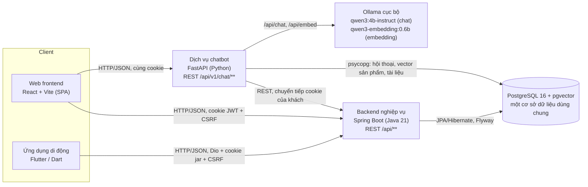
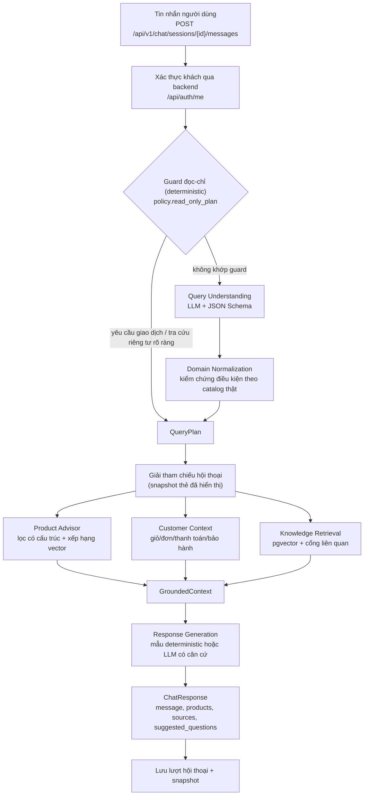

# Khảo sát công nghệ và định hướng chương Cơ sở lý thuyết

**Đề tài:** Xây dựng hệ thống cửa hàng mua bán thiết bị điện tử (dự án `QL_CHTBDT_Ecommerce`)

> Tài liệu này là **nguồn tham khảo để viết chương Cơ sở lý thuyết**, không phải bản chương hoàn chỉnh và không phải hướng dẫn cài đặt. Mọi phát biểu về hệ thống đều dựa trên mã nguồn tại thời điểm khảo sát. Phần định nghĩa và nguyên lý tổng quát vẫn cần được viết lại từ tài liệu học thuật/official documentation (mục 9).

## Mục lục

0. [Thông tin baseline khảo sát](#0-thông-tin-baseline-khảo-sát)
1. [Tổng quan các thành phần hệ thống](#1-tổng-quan-các-thành-phần-hệ-thống)
2. [Kiến trúc thực tế](#2-kiến-trúc-thực-tế)
3. [Công nghệ, phiên bản và bằng chứng mã nguồn](#3-công-nghệ-phiên-bản-và-bằng-chứng-mã-nguồn)
4. [Phân loại công nghệ: cốt lõi, hỗ trợ, chi tiết triển khai](#4-phân-loại-công-nghệ)
5. [Kiến thức nền tảng theo nhóm chủ đề](#5-kiến-thức-nền-tảng-theo-nhóm-chủ-đề)
6. [Phân tích riêng: chatbot AI](#6-phân-tích-riêng-chatbot-ai)
7. [Mapping cơ sở lý thuyết với mã nguồn](#7-mapping-cơ-sở-lý-thuyết-với-mã-nguồn)
8. [Đề xuất cấu trúc chương Cơ sở lý thuyết](#8-đề-xuất-cấu-trúc-chương-cơ-sở-lý-thuyết)
9. [Định hướng tài liệu tham khảo](#9-định-hướng-tài-liệu-tham-khảo)
10. [Phân biệt nội dung giữa các chương](#10-phân-biệt-nội-dung-giữa-các-chương)
11. [Những chủ đề không cần đưa vào chương Cơ sở lý thuyết](#11-những-chủ-đề-không-cần-đưa-vào-chương-cơ-sở-lý-thuyết)
12. [Thông tin chưa xác minh hoặc cần lưu ý](#12-thông-tin-chưa-xác-minh-hoặc-cần-lưu-ý)
13. [Tóm tắt thứ tự ưu tiên khi viết](#13-tóm-tắt-thứ-tự-ưu-tiên-khi-viết)

---

## 0. Thông tin baseline khảo sát

| Mục | Giá trị |
|---|---|
| Workspace | `QL_CHTBDT_Ecommerce` (thư mục `KLCN-QL_CHTBDT-Ecommerce-main`) |
| Branch / HEAD | `dev/thai-duy-vu` @ `df64381` |
| Thời điểm khảo sát | 2026-10-21 (UTC) |
| Working tree | Có thay đổi chưa commit từ các nhiệm vụ trước: trang chatbot khách hàng `/chatbot`, dropdown danh mục có tìm kiếm ở nhập kho, cửa sổ chọn chi nhánh bắt buộc, hotfix giỏ hàng của chatbot. Tài liệu ghi rõ khi một bằng chứng **chỉ có trong working tree**. |
| Phương pháp | Đọc manifest (`pom.xml`, `package.json`/`package-lock.json`, `pubspec.yaml`/`pubspec.lock`, `pyproject.toml`), entry point, cấu hình, các implementation tiêu biểu; đếm mẫu mã bằng tìm kiếm có kiểm soát. Không chạy test, không ghi dữ liệu. |
| Quy ước dẫn chứng | `đường/dẫn/file:dòng` theo working tree lúc khảo sát; số dòng có thể lệch nhẹ sau các commit tiếp theo. |

---

## 1. Tổng quan các thành phần hệ thống

| Thành phần | Thư mục | Ngôn ngữ / nền tảng | Vai trò |
|---|---|---|---|
| Web frontend | `Fontend/` | JavaScript, React | Storefront cho CUSTOMER và giao diện quản trị cho ADMIN/MANAGER/STAFF trong cùng một ứng dụng SPA; trang chatbot khách hàng và Chatbot Lab (công cụ dev) |
| Backend nghiệp vụ | `backend/` | Java, Spring Boot | REST API cho sản phẩm, giỏ hàng, đơn hàng, thanh toán, khuyến mãi, kho, nhập hàng, serial/IMEI, bảo hành, báo cáo, người dùng/phân quyền |
| Ứng dụng di động | `flutter/` | Dart, Flutter | Ứng dụng mua sắm cho khách hàng (sản phẩm, giỏ, checkout, đơn hàng, bảo hành, chi nhánh, hồ sơ) |
| Dịch vụ chatbot | `chatbot-service/` | Python, FastAPI | Trợ lý tư vấn/tra cứu: hiểu câu hỏi bằng LLM, kiểm chứng điều kiện, truy xuất dữ liệu sản phẩm/khách hàng/tài liệu, sinh câu trả lời có căn cứ |
| Cơ sở dữ liệu | `backend/src/main/resources/db/migration/`, `docker-compose.yml` | PostgreSQL 16 + pgvector | Lưu dữ liệu nghiệp vụ, hội thoại chatbot, vector ngữ nghĩa sản phẩm và tài liệu |
| Mô hình AI cục bộ | cấu hình trong `chatbot-service/app/shared/config.py` | Ollama | Chạy mô hình Qwen để sinh/hiểu ngôn ngữ và tạo embedding |
| Hạ tầng local | `docker-compose.yml`, `docker/postgres/init/`, `scripts/` | Docker, shell | Khởi chạy PostgreSQL/pgvector và các dịch vụ trên máy phát triển |

Phân hệ nghiệp vụ backend (theo package `backend/src/main/java/com/example/backend/`): `auth`, `brand`, `category`, `product`, `promotion`, `cart`, `order` (gồm `payment`, trả góp), `warehouse`, `inventory`, `goodsreceipt`, `supplier`, `warranty`, `customer` (gồm địa chỉ), `report`, `common` (bảo mật, xử lý lỗi, seed).

---

## 2. Kiến trúc thực tế

### 2.1. Mô tả

Hệ thống là kiến trúc **client–server nhiều thành phần**:
- Hai client (web SPA và mobile) giao tiếp với backend bằng **REST/HTTP + JSON**.
- Backend Spring Boot là một **ứng dụng nguyên khối theo module nghiệp vụ** (modular monolith): một tiến trình, một cơ sở dữ liệu, các package tách theo miền.
- Dịch vụ chatbot được **tách thành một tiến trình riêng** bằng ngôn ngữ khác (Python). Nó gọi backend qua REST API có xác thực của khách hàng và truy cập trực tiếp một số bảng/vector trong cùng PostgreSQL.

Không nên gọi hệ thống là *microservices architecture*. Chỉ có hai dịch vụ server, chúng **dùng chung một cơ sở dữ liệu** (bảng hội thoại được tạo bằng migration Flyway của backend), và không có service discovery, message broker hay triển khai độc lập theo từng dịch vụ trong repository. Cách gọi phù hợp: *kiến trúc client–server với backend nghiệp vụ dạng modular monolith và một dịch vụ AI tách riêng*.

Bằng chứng các kết nối:

| Kết nối | Bằng chứng |
|---|---|
| Web → Backend (`/api/**`) và Web → Chatbot (`/api/v1/chat/**`) | `Fontend/vite.config.js:12-21` (proxy dev, `/api/v1/chat` khai báo trước `/api`); `Fontend/src/api/apiClient.js:37-85` (fetch, `credentials: 'include'` dòng 56, header CSRF dòng 46-48); `Fontend/src/features/chatbot/chatbotApi.js` |
| Mobile → Backend | `flutter/lib/core/network/api_client.dart:9-12` (`API_BASE_URL`, mặc định `http://127.0.0.1:8080`), dòng 39-47 (Dio + `CookieManager`) |
| Mobile → Chatbot | **Không có** (không tìm thấy `v1/chat` trong `flutter/lib`) |
| Backend → Chatbot / Ollama | **Không có** (không có tham chiếu trong `backend/src/main`) |
| Chatbot → Backend | `chatbot-service/app/shared/backend/client.py` (`/api/auth/me`, `/api/cart`, `/api/orders/mine`, `/api/warranties/mine`, `/api/warranties/mine/tickets`); `chatbot-service/app/features/product_advisor/backend.py` (`/api/v1/categories`, `/api/v1/brands`, `/api/v1/products`, `/api/v1/products/search/advanced`, `/api/v1/products/{id}/detail`, `/api/v1/product-variants`) |
| Chatbot → PostgreSQL | `conversation/postgres_repository.py` (`chat_sessions`, `chat_history`, advisory lock dòng 57-63); `product_advisor/semantic.py` (`product_semantic_index`); `knowledge/repository.py` (`knowledge_documents`, `knowledge_chunks`) |
| Chatbot → Ollama | `chatbot-service/app/shared/ollama/client.py:84-99` (`/api/chat`, `/api/embed`) |
| Backend → PostgreSQL | `backend/pom.xml` (`spring-boot-starter-data-jpa`, `postgresql`, Flyway); `backend/src/main/resources/application-dev.yml` (`ddl-auto: validate`) |

### 2.2. Sơ đồ tổng thể

Điều kiện chạy cần nêu khi dùng sơ đồ:
- Đường Web → Chatbot qua proxy Vite chỉ được cấu hình cho môi trường dev. Repo chưa có cấu hình reverse proxy production.
- Chatbot có các chế độ: AI bật/tắt (`CHATBOT_AI_ENABLED`), Product Advisor `mock`/`real`, lưu hội thoại `memory`/`postgres` (`chatbot-service/app/shared/config.py`). **Mặc định là mock/memory/AI tắt.** Mũi tên tới Ollama, backend sản phẩm và PostgreSQL chỉ có khi chạy chế độ thật.

### 2.3. Sơ đồ luồng xử lý của chatbot

---

## 3. Công nghệ, phiên bản và bằng chứng mã nguồn

Phiên bản chỉ ghi khi manifest/lock file cung cấp. "Khai báo" là ràng buộc trong manifest; "Khóa" là bản cụ thể trong lock file hoặc môi trường cài đặt.

### 3.1. Backend (`backend/pom.xml`)

| Công nghệ | Phiên bản | Bằng chứng |
|---|---|---|
| Java | 21 (`java.version`) | `backend/pom.xml:30` |
| Spring Boot (parent) | 4.1.1 | `backend/pom.xml:6-8` |
| Spring Web MVC | theo Spring Boot | `spring-boot-starter-web`; 32 lớp `@RestController` |
| Spring Data JPA (Hibernate là provider mặc định của starter) | theo Spring Boot | `spring-boot-starter-data-jpa`; 43 lớp `@Entity`, 31 repository `extends JpaRepository` |
| PostgreSQL JDBC driver | theo Spring Boot | `org.postgresql:postgresql` |
| Bean Validation | theo Spring Boot | `spring-boot-starter-validation`; `@Valid` ở 29 file, ràng buộc `@NotBlank/@NotNull/@Size/...` ở 35 file |
| Flyway | theo Spring Boot | `spring-boot-starter-flyway`, `flyway-database-postgresql`; migration V1–V8 |
| Spring Security | theo Spring Boot | `spring-boot-starter-security`; `common/security/SecurityConfig.java` |
| JJWT | 0.12.6 | `jjwt-api/impl/jackson` trong `pom.xml:114-129`; `auth/service/JwtServiceImpl.java` |
| JUnit / Spring Boot Test / MockMvc / Spring Security Test | theo Spring Boot | `spring-boot-starter-test`, `spring-boot-starter-webmvc-test`, `spring-security-test` |
| Testcontainers (PostgreSQL) | 1.20.6 | `pom.xml:31, 93-101`; 27 lớp test, 8 lớp `*IntegrationTest` |
| springboot4-dotenv | 5.1.0 | `pom.xml:105-107`. Không có tham chiếu trực tiếp trong mã (thư viện tự cấu hình), xem mục 12 |
| Lombok | theo Spring Boot | Khai báo trong `pom.xml`; chỉ 1 file dùng annotation Lombok. Là chi tiết phụ |
| Maven Wrapper | — | `backend/mvnw` |

### 3.2. Web frontend (`Fontend/package.json`, `package-lock.json`)

| Công nghệ | Khai báo | Khóa | Bằng chứng sử dụng |
|---|---|---|---|
| React / React DOM | ^19.3.0 | 19.3.0 | `Fontend/src/main.jsx` (`createRoot`, `StrictMode`) |
| React Router (`react-router`) | ^7.18.4 | 7.18.4 | `Fontend/src/App.jsx` (`Routes`, `Route`, lồng layout và guard) |
| Vite (+ `@vitejs/plugin-react`) | ^8.3.0 | 8.3.0 | `Fontend/vite.config.js` (dev server, proxy, cấu hình test) |
| Vitest | ^4.1.11 | 4.1.11 | `package.json` scripts `test`; 14 file `*.test.js(x)` |
| React Testing Library, user-event, jest-dom, jsdom | ^16.3.3 / ^14.6.7 / ^6.9.1 / ^29.1.1 | — | các file test trong `Fontend/src/**` |
| ESLint (+ react-hooks, react-refresh) | ^10.10.0 | 10.10.0 | `package.json` script `lint` |
| Recharts | ^3.10.1 | 3.10.1 | `Fontend/src/features/reports/components/ReportCharts.jsx` |
| Node.js (yêu cầu) | `^20.19.0 \|\| >=22.12.0` | — | `package.json` `engines` |

### 3.3. Ứng dụng di động (`flutter/pubspec.yaml`, `pubspec.lock`)

| Công nghệ | Khai báo | Khóa | Bằng chứng sử dụng |
|---|---|---|---|
| Dart SDK | ^3.10.7 | — | `pubspec.yaml` `environment` |
| Flutter (Material 3) | SDK | — | `flutter/lib/main.dart:26-40` (`MaterialApp.router`, `useMaterial3`) |
| flutter_riverpod | ^2.5.1 | 2.6.1 | `main.dart:16` (`ProviderScope`); providers trong `lib/features/*/presentation/providers/` (Provider, FutureProvider, StateNotifierProvider, StateProvider) |
| go_router | ^13.2.0 | 13.2.5 | `lib/core/router/app_router.dart:10-21` (`GoRouter`, `redirect`) |
| dio | ^5.4.2 | 5.11.1 | `lib/core/network/api_client.dart:39-47` |
| cookie_jar + dio_cookie_manager | ^4.0.9 / ^3.1.1 | 4.0.9 / 3.5.0 | `lib/core/storage/cookie_storage.dart:6-13` (`PersistCookieJar`); `lib/core/network/auth_interceptor.dart` (gắn `X-XSRF-TOKEN`) |
| path_provider | ^2.1.2 | — | thư mục lưu cookie trong `cookie_storage.dart` |
| url_launcher | ^6.2.5 | — | `lib/features/checkout/presentation/pages/checkout_screen.dart:120` (`launchUrl` mở URL thanh toán) |
| flutter_secure_storage | ^9.0.0 | — | **Có khai báo dependency, chưa xác minh việc sử dụng** (không tìm thấy trong `lib/`) |
| flutter_test, flutter_lints | dev | — | `flutter/test/` (4 file) |

### 3.4. Dịch vụ chatbot (`chatbot-service/pyproject.toml`)

| Công nghệ | Khai báo | Bản cài đặt trong `.venv` | Bằng chứng |
|---|---|---|---|
| Python | `>=3.12` | 3.12.15 | `pyproject.toml` |
| FastAPI | không ghim | 0.142.2 | `chatbot-service/app/main.py`, `app/features/chat/router.py` |
| Uvicorn | không ghim | 0.54.0 | ASGI server (`scripts/start.sh`) |
| Pydantic / pydantic-settings | `>=2` / không ghim | 2.13.5 / 2.15.0 | hợp đồng dữ liệu `app/shared/contracts/*.py`; cấu hình `app/shared/config.py` |
| httpx | không ghim | 0.28.1 | gọi backend và Ollama (`app/shared/backend/client.py`, `app/shared/ollama/client.py`) |
| psycopg (v3) | `>=3.2,<4` | 3.3.6 | truy cập PostgreSQL/pgvector |
| pytest (+ pytest-asyncio) | dev | 9.1.1 | `chatbot-service/tests/` (37 file) |
| Ollama + Qwen | cấu hình runtime | `qwen3:4b-instruct`, `qwen3-embedding:0.6b` | `app/shared/config.py` (`ollama_chat_model`, `ollama_embedding_model`) |

Không có OpenAI SDK, LangChain hay LlamaIndex. Không có mã huấn luyện hay fine-tuning.

### 3.5. Cơ sở dữ liệu và hạ tầng

| Công nghệ | Phiên bản / chi tiết | Bằng chứng |
|---|---|---|
| PostgreSQL + pgvector | image `pgvector/pgvector:pg16` | `docker-compose.yml`; `docker/postgres/init/01-enable-pgvector.sql` (`CREATE EXTENSION IF NOT EXISTS vector`) |
| Migration | Flyway V1–V8: 49 bảng; 74 khóa ngoại, 53 ràng buộc CHECK, 35 ràng buộc/chỉ mục UNIQUE, 95 câu lệnh tạo index (đếm thô) | `backend/src/main/resources/db/migration/` |
| Kiểu vector | `knowledge_chunks.embedding_vector VECTOR` (V1, dòng ~1355); `product_semantic_index.embedding_vector vector` (V7, dòng 8) | không khai báo số chiều cố định; **không có index ANN (HNSW/IVFFlat)** |
| Docker Compose | dịch vụ `postgres`, healthcheck `pg_isready`, cổng bind `127.0.0.1` | `docker-compose.yml` |
| Script vận hành | `start.sh`, `stop.sh`, `build.sh`, `test-backend.sh`, `env.sh`, `git.sh` | `scripts/` |

---

## 4. Phân loại công nghệ

**A** = cốt lõi, cần trình bày trong Cơ sở lý thuyết; **B** = hỗ trợ, giới thiệu ngắn; **C** = chi tiết triển khai (đưa vào chương Thiết kế/Triển khai/Kiểm thử).

| Công nghệ / Khái niệm | Nhóm | Vai trò trong hệ thống | Bằng chứng mã nguồn | Trạng thái xác minh | Mức ưu tiên |
|---|---|---|---|---|---|
| Kiến trúc client–server, REST, HTTP, JSON | Kiến trúc | Cách web/mobile/chatbot giao tiếp với backend | `SecurityConfig.java`, các `@RestController`, `apiClient.js`, `api_client.dart` | Đã xác minh | **A** |
| Kiến trúc phân lớp Controller–Service–Repository, DTO | Kiến trúc backend | Tổ chức mã từng module nghiệp vụ | `backend/.../order/{controller,service,repository,dto}` | Đã xác minh | **A** |
| Java 21 + Spring Boot (IoC/DI, auto-configuration) | Backend | Nền tảng backend | `pom.xml`, `BackendApplication.java:6`, constructor injection (ví dụ `CartServiceImpl`) | Đã xác minh | **A** |
| JPA / ORM (Hibernate), Spring Data repository | Backend / CSDL | Ánh xạ thực thể – bảng, truy vấn | 43 `@Entity`, 31 `JpaRepository`, `@ManyToOne` ở `product/entity/Product.java:30` | Đã xác minh (Hibernate là provider mặc định của starter) | **A** |
| Transaction, ACID, khóa bi quan | CSDL / Backend | Đảm bảo nhất quán khi checkout, đổi trạng thái đơn, khuyến mãi | `@Transactional` ở 41 file; `@Lock(PESSIMISTIC_WRITE)` ở 10 vị trí (ví dụ `OrderRepository.java:10`); `isolation = REPEATABLE_READ` ở `ReportServiceImpl.java:18` | Đã xác minh | **A** |
| PostgreSQL, mô hình quan hệ, ràng buộc toàn vẹn, index | CSDL | Lưu trữ toàn bộ dữ liệu | migration V1–V8 | Đã xác minh | **A** |
| Flyway (database migration) | CSDL | Quản lý phiên bản schema; `ddl-auto: validate` | `db/migration/V1..V8`, `application-dev.yml` | Đã xác minh | **B** |
| Spring Security, xác thực/ủy quyền | Bảo mật | Bảo vệ API | `SecurityConfig.java:42-115` | Đã xác minh | **A** |
| JWT (HS256), access/refresh token | Bảo mật | Phiên đăng nhập stateless | `JwtServiceImpl.java:39-80`; `RefreshTokenServiceImpl.java:53` (xoay vòng), `:171` (băm SHA-256) | Đã xác minh | **A** |
| Cookie HttpOnly, SameSite, CSRF (double-submit qua cookie) | Bảo mật web | Lưu token an toàn, chống CSRF | `AuthCookieService.java:96-131`; `SecurityConfig.java:76-80`; `apiClient.js:46-48`; `auth_interceptor.dart` | Đã xác minh | **A** |
| RBAC (vai trò, quyền) | Bảo mật | ADMIN/MANAGER/STAFF/CUSTOMER; bảng `roles`, `permissions`, `role_permissions` | `@RequireAnyAuthority` + interceptor (`SecurityConfig.java:45-65`); `@PreAuthorize` ở 5 controller; `RequireRole.jsx` | Đã xác minh | **A** |
| Băm mật khẩu BCrypt | Bảo mật | Lưu mật khẩu | `PasswordConfig.java:13` | Đã xác minh | **B** (gộp vào mục bảo mật) |
| CORS | Bảo mật web | Cho phép origin frontend | `SecurityConfig.java:122+`, `app.cors.allowed-origins` | Đã xác minh | **B** |
| React, component, JSX, Hooks, Context | Frontend | Giao diện web | `main.jsx`, `App.jsx`, `AuthContext.jsx`, `CartProvider.jsx`, `WarehouseProvider.jsx` | Đã xác minh | **A** |
| SPA và client-side routing (React Router) | Frontend | Điều hướng, guard theo vai trò, lazy loading | `App.jsx` (`RequireAuth`, `RequireRole`, `lazy`) | Đã xác minh | **A** (có thể gộp với React) |
| Vite | Công cụ build | Dev server, bundling, proxy | `vite.config.js` | Đã xác minh | **B** |
| Responsive Web Design | Frontend | Hiển thị desktop/tablet/mobile | media query trong `styles/index.css`, `styles/storefront.css` | Đã xác minh | **B** |
| Flutter, Dart, widget tree, declarative UI | Mobile | Ứng dụng di động | `flutter/lib/main.dart`, `lib/features/**/presentation` | Đã xác minh | **A** |
| Riverpod (state management) | Mobile | Quản lý trạng thái, inject repository | `ProviderScope`; providers theo feature | Đã xác minh | **A** (trong mục Mobile) |
| GoRouter, Dio, cookie jar | Mobile | Điều hướng, HTTP, phiên | `app_router.dart`, `api_client.dart`, `cookie_storage.dart` | Đã xác minh | **B** |
| FastAPI, Pydantic (schema validation), ASGI/async | Chatbot | Web service chatbot, hợp đồng dữ liệu | `app/main.py`, `app/shared/contracts/*.py` | Đã xác minh | **B** |
| LLM, Transformer (mức khái niệm) | AI | Hiểu ý định, sinh câu trả lời | `query_understanding/ollama_service.py`, `response_generation/ollama_service.py` | Đã xác minh dùng LLM; Transformer là nền tảng của Qwen (lý thuyết) | **A** |
| Prompt engineering, structured output (JSON Schema) | AI | Buộc LLM trả về `QueryPlan` hợp lệ | `query_understanding/ollama_service.py:24-56`; `shared/ollama/client.py:85-88` (`format`, `temperature: 0`) | Đã xác minh | **A** |
| Intent classification, slot extraction | AI/NLP | 12 intent của `Intent`; bộ lọc giá/RAM/hãng | `shared/contracts/enums.py`, `shared/contracts/query.py:57` | Đã xác minh | **A** |
| Kiểm chứng tất định (deterministic validation), grounding, chống hallucination | AI | Không để LLM tự tạo giá/tồn kho/đơn | `normalization.py:50`, `constraints.py:368` (`ProductEvidence`), `response_generation/ollama_service.py:20-101` | Đã xác minh | **A** |
| Text embedding, cosine similarity, vector search, pgvector | AI/CSDL | Xếp hạng sản phẩm theo ngữ nghĩa, tìm tài liệu | `semantic.py:99` (`<=>`), `knowledge/repository.py:96`, migration V7 | Đã xác minh (truy vấn chính xác, không có index ANN) | **A** |
| RAG (Retrieval-Augmented Generation) | AI | Trả lời chính sách dựa trên tài liệu | `knowledge/service.py:18-77`, `chat/service.py:245` | Đã triển khai cơ chế; kho tài liệu hiện chỉ có tài liệu DEMO | **A** (trình bày kèm giới hạn) |
| Ngữ cảnh hội thoại nhiều lượt | AI | Lịch sử đã hoàn tất + giải tham chiếu | `conversation/context.py:5`, `conversation/references.py:34` | Đã xác minh | **B** |
| Ollama, Qwen | Công cụ AI | Chạy mô hình cục bộ | `shared/ollama/client.py`, `config.py` | Đã xác minh cấu hình và client; chạy thật phụ thuộc môi trường | **B** |
| Miền thương mại điện tử: sản phẩm–biến thể–SKU, giỏ, đơn, thanh toán, khuyến mãi, kho, nhập hàng, serial/IMEI, bảo hành | Nghiệp vụ | Phạm vi chức năng | các package backend, migration V1–V8 | Đã xác minh | **A** (khái niệm miền) / **C** (quy tắc riêng) |
| VNPay (chữ ký HMAC-SHA512) | Thanh toán | Tích hợp sandbox, **tắt mặc định** | `VnpaySignature.java:27`; `app.payment.vnpay.enabled=false` | Đã xác minh mã; không xác minh chạy thật | **C** (nhắc ngắn ở thanh toán) |
| Recharts | Frontend | Biểu đồ báo cáo | `ReportCharts.jsx` | Đã xác minh | **C** |
| Vitest, RTL, JUnit, MockMvc, Testcontainers, pytest, flutter_test | Kiểm thử | Kiểm thử tự động | xem mục 3 | Đã xác minh | **C** (chương Kiểm thử); có thể nhắc 1 đoạn ở mục công cụ |
| Docker, Docker Compose | Hạ tầng | Chạy PostgreSQL/pgvector | `docker-compose.yml` | Đã xác minh | **B** |
| Advisory lock, async offload, tracing có che dữ liệu | Chatbot | Tuần tự hóa lượt chat, không chặn event loop | `postgres_repository.py:57-63`, `async_lease.py:16`, `tracing/__init__.py:24` | Đã xác minh | **C** |
| Lombok, springboot4-dotenv, path_provider | Thư viện phụ | Tiện ích | manifest | Khai báo; mức dùng rất ít/không trực tiếp | **C** |

Tổng cộng 37 dòng phân loại: 20 thuộc nhóm A (có dòng gộp nhiều khái niệm), 9 thuộc B, 8 thuộc C.

---

## 5. Kiến thức nền tảng theo nhóm chủ đề

Mỗi mục gồm: công nghệ là gì, khái niệm cần nắm, vai trò trong đề tài, lý do nên trình bày, độ sâu đề xuất và bằng chứng.

### 5.1. Nhóm 1 — Kiến trúc hệ thống

**Client–Server, REST, HTTP/JSON**
- *Là gì:* mô hình phân tách bên yêu cầu (client) và bên cung cấp dịch vụ (server). REST là phong cách thiết kế API dựa trên tài nguyên, phương thức HTTP chuẩn và giao tiếp không trạng thái; JSON là định dạng trao đổi dữ liệu.
- *Khái niệm:* tài nguyên và URI, phương thức GET/POST/PUT/PATCH/DELETE, mã trạng thái (200/201/204/400/401/403/404/409/5xx), header, statelessness, idempotency.
- *Vai trò:* mọi client và cả chatbot đều dùng REST JSON. Hệ thống dùng nhất quán các mã lỗi nghiệp vụ, ví dụ 409 khi xung đột trạng thái (`CartServiceImpl.java:45-60` chọn chi nhánh khi giỏ còn hàng; `PromotionServiceImpl.java:88`).
- *Độ sâu:* vừa. Không cần lịch sử HTTP; nên có bảng phương thức/mã trạng thái gắn ví dụ API của đề tài.
- *Bằng chứng:* `backend/.../controller/*.java` (32 lớp); `Fontend/src/api/apiClient.js`; `flutter/lib/core/network/api_client.dart`.

**Kiến trúc phân lớp và DTO**
- *Khái niệm:* Controller (giao tiếp HTTP), Service (nghiệp vụ, transaction), Repository (truy cập dữ liệu), Entity (ánh xạ bảng), DTO (dữ liệu vào/ra API, tách khỏi entity), validation ở biên, xử lý lỗi tập trung.
- *Vai trò:* mọi module backend theo cấu trúc `controller/service/repository/entity/dto`; lỗi được ánh xạ tập trung ở `GlobalExceptionHandler.java:42`.
- *Độ sâu:* vừa. Nên có hình minh họa luồng request qua các lớp.
- *Lưu ý:* sơ đồ lớp/package cụ thể thuộc chương Thiết kế.

**Hệ thống nhiều thành phần**
- *Vai trò:* backend Java và chatbot Python là hai dịch vụ với trách nhiệm khác nhau. Chatbot không tự ghi dữ liệu nghiệp vụ mà đọc qua API có xác thực của backend.
- *Độ sâu:* ngắn. Trình bày như lý do tách dịch vụ AI (khác ngôn ngữ/thư viện, khác đặc tính tài nguyên), không gọi là microservices (mục 2.1).

**Quản lý trạng thái client–server**
- *Khái niệm:* server stateless (JWT), trạng thái phiên ở cookie; trạng thái giao diện ở client (React Context/Hooks, Riverpod). Dữ liệu nguồn (giỏ, đơn) luôn đọc lại từ server.
- *Bằng chứng:* `SecurityConfig.java:85` (`STATELESS`); `CartProvider.jsx:12`; `WarehouseProvider.jsx`.
- *Độ sâu:* ngắn, lồng trong mục Frontend/Mobile.

### 5.2. Nhóm 2 — Backend

**Java và Spring Boot**
- *Là gì:* Java là ngôn ngữ hướng đối tượng chạy trên JVM. Spring Framework cung cấp IoC container và Dependency Injection; Spring Boot thêm auto-configuration, starter dependencies và embedded server.
- *Khái niệm cần nắm:* Bean, IoC container, Dependency Injection qua constructor, auto-configuration, cấu hình theo profile (`application-dev.yml`) và thuộc tính (`application.properties`), annotation `@RestController`, `@Service`, `@Repository`.
- *Vai trò:* toàn bộ backend; DI qua constructor phổ biến (ví dụ `CartServiceImpl` nhận repository qua constructor).
- *Độ sâu:* vừa – chuyên sâu (công nghệ trung tâm).
- *Bằng chứng:* `pom.xml:6-30`, `BackendApplication.java:6`.

**Spring Web MVC / REST Controller**
- *Khái niệm:* `DispatcherServlet`, ánh xạ request (`@GetMapping`…), `@RequestBody`/`@PathVariable`/`@RequestParam`, `ResponseEntity`, serialization JSON.
- *Độ sâu:* ngắn – vừa, gộp với Spring Boot.

**Spring Data JPA, JPA/Hibernate (ORM)**
- *Khái niệm:* Object–Relational Mapping, Entity và vòng đời persistence context, quan hệ `@ManyToOne` (LAZY), repository interface, truy vấn dẫn xuất từ tên phương thức, JPQL `@Query`, Specification cho bộ lọc động, `open-in-view: false`, `ddl-auto: validate` (schema do migration quản lý).
- *Vai trò:* truy cập dữ liệu cho mọi module. Truy vấn phức tạp (tìm kiếm nâng cao, báo cáo) dùng SQL gốc qua `JdbcTemplate`/native query.
- *Bằng chứng:* 43 `@Entity`, 31 `JpaRepository`, 14 file dùng `Specification`, 14 file `@Query`; `product/service/ProductAdvancedSearchService.java:44` (SQL); `report/repository/ReportRepository.java`.
- *Độ sâu:* vừa.

**Transaction management**
- *Khái niệm:* `@Transactional` khai báo, read-only transaction, mức cô lập (isolation level), khóa bi quan (`PESSIMISTIC_WRITE`, tương đương `SELECT … FOR UPDATE`), rollback khi ngoại lệ.
- *Vai trò:* checkout khóa hồ sơ khách và tạo đơn trong một transaction (`OrderServiceImpl.java:66-72`); chuyển trạng thái đơn/thanh toán khóa đơn và payment (`OrderServiceImpl.java:163-167`); báo cáo dùng `REPEATABLE_READ` (`ReportServiceImpl.java:18`). Chỉ ghi mức cô lập ở những nơi có khai báo; các nơi khác dùng mặc định của CSDL.
- *Độ sâu:* vừa. Nên gắn với lý thuyết ACID ở Nhóm 5.

**Bean Validation**
- *Khái niệm:* ràng buộc khai báo trên DTO (`@NotBlank`, `@NotNull`, `@Size`, `@Positive`, `@Pattern`, `@Email`…), kích hoạt bằng `@Valid`, phản hồi 400.
- *Bằng chứng:* `@Valid` ở 29 file, ràng buộc ở 35 file.
- *Độ sâu:* ngắn.

**Spring Security, xác thực và phân quyền** (chi tiết ở 5.7).

### 5.3. Nhóm 3 — Frontend web

**JavaScript, React, component, JSX, Hooks**
- *Là gì:* React là **thư viện** xây dựng giao diện theo component, không phải framework đầy đủ. JSX là cú pháp mô tả cây giao diện. Hooks (`useState`, `useEffect`, `useMemo`, `useRef`, `useContext`…) quản lý trạng thái và side effect trong function component.
- *Khái niệm cần nắm:* Virtual DOM và reconciliation (mức khái niệm), props/state, render một chiều, lifting state, Context API, lazy loading (`React.lazy` + `Suspense`), StrictMode.
- *Vai trò:* storefront và quản trị trong một SPA. Trạng thái dùng chung (phiên đăng nhập, giỏ hàng, chi nhánh) được tổ chức bằng **Context + Provider**, không dùng Redux (`Fontend/src/main.jsx:14`: `AuthProvider > CartProvider > WarehouseProvider > App`).
- *Độ sâu:* vừa – chuyên sâu.
- *Bằng chứng:* `src/auth/AuthContext.jsx:7`, `src/features/cart/CartProvider.jsx:12`, `src/features/warehouses/WarehouseProvider.jsx`; `App.jsx:42` (lazy route).

**React Router và client-side routing**
- *Khái niệm:* SPA, history API, route lồng nhau, layout route, route guard, redirect sau đăng nhập.
- *Vai trò:* `RequireAuth`/`RequireRole` bảo vệ route theo vai trò (`App.jsx:57-104`, `RequireRole.jsx:10`). Layout storefront và layout quản trị được chọn theo vai trò trong `components/layout/AppLayout.jsx`.
- *Độ sâu:* ngắn – vừa, gộp với React.

**Tích hợp REST bằng Fetch API**
- *Khái niệm:* `fetch`, `credentials: 'include'` để gửi cookie, header CSRF cho phương thức ghi, timeout bằng `AbortSignal`, chuẩn hóa lỗi.
- *Bằng chứng:* `src/api/apiClient.js:23-90`; `src/features/orders/api/orderApi.js:3` (tự làm mới token khi 401).
- *Độ sâu:* ngắn.

**Vite (công cụ build), Responsive Web Design**
- Phân biệt rõ ba loại: **thư viện UI** (React), **công cụ build/dev server** (Vite, kèm proxy `/api` và `/api/v1/chat`), **công cụ kiểm thử** (Vitest + React Testing Library + jsdom).
- Responsive bằng CSS thuần (media query, grid/flex), không dùng UI framework bên ngoài.
- *Độ sâu:* ngắn.

### 5.4. Nhóm 4 — Mobile

**Flutter, Dart, widget tree, declarative UI**
- *Là gì:* Flutter là **framework** UI đa nền tảng; Dart là **ngôn ngữ**. Giao diện được mô tả bằng cây widget theo kiểu declarative (UI là hàm của state).
- *Khái niệm:* StatelessWidget/StatefulWidget, `BuildContext`, Material 3/theme, async/await trong Dart.
- *Bằng chứng:* `flutter/lib/main.dart:9-40`.
- *Độ sâu:* vừa.

**Riverpod (state management)**
- *Khái niệm:* provider là nguồn trạng thái/phụ thuộc có thể quan sát; `ProviderScope`; `ref.watch`/`ref.read`; `FutureProvider` (dữ liệu bất đồng bộ), `StateNotifierProvider` (trạng thái có hành vi), `StateProvider`; `autoDispose`/`family`.
- *Vai trò:* mỗi feature có thư mục `presentation/providers/` (auth, cart, checkout, orders, products, profile, warehouse, warranty).
- *Độ sâu:* vừa, trong mục Mobile.

**GoRouter, Dio, cookie và CSRF**
- *Vai trò:* điều hướng khai báo với `redirect` theo trạng thái đăng nhập (`app_router.dart:10-21`). Dio + `PersistCookieJar` lưu cookie JWT bền vững. Interceptor lấy và gắn `X-XSRF-TOKEN` (`auth_interceptor.dart`), cùng giao thức với web.
- *Độ sâu:* ngắn.

**Tổ chức feature module**
- `lib/core/{network,router,storage}` và `lib/features/<feature>/{data,presentation}`: phân tách lớp dữ liệu (repository gọi API) và lớp trình bày.
- *Độ sâu:* ngắn. Chi tiết cây thư mục đưa vào chương Triển khai.

### 5.5. Nhóm 5 — Cơ sở dữ liệu

**Cơ sở dữ liệu quan hệ, PostgreSQL, SQL**
- *Khái niệm:* quan hệ/bảng/bộ, khóa chính, khóa ngoại, ràng buộc CHECK/UNIQUE/NOT NULL, chuẩn hóa (1NF–3NF), SQL DDL/DML, index (B-tree).
- *Vai trò:* 49 bảng; khóa chính UUID sinh bằng `gen_random_uuid()` (V1 dòng 25, 51…); 74 khóa ngoại, 53 CHECK, 35 UNIQUE, 95 index (đếm thô trên V1–V8).
- *Độ sâu:* vừa. Lý thuyết chung ở đây; ERD và danh sách bảng ở chương Thiết kế.

**Transaction, ACID, concurrency, locking**
- *Khái niệm:* Atomicity, Consistency, Isolation, Durability; các mức cô lập; khóa bi quan/lạc quan; deadlock (mức khái niệm).
- *Vai trò:* khóa bi quan (10 vị trí `@Lock(PESSIMISTIC_WRITE)`), `REPEATABLE_READ` cho báo cáo, advisory lock của PostgreSQL để tuần tự hóa lượt chat cùng phiên (`chatbot-service/.../postgres_repository.py:57-63`). Không có `@Version` (khóa lạc quan) trong backend.
- *Độ sâu:* vừa. Chỉ nêu những cơ chế có trong mã, không suy diễn thêm.

**Database migration và Flyway**
- *Khái niệm:* version hóa schema, migration có thứ tự (V1…V8), áp dụng một lần, xác thực schema khi khởi động (`ddl-auto: validate`).
- *Độ sâu:* ngắn.

**Dữ liệu vector và pgvector**
- *Khái niệm:* kiểu `vector`, các toán tử khoảng cách (cosine `<=>`), tìm kiếm k láng giềng gần nhất (exact và xấp xỉ – ANN như HNSW/IVFFlat).
- *Vai trò:* hai bảng vector (`knowledge_chunks`, `product_semantic_index`). Truy vấn dùng `1 - (embedding_vector <=> query)` làm điểm cosine similarity, `ORDER BY … LIMIT k`, lọc theo `vector_dims` và tên mô hình embedding (`knowledge/repository.py:94-98`, `product_advisor/semantic.py:99-110`). **Không có index ANN**, tức là tìm kiếm chính xác. Phù hợp quy mô dữ liệu hiện tại, nhưng cần nêu như một giới hạn khi mở rộng.
- *Độ sâu:* vừa (cầu nối giữa CSDL và AI).

### 5.6. Nhóm 6 — Miền thương mại điện tử

| Khái niệm | Loại nội dung | Ghi chú / bằng chứng |
|---|---|---|
| Sản phẩm, biến thể (variant), SKU, thông số, hình ảnh, thương hiệu, danh mục | **Kiến thức miền** (nên có trong Cơ sở lý thuyết, ngắn) | `product/entity/{Product,ProductVariant,Specification,ProductImage,Brand}.java`. Biến thể theo RAM/bộ nhớ/màu là đặc thù thiết bị điện tử |
| Giỏ hàng, checkout, đơn hàng, vòng đời trạng thái đơn | Kiến thức miền + **quy tắc riêng** | Chuyển trạng thái cho phép nằm ở `order/service/OrderTransitions.java:5` (quy tắc riêng → chương Phân tích) |
| Thanh toán (COD, trả góp nội bộ, VNPay sandbox) | Kiến thức miền; tích hợp cổng thanh toán chỉ nhắc ngắn | VNPay ký HMAC-SHA512 (`VnpaySignature.java:27`), tắt mặc định |
| Khuyến mãi | Kiến thức miền; quy tắc chồng lấn là **quy tắc riêng** | `PromotionServiceImpl.java:88-108` (409 khi chồng lấn) |
| Kho/chi nhánh, tồn kho, giữ chỗ | Kiến thức miền | `inventory/entity/Inventory.java`; giỏ hàng gắn chi nhánh (`CartServiceImpl.java:45`) |
| Phiếu nhập kho (goods receipt), nhà cung cấp | Kiến thức miền | `goodsreceipt/entity/*` |
| Serial number và IMEI, tracking type | Kiến thức miền đặc thù thiết bị điện tử (nên trình bày) | `ProductTrackingType.java`, `GoodsReceiptItemDevice(Imei).java` |
| Bảo hành, phiếu yêu cầu bảo hành | Kiến thức miền | `warranty/entity/{Warranty,WarrantyTicket}.java` |

Gợi ý: chương Cơ sở lý thuyết chỉ cần **một mục tổng quan** về thương mại điện tử và đặc thù kinh doanh thiết bị điện tử (biến thể, quản lý theo serial/IMEI, bảo hành theo thiết bị, tồn kho theo chi nhánh). Quy trình chi tiết và quy tắc của phần mềm thuộc chương Phân tích hệ thống.

### 5.7. Bảo mật, xác thực và phân quyền (thuộc Nhóm 2, tách riêng vì quan trọng)

| Khái niệm | Ứng dụng | Bằng chứng |
|---|---|---|
| Authentication / Authorization | Spring Security filter chain; mọi request cần xác thực trừ danh sách công khai | `SecurityConfig.java:91-106` |
| JWT (header.payload.signature, claims, HS256, `iss`/`aud`, hết hạn) | Access token 15 phút, refresh token 7 ngày; kiểm tra thuật toán HS256 | `application.properties` (`app.jwt.*`); `JwtServiceImpl.java:39-80` |
| Stateless session | Không có session server; filter đọc JWT từ cookie | `SecurityConfig.java:85`; `JwtAuthenticationFilter.java:106` |
| Cookie HttpOnly / Secure / SameSite | Token trong cookie HttpOnly; `Secure` và `SameSite` (mặc định `Lax`) cấu hình qua biến môi trường | `AuthCookieService.java:96-131`; `application.properties` |
| Refresh token rotation, lưu băm | Xoay vòng refresh token, lưu SHA-256, thu hồi | `RefreshTokenServiceImpl.java:53, 86, 171`; migration V2 |
| CSRF | `CookieCsrfTokenRepository`: cookie `XSRF-TOKEN` đọc được bởi JS, client gửi header `X-XSRF-TOKEN` (double-submit) | `SecurityConfig.java:72-80`; web `apiClient.js:26-35, 46-48`; mobile `auth_interceptor.dart` |
| Băm mật khẩu | BCrypt | `PasswordConfig.java:13` |
| RBAC | 4 vai trò; quyền theo bảng `permissions`/`role_permissions`; annotation tùy biến `@RequireAnyAuthority` kiểm tra bằng `AuthorityAuthorizationManager`; `@PreAuthorize` ở controller quản trị; guard route phía client chỉ là trải nghiệm, server mới là bên quyết định | `SecurityConfig.java:45-65`; `RequireAnyAuthority.java`; `RequireRole.jsx` |
| Bảo vệ dữ liệu sở hữu (owned resources) | API `/mine` theo người dùng hiện tại; chatbot chuyển tiếp cookie của chính khách | `chatbot-service/app/shared/backend/client.py`; `CartController` (`@AuthenticationPrincipal`) |
| CORS | Danh sách origin cấu hình | `SecurityConfig.java:122+` |

Độ sâu đề xuất: **vừa – chuyên sâu**. Đây là phần có giá trị học thuật cao (liên hệ được OWASP).

### 5.8. Nhóm 7 — Trí tuệ nhân tạo và chatbot

Phân tích chi tiết ở mục 6. Tóm tắt kiến thức cần trình bày:

| Khái niệm | Mức | Ghi chú gắn với hệ thống |
|---|---|---|
| AI, NLP, chatbot (rule-based vs. LLM-based) | ngắn | Hệ thống **lai**: guard và kiểm chứng tất định + LLM |
| LLM, Transformer, tokenization, ngữ cảnh | vừa | Qwen chạy qua Ollama; không huấn luyện/fine-tune |
| Prompt engineering, system prompt, structured output | vừa | System prompt tiếng Việt + JSON Schema của `QueryPlan` làm `format`; `temperature: 0` |
| Intent classification, slot/entity extraction | vừa | 12 intent; slot giá, RAM, dung lượng, hãng, danh mục, mục tiêu so sánh |
| Schema validation, repair | ngắn | Pydantic `model_validate_json`, thử lại có giới hạn |
| Hallucination, grounding, deterministic response | vừa – chuyên sâu | Kiểm chứng tất định; sinh câu trả lời từ bằng chứng; mẫu câu cố định cho dữ liệu nhạy cảm |
| Embedding, cosine similarity, vector search, kNN | vừa | `qwen3-embedding:0.6b`; pgvector `<=>` |
| RAG | vừa | Chia đoạn 1000 ký tự/overlap 150, truy xuất top-k, cổng liên quan, trả lời trích đoạn kèm nguồn |
| Hội thoại nhiều lượt, quản lý ngữ cảnh | ngắn | Chỉ dùng các lượt đã hoàn tất; tham chiếu từ snapshot thẻ đã hiển thị |
| Ollama, Qwen | ngắn | Công cụ chạy mô hình cục bộ, không phải lý thuyết |

---

## 6. Phân tích riêng: chatbot AI

### 6.1. Luồng xử lý và file đại diện

| Bước | Mô tả | File / hàm |
|---|---|---|
| 0. Nhận yêu cầu, xác thực | `POST /api/v1/chat/sessions/{id}/messages`; xác thực khách qua `/api/auth/me` của backend | `app/features/chat/router.py:36-69`; `app/shared/backend/client.py` (`get_current_customer`) |
| 1. Lưu lượt người dùng và lấy ngữ cảnh | Ghi tin USER; lấy các cặp USER–ASSISTANT **đã hoàn tất** làm lịch sử | `chat/service.py:102-140`; `conversation/context.py:5` (`completed_messages`) |
| 2a. Guard đọc-chỉ (tất định) | Từ chối yêu cầu giao dịch (đặt hàng, thanh toán, hủy…); định tuyến rõ ràng cho giỏ/đơn/bảo hành; phân tích phạm vi hành động (khẳng định, phủ định, hỏi hướng dẫn, trích dẫn) | `chat/policy.py:19` (`read_only_plan`); `chat/actions.py:42` (`analyze_actions`); `chat/service.py:174` |
| 2b. Query Understanding (LLM) | Gửi system prompt + lịch sử + câu hiện tại; buộc trả JSON theo schema `QueryPlan`; xóa `clarification` và `references` do model tự sinh | `query_understanding/ollama_service.py:23-71` (gọi `self.model.chat(messages, schema=schema)` dòng 54, `QueryPlan.model_validate_json` dòng 56) |
| 3. Domain Normalization (tất định) | Dựng lại bộ lọc từ **chính câu người dùng** và catalog thật: danh mục/hãng tồn tại, giá (quan hệ dưới/trên/khoảng), RAM/dung lượng, SKU/tên model; phát hiện điều kiện chưa hiểu để hỏi lại; `ProductEvidence` chặn mọi việc nới lỏng điều kiện | `query_understanding/normalization.py:50` (`_normalize`); `query_understanding/constraints.py:185` (`price_evidence`), `:368` (`ProductEvidence`) |
| 4. QueryPlan | Hợp đồng trung gian: intent, requested_fields, product_search, references, clarification | `shared/contracts/query.py:57` |
| 5. Giải tham chiếu | "máy đầu tiên", "cái thứ hai", "có loại rẻ hơn" được giải từ snapshot thẻ đã hiển thị trong phiên của chính khách | `conversation/references.py:34` (`resolve_reference`); `chat/service.py:184` |
| 6a. Product Advisor | (i) **Lọc có cấu trúc** qua API tìm kiếm nâng cao của backend (SQL theo danh mục/hãng/giá/RAM/dung lượng/kho); (ii) **xếp hạng ngữ nghĩa** bằng embedding + pgvector (tùy chọn, lỗi thì quay về thứ tự cố định); (iii) đọc lại chi tiết để dựng thẻ sản phẩm | `product_advisor/real_service.py:131` (`search`), `:207` (`build_cards`); `product_advisor/backend.py:35`; `product_advisor/semantic.py:99` (`scores`); backend `ProductAdvancedSearchService.java:44` |
| 6b. Customer Context | Đọc giỏ/đơn/thanh toán/bảo hành của **chính khách** qua API `/mine` bằng cookie của khách | `customer_context/service.py:71` (`load_context`); `chat/service.py:224` |
| 6c. Knowledge Retrieval (RAG) | Embedding câu hỏi → pgvector top-k (cosine) → cổng liên quan (điểm dương + khớp chủ đề) | `knowledge/service.py:18` (`relevant_chunks`), `:46` (`chunk_text`); `knowledge/repository.py:94-98`; `chat/service.py:245` |
| 7. GroundedContext | Gom QueryPlan, câu hỏi, lịch sử, sản phẩm đã xác minh, đoạn tài liệu, dữ liệu khách | `shared/contracts/context.py:149`; `chat/service.py:256` |
| 8. Response Generation | Ưu tiên **câu trả lời tất định** dựng từ bằng chứng (sản phẩm, đơn, thanh toán, giỏ, bảo hành, trích đoạn tài liệu, câu hỏi lại); chỉ gọi LLM khi cần, với system prompt cấm suy đoán giá/tồn kho/trạng thái | `response_generation/ollama_service.py:20-118` (prompt dòng 101) |
| 9. ChatResponse và lưu trữ | `message`, `products` (ProductCard), `sources`, `suggested_questions`; lưu tin ASSISTANT kèm snapshot | `shared/contracts/response.py:41`; `chat/service.py:268-293` |

Ghi chú: số dòng của `chat/service.py` là của working tree (có hotfix giỏ hàng chưa commit).

### 6.2. Những gì đã triển khai, có cấu hình, hoặc chưa có

| Hạng mục | Trạng thái |
|---|---|
| Query Understanding bằng LLM + JSON Schema | **Đã triển khai trong mã**; chạy thật khi `CHATBOT_AI_ENABLED=true` và Ollama có model |
| Kiểm chứng tất định (normalization, constraints, ProductEvidence) | **Đã triển khai** |
| Lọc sản phẩm có cấu trúc qua backend | **Đã triển khai**; chỉ dùng khi `PRODUCT_ADVISOR_MODE=real` (mặc định `mock`) |
| Xếp hạng ngữ nghĩa sản phẩm bằng pgvector | **Đã triển khai**; cần chạy CLI tạo chỉ mục `product_advisor/index_products.py` để có vector |
| Knowledge RAG | **Cơ chế đã triển khai** (chunking, embedding, truy xuất, cổng liên quan, trích dẫn nguồn). Kho tài liệu hiện chỉ có tài liệu DEMO và câu trả lời luôn gắn nhãn "không xác nhận chính sách chính thức" (`response_generation/ollama_service.py:83`). Đưa tài liệu chính thức vào là hạng mục **chưa thực hiện** |
| Hội thoại bền vững PostgreSQL, khóa theo phiên | **Đã triển khai**; khi `CONVERSATION_STORAGE=postgres` |
| Tracing có che dữ liệu nhạy cảm | **Đã triển khai**, chỉ bật ở môi trường dev |
| Kiểm tra cấu hình production | **Đã triển khai** (`shared/config.py:58` `validate_runtime_settings`) |
| Fine-tuning / huấn luyện mô hình | **Không có** |
| Autonomous agent / tool-calling tự do | **Không có**; LLM chỉ phân loại và (khi cần) diễn đạt, không gọi công cụ hay ghi dữ liệu |
| Multi-intent trong một câu | **Chưa hỗ trợ** (có chủ đích) |
| Bộ nhớ giữa các phiên | **Không có** |
| Chatbot trên mobile | **Không có** |

### 6.3. Điểm nhấn học thuật nên khai thác

1. **Kiến trúc lai LLM + kiểm chứng tất định:** LLM không phải nguồn sự thật. Nó chỉ đề xuất cấu trúc (intent/slot); hệ thống dựng lại và kiểm chứng điều kiện từ câu người dùng và dữ liệu thật. Đây là cách giảm hallucination có thể minh họa bằng sơ đồ 2.3.
2. **Structured output:** dùng JSON Schema làm ràng buộc đầu ra, cộng với Pydantic validation và thử lại có giới hạn.
3. **Kết hợp tìm kiếm có cấu trúc và tìm kiếm ngữ nghĩa:** bộ lọc cứng (giá, RAM…) quyết định tập ứng viên; vector chỉ dùng để **xếp hạng**. Phân biệt với RAG tài liệu.
4. **Grounded generation:** câu trả lời dựa trên dữ liệu đã truy xuất, ưu tiên mẫu câu tất định cho giá/tồn kho/đơn hàng.
5. **Giới hạn:** mô hình nhỏ (4B) chạy cục bộ, tìm kiếm vector chính xác không có index ANN, RAG thiếu tài liệu chính thức, chỉ hỗ trợ một ý mỗi câu.

---

## 7. Mapping cơ sở lý thuyết với mã nguồn

| Chủ đề lý thuyết | Kiến thức cần trình bày | Ứng dụng trong hệ thống | File chứng minh | Ưu tiên | Mục đề xuất |
|---|---|---|---|---|---|
| Client–Server, REST, HTTP, JSON | tài nguyên, phương thức, mã trạng thái, stateless | API backend cho web/mobile/chatbot | `backend/.../controller/*`; `Fontend/src/api/apiClient.js`; `flutter/lib/core/network/api_client.dart` | A | 2.2 |
| Kiến trúc phân lớp, DTO, xử lý lỗi tập trung | Controller–Service–Repository, DTO, exception handler | mọi module backend | `order/{controller,service,repository,dto}`; `GlobalExceptionHandler.java:42` | A | 2.2 / 2.3 |
| Spring Boot, IoC/DI | bean, container, auto-configuration, profile | nền tảng backend | `pom.xml:6-30`; `BackendApplication.java:6`; constructor injection ở `CartServiceImpl.java` | A | 2.3 |
| ORM, JPA, Spring Data | entity, quan hệ, repository, JPQL, Specification | truy cập dữ liệu | `product/entity/Product.java:22-40`; 31 `JpaRepository`; `ProductAdvancedSearchService.java:44` | A | 2.3 |
| Transaction, ACID, locking | transaction khai báo, isolation, khóa bi quan | checkout, trạng thái đơn, khuyến mãi, báo cáo | `OrderServiceImpl.java:66-72, 163-167`; `OrderRepository.java:10`; `ReportServiceImpl.java:18` | A | 2.6 |
| Cơ sở dữ liệu quan hệ, PostgreSQL | khóa, ràng buộc, chuẩn hóa, index | 49 bảng, ràng buộc CHECK/FK/UNIQUE | `db/migration/V1__create_full_database.sql` | A | 2.6 |
| Database migration | version hóa schema | Flyway V1–V8, `ddl-auto: validate` | `db/migration/`; `application-dev.yml` | B | 2.6 (đoạn ngắn) |
| Xác thực, JWT, cookie, CSRF | JWT, HttpOnly/SameSite, CSRF double-submit, refresh rotation | đăng nhập web/mobile | `SecurityConfig.java:72-115`; `JwtServiceImpl.java:39-80`; `AuthCookieService.java:96-131`; `RefreshTokenServiceImpl.java:53-171` | A | 2.7 |
| Phân quyền RBAC | vai trò, quyền, kiểm tra ở server | 4 vai trò, bảng quyền, annotation tùy biến | `SecurityConfig.java:45-65`; `RequireAnyAuthority.java`; `RequireRole.jsx:10` | A | 2.7 |
| React, component, Hooks, Context | component, state, effect, context | storefront + quản trị | `main.jsx:14`; `AuthContext.jsx:7`; `CartProvider.jsx:12` | A | 2.4 |
| SPA, client-side routing | route lồng, guard, lazy | phân quyền giao diện | `App.jsx:42-108`; `AppLayout.jsx` | A | 2.4 |
| Flutter, Dart, declarative UI | widget tree, state | app khách hàng | `flutter/lib/main.dart:9-40` | A | 2.5 |
| State management (Riverpod) | provider, watch/read, async state | các feature mobile | `lib/features/*/presentation/providers/*.dart` | A | 2.5 |
| LLM, Transformer | mô hình ngôn ngữ, ngữ cảnh, suy luận | hiểu câu hỏi, sinh câu trả lời | `query_understanding/ollama_service.py`; `response_generation/ollama_service.py`; `shared/ollama/client.py:84-99` | A | 2.8 |
| Prompt engineering, structured output | system prompt, JSON Schema, temperature | sinh `QueryPlan` hợp lệ | `query_understanding/ollama_service.py:24-56`; `shared/ollama/client.py:85-88` | A | 2.8 |
| Intent classification, slot extraction | phân loại ý định, trích xuất thực thể | 12 intent; bộ lọc sản phẩm | `shared/contracts/enums.py`; `shared/contracts/query.py:57` | A | 2.8 |
| Hallucination, grounding | rủi ro, kiểm chứng, sinh có căn cứ | normalization + câu trả lời tất định | `normalization.py:50`; `constraints.py:368`; `response_generation/ollama_service.py:20-101` | A | 2.8 |
| Embedding, vector search, pgvector | vector, cosine, kNN, ANN | xếp hạng sản phẩm, tìm đoạn tài liệu | `product_advisor/semantic.py:99`; `knowledge/repository.py:94-98`; migration V7 | A | 2.9 |
| RAG | chunking, retrieval, augmentation, trích dẫn | trả lời chính sách từ tài liệu | `knowledge/service.py:18-77`; `chat/service.py:245` | A | 2.9 |
| Hội thoại nhiều lượt | context window, tham chiếu | lịch sử hoàn tất, snapshot thẻ | `conversation/context.py:5`; `conversation/references.py:34` | B | 2.8 |
| FastAPI, Pydantic | ASGI, async, schema validation | dịch vụ chatbot | `chatbot-service/app/main.py`; `shared/contracts/*.py` | B | 2.10 |
| Miền thương mại điện tử thiết bị điện tử | biến thể/SKU, serial/IMEI, bảo hành, tồn kho theo chi nhánh | phạm vi nghiệp vụ | package `product`, `goodsreceipt`, `warranty`, `inventory` | A (tổng quan) | 2.1 |
| Docker, Vite, Maven, công cụ kiểm thử | công cụ hỗ trợ | môi trường phát triển | `docker-compose.yml`; `vite.config.js`; `pom.xml` | B | 2.10 |

---

## 8. Đề xuất cấu trúc chương Cơ sở lý thuyết

Mười mục, được sắp từ tổng quan nghiệp vụ, qua nền tảng kỹ thuật, tới AI. Phân bổ dung lượng là tương đối (tỉ trọng ước lượng), không phải số trang bắt buộc.

| Mục | Mục tiêu | Nội dung cần viết | Độ sâu | Lý do đưa vào | Ví dụ liên hệ hệ thống | Tài liệu cần nghiên cứu | Tỉ trọng |
|---|---|---|---|---|---|---|---|
| **2.1. Tổng quan thương mại điện tử và đặc thù kinh doanh thiết bị điện tử** | Đặt bối cảnh nghiệp vụ | Mô hình B2C, quy trình mua hàng trực tuyến; sản phẩm–biến thể–SKU; quản lý theo serial/IMEI; bảo hành; tồn kho đa chi nhánh | Ngắn – vừa | Đề tài thuộc miền này | biến thể RAM/bộ nhớ/màu; IMEI khi nhập kho; giỏ gắn chi nhánh | sách/giáo trình thương mại điện tử | ~8% |
| **2.2. Kiến trúc ứng dụng client–server và RESTful API** | Nền tảng kiến trúc | Client–server, HTTP, REST, JSON, mã trạng thái; kiến trúc phân lớp; SPA và mobile client; tách dịch vụ AI | Vừa | Mọi thành phần giao tiếp qua REST | 409 khi xung đột giỏ; luồng request qua controller–service–repository | luận án REST của Fielding; RFC HTTP | ~10% |
| **2.3. Công nghệ phát triển backend: Java và Spring Boot** | Hiểu nền tảng backend | Spring IoC/DI, Spring Boot auto-config, Spring Web MVC, Spring Data JPA/Hibernate, Bean Validation | Vừa – chuyên sâu | Công nghệ trung tâm | DI trong service; repository; DTO validate | tài liệu Spring Framework/Boot/Data JPA, đặc tả Jakarta Persistence | ~13% |
| **2.4. Công nghệ phát triển frontend: React** | Hiểu nền tảng web | Component, JSX, Hooks, Context, SPA routing (React Router), lazy loading; vai trò Vite; responsive | Vừa | Toàn bộ giao diện web | Provider auth/cart/warehouse; guard route theo vai trò | react.dev, tài liệu React Router, Vite | ~10% |
| **2.5. Công nghệ phát triển ứng dụng di động: Flutter** | Hiểu nền tảng mobile | Flutter/Dart, widget tree, declarative UI, Riverpod, GoRouter, gọi API bằng Dio | Vừa | Có ứng dụng mobile | provider theo feature; redirect đăng nhập | docs.flutter.dev, dart.dev, riverpod.dev | ~9% |
| **2.6. Cơ sở dữ liệu quan hệ PostgreSQL và quản lý giao dịch** | Nền tảng dữ liệu | Mô hình quan hệ, khóa, ràng buộc, chuẩn hóa, index; transaction, ACID, isolation, khóa; migration (Flyway) | Vừa – chuyên sâu | Tính đúng đắn của đơn/kho/thanh toán | khóa bi quan khi checkout; ràng buộc CHECK/FK | tài liệu PostgreSQL; giáo trình CSDL; bài báo mô hình quan hệ | ~13% |
| **2.7. Bảo mật ứng dụng web: xác thực và phân quyền** | Nền tảng bảo mật | Authentication/authorization, JWT, cookie HttpOnly/SameSite, CSRF, băm mật khẩu, RBAC, nguyên tắc kiểm tra ở server | Vừa – chuyên sâu | Dữ liệu cá nhân, đơn, thanh toán | JWT trong cookie, CSRF double-submit, refresh rotation, `@RequireAnyAuthority` | Spring Security docs; RFC 7519; OWASP | ~11% |
| **2.8. Trí tuệ nhân tạo, mô hình ngôn ngữ lớn và chatbot** | Nền tảng AI | NLP, LLM/Transformer (khái niệm), prompt, structured output, intent/slot, hội thoại nhiều lượt, hallucination và grounding; chạy mô hình cục bộ (Ollama/Qwen) | Chuyên sâu | Điểm khác biệt của đề tài | sơ đồ 2.3; JSON Schema `QueryPlan`; kiểm chứng tất định | bài báo Transformer gốc; tài liệu Qwen/Ollama; khảo sát về hallucination | ~14% |
| **2.9. Tìm kiếm ngữ nghĩa và Retrieval-Augmented Generation** | Nền tảng truy xuất | Embedding, cosine similarity, kNN/ANN, pgvector; kết hợp lọc có cấu trúc với xếp hạng ngữ nghĩa; RAG: chunking, truy xuất, trích dẫn | Vừa – chuyên sâu | Chatbot tư vấn sản phẩm và tài liệu | `<=>` trong `semantic.py`/`repository.py`; chunk 1000/150 | bài báo RAG gốc; tài liệu pgvector | ~9% |
| **2.10. Công nghệ và công cụ hỗ trợ** | Liệt kê có chọn lọc | FastAPI/Pydantic, Docker/Compose, Maven, Vite, Git, công cụ kiểm thử (JUnit/Testcontainers, Vitest/RTL, pytest, flutter_test) | Ngắn | Hoàn thiện bức tranh công nghệ | bảng một dòng mỗi công cụ | official docs tương ứng | ~3% |

Ghi chú khi viết:
- Nếu chương bị giới hạn dung lượng, có thể gộp 2.4 và 2.5 thành "Công nghệ phát triển giao diện người dùng", và gộp 2.8 với 2.9.
- Nên có 3–4 hình: sơ đồ client–server/kiến trúc phân lớp, luồng JWT + CSRF, luồng chatbot lai, sơ đồ RAG/vector search. Đây là **sơ đồ khái niệm**; sơ đồ chi tiết của hệ thống đưa vào chương Thiết kế.

---

## 9. Định hướng tài liệu tham khảo

> Các mục dưới đây là **nguồn gợi ý cần tra cứu**. Agent chưa truy cập để xác minh nội dung, phiên bản hay thông tin xuất bản, nên đây **không phải danh mục tài liệu tham khảo hoàn chỉnh**. Khi trích dẫn, người viết phải tự mở nguồn và lấy đúng tác giả, năm, phiên bản theo quy định của trường.

**Hai loại bằng chứng cần tách bạch:**
- *Repository evidence* (mục 3, 4, 7): chứng minh dự án **dùng** công nghệ gì. Mã nguồn **không** phải tài liệu học thuật để định nghĩa khái niệm.
- *Academic reference* (mục này): chứng minh **định nghĩa, nguyên lý**.

| Chủ đề | Loại nguồn nên tìm | Gợi ý cụ thể cần tra cứu |
|---|---|---|
| HTTP, REST, JSON, cookie | Đặc tả chuẩn, luận án gốc | Các RFC của IETF về ngữ nghĩa HTTP, JSON và cookie; luận án tiến sĩ của Roy Fielding giới thiệu phong cách REST |
| JWT | Đặc tả chuẩn | RFC 7519 (JSON Web Token) và các RFC liên quan (JWS) của IETF |
| Bảo mật ứng dụng web | Tổ chức chuyên ngành | OWASP Top 10; OWASP Cheat Sheet Series về CSRF, Session Management, JWT, Password Storage |
| Spring | Official documentation | Spring Framework Reference (IoC, transaction), Spring Boot Reference, Spring Data JPA Reference, Spring Security Reference |
| JPA / ORM | Đặc tả, tài liệu | Đặc tả Jakarta Persistence; tài liệu Hibernate ORM |
| Java | Official documentation | Tài liệu Java SE 21 của Oracle/OpenJDK |
| React | Official documentation | react.dev (Learn, Reference); tài liệu React Router; tài liệu Vite |
| Flutter/Dart | Official documentation | docs.flutter.dev (widget, state management), dart.dev, tài liệu Riverpod, go_router, Dio trên pub.dev |
| Cơ sở dữ liệu | Giáo trình, bài báo gốc, official docs | Giáo trình hệ cơ sở dữ liệu (mô hình quan hệ, chuẩn hóa, transaction); bài báo gốc của E. F. Codd về mô hình quan hệ; PostgreSQL Documentation (Concurrency Control, Transaction Isolation, Explicit Locking, Indexes); tài liệu Flyway |
| Vector search | Official docs, tài liệu khoa học | README/tài liệu của pgvector (kiểu `vector`, toán tử khoảng cách, HNSW/IVFFlat); tài liệu tổng quan về approximate nearest neighbor search |
| Transformer / LLM | Bài báo nghiên cứu gốc, sách | Bài báo giới thiệu kiến trúc Transformer ("Attention Is All You Need"); sách/giáo trình NLP; báo cáo kỹ thuật của dòng mô hình Qwen |
| RAG | Bài báo nghiên cứu gốc, khảo sát | Bài báo giới thiệu Retrieval-Augmented Generation cho tác vụ tri thức chuyên sâu; các bài khảo sát về RAG và hallucination của LLM |
| Ollama | Official documentation | Tài liệu và API reference của Ollama (`/api/chat`, `/api/embed`, structured outputs) |
| FastAPI, Pydantic | Official documentation | fastapi.tiangolo.com; docs.pydantic.dev |
| Thương mại điện tử | Sách/giáo trình | Giáo trình thương mại điện tử (mô hình kinh doanh, quy trình đặt hàng, thanh toán) |

---

## 10. Phân biệt nội dung giữa các chương

| Chương | Nên viết | Không nên viết | Ví dụ cụ thể với đề tài |
|---|---|---|---|
| **Cơ sở lý thuyết** | Khái niệm, nguyên lý, công nghệ, mô hình chung | Danh sách bảng, API, màn hình, số test | "JWT gồm header, payload, chữ ký; lưu trong cookie HttpOnly giúp giảm rủi ro XSS đánh cắp token; CSRF được chống bằng double-submit token" — **không** liệt kê tên cookie `ACCESS_TOKEN` hay thời hạn 15 phút |
| **Phân tích và thiết kế** | Use case, yêu cầu, kiến trúc đề xuất, ERD, sơ đồ lớp, sequence diagram, quy trình nghiệp vụ, quy tắc nghiệp vụ | Định nghĩa lại REST/JPA | Sequence diagram checkout có khóa đơn và trừ tồn; ERD `products`–`product_variants`–`inventory`; quy tắc đổi chi nhánh phải xóa giỏ; luồng chatbot chi tiết với `QueryPlan` |
| **Triển khai hệ thống** | Cấu trúc source, module, API cụ thể, cấu hình, ảnh màn hình | Lý thuyết chung | Bảng endpoint `/api/orders/mine`; cây thư mục `lib/features/*`; prompt hệ thống thực tế; cấu hình Ollama model; ảnh storefront, Chatbot Lab |
| **Kiểm thử và đánh giá** | Môi trường test, kịch bản, kết quả, độ chính xác, giới hạn | Mô tả công nghệ test dài | Integration test bằng Testcontainers; bộ 120 tình huống chatbot và kết quả; giới hạn RAG và multi-intent |

Nguyên tắc tránh lặp: **một khái niệm được định nghĩa một lần** ở Cơ sở lý thuyết. Các chương sau chỉ tham chiếu lại và mô tả *cách hệ thống áp dụng*.

---

## 11. Những chủ đề không cần đưa vào chương Cơ sở lý thuyết

- Danh sách dependency đầy đủ, phiên bản patch của thư viện (đưa vào phụ lục hoặc chương Triển khai nếu cần).
- Lombok, springboot4-dotenv, path_provider, cupertino_icons, ESLint, Recharts: chi tiết công cụ.
- Chi tiết VNPay (tham số, chữ ký): chỉ nhắc ngắn khi nói về thanh toán trực tuyến; triển khai thuộc chương Triển khai, và tích hợp đang tắt mặc định.
- Advisory lock, async offload, tracing, validator cấu hình production của chatbot: chi tiết kỹ thuật vận hành, thuộc chương Triển khai/Đánh giá.
- Chatbot Lab và Trace panel: công cụ phát triển, không phải lý thuyết.
- Microservices, message queue, cache phân tán, Kubernetes: **không** có trong hệ thống. Không trình bày như thành phần đã dùng.
- Fine-tuning, huấn luyện mô hình, agent tự động, function calling: không có trong mã. Chỉ có thể nhắc trong phần "hướng phát triển".
- Index ANN (HNSW/IVFFlat): chỉ trình bày như kiến thức nền và hướng mở rộng, vì hệ thống chưa tạo index này.

---

## 12. Thông tin chưa xác minh hoặc cần lưu ý

| Nội dung | Tình trạng |
|---|---|
| `flutter_secure_storage` | Có khai báo dependency, chưa xác minh việc sử dụng (không có tham chiếu trong `flutter/lib`) |
| `springboot4-dotenv` | Có khai báo; không có tham chiếu trực tiếp trong mã. Có thể hoạt động qua cơ chế tự cấu hình để nạp `.env`, nhưng chưa kiểm chứng ở runtime |
| Hibernate là JPA provider | Suy ra từ `spring-boot-starter-data-jpa` (mặc định); không thấy cấu hình provider khác. Không đọc file JAR |
| Phiên bản Spring Framework/Hibernate/Security cụ thể | Do Spring Boot 4.1.1 quản lý; không ghi số cụ thể vì không đọc BOM |
| Phiên bản Flutter SDK cụ thể | Chỉ có ràng buộc Dart SDK `^3.10.7`; chưa chạy `flutter --version` |
| Số chiều embedding | Không khai báo trong schema; phụ thuộc model `qwen3-embedding:0.6b` lúc chạy |
| Chatbot chạy chế độ thật | Mặc định của mã là mock/memory/AI tắt; chế độ thật phụ thuộc `.env` của môi trường |
| Kho tài liệu Knowledge | Chỉ có tài liệu DEMO. Chưa có chính sách chính thức của cửa hàng |
| Cấu hình production (reverse proxy, HTTPS, Secure cookie) | Repo không có cấu hình deploy production. `AUTH_COOKIE_SECURE` mặc định `false` cho môi trường dev |
| Đếm ràng buộc/index trong migration | Là đếm thô theo từ khóa trên V1–V8, có thể lệch vài đơn vị; dùng để minh họa quy mô, không dùng như số liệu chính xác |
| Các tính năng chưa commit | Trang `/chatbot`, cửa sổ chọn chi nhánh, dropdown danh mục có tìm kiếm, hotfix giỏ hàng chatbot đang ở working tree, chưa có trong HEAD `df64381` |
| README/LOCAL_SETUP | Một số tài liệu cũ có thể mô tả chatbot ở chế độ mock; tài liệu này dùng mã nguồn làm căn cứ |

---

## 13. Tóm tắt thứ tự ưu tiên khi viết

1. **2.8 + 2.9 (AI, LLM, RAG, vector search):** điểm khác biệt của đề tài. Viết kỹ nhất, gắn với kiến trúc lai LLM + kiểm chứng tất định.
2. **2.7 (Bảo mật):** JWT trong cookie, CSRF, RBAC. Giá trị học thuật cao, liên hệ được OWASP.
3. **2.6 (CSDL và giao dịch):** ACID, khóa, ràng buộc. Nền tảng cho tính đúng đắn của đơn/kho/thanh toán.
4. **2.3 (Spring Boot/JPA)** và **2.2 (Client–server/REST, phân lớp).**
5. **2.4 (React)** và **2.5 (Flutter).**
6. **2.1 (Thương mại điện tử, thiết bị điện tử)**: ngắn, đặt bối cảnh.
7. **2.10 (Công cụ hỗ trợ)**: ngắn gọn, dạng bảng.

Trước khi viết bản chính thức, cần: (a) tra cứu và xác minh từng nguồn ở mục 9; (b) đối chiếu lại các phiên bản ở mục 3 nếu mã nguồn thay đổi; (c) thống nhất với giảng viên hướng dẫn về việc gộp mục và dung lượng chương.
